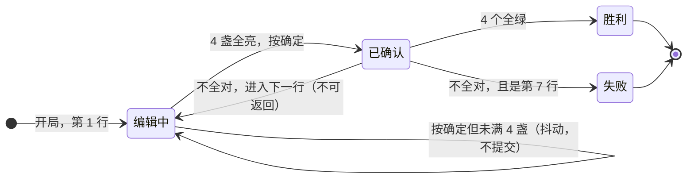
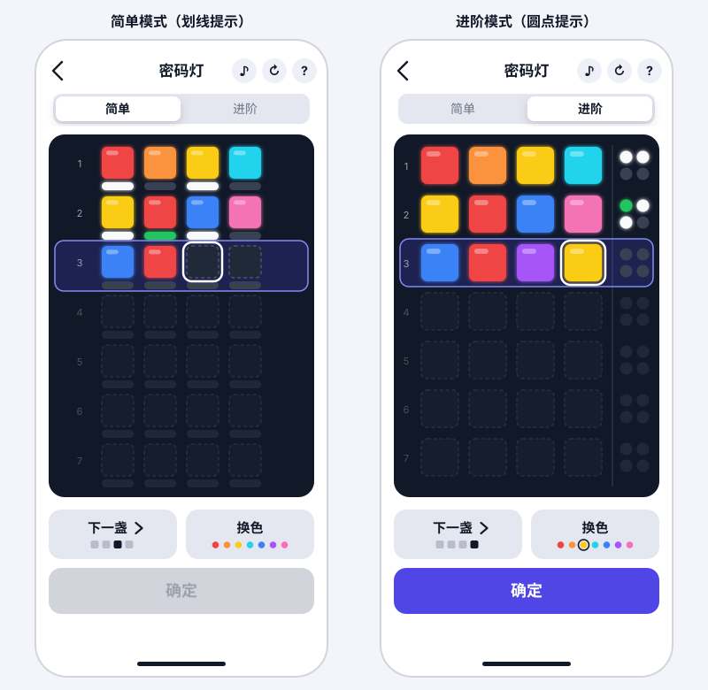
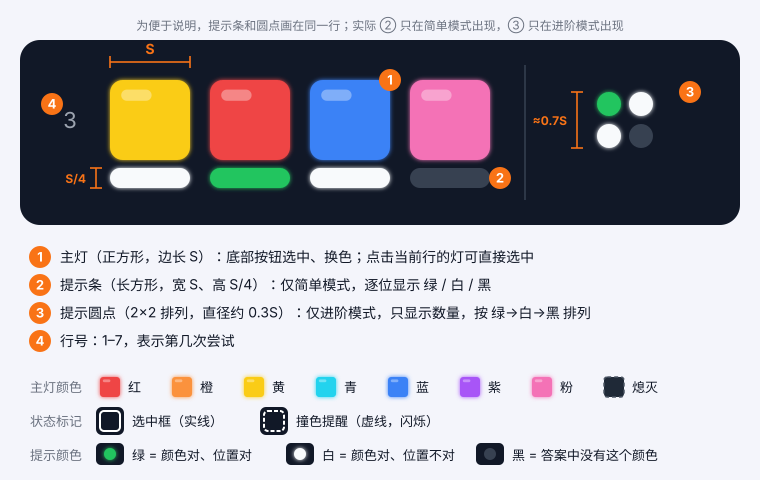
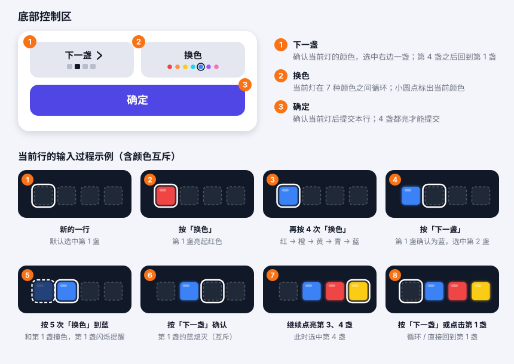
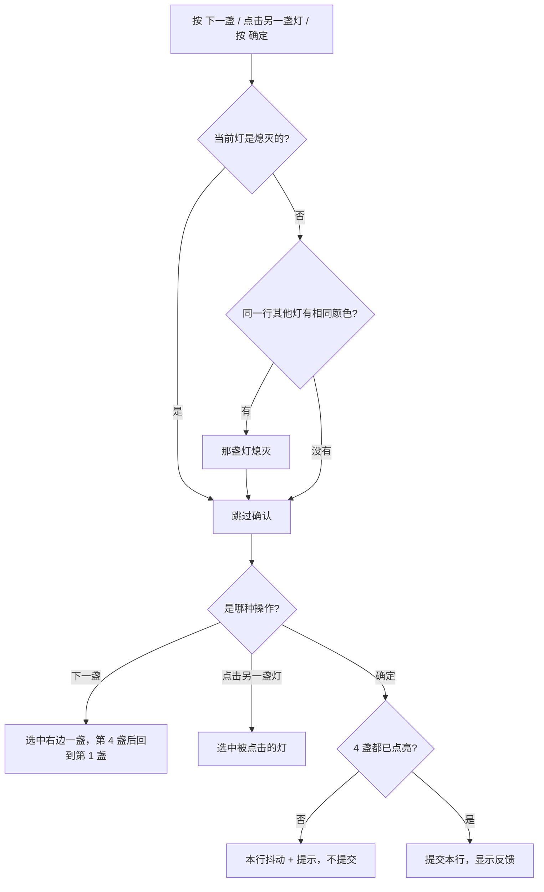
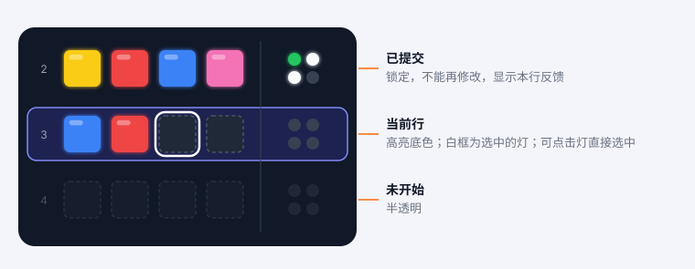
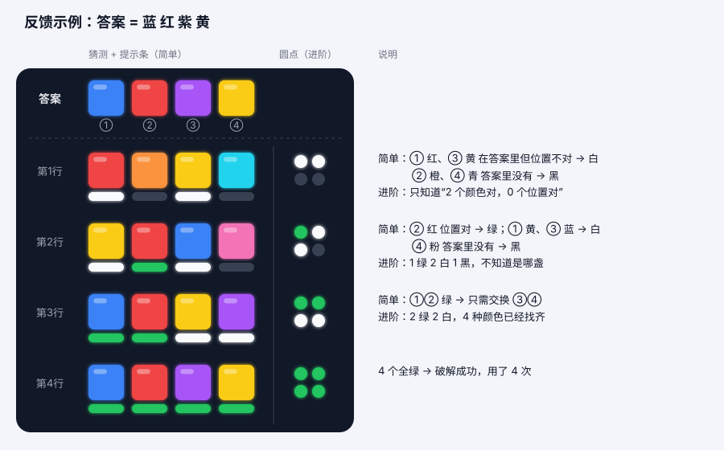
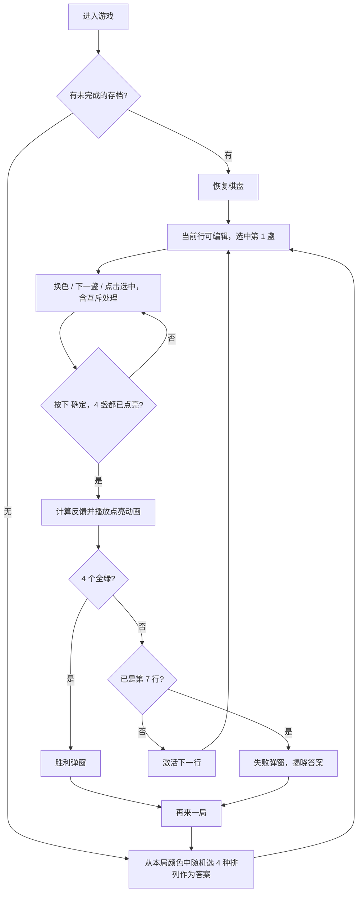
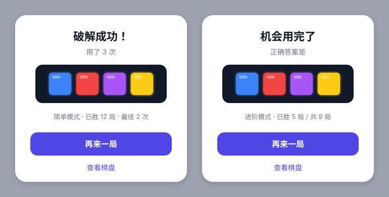

# 密码灯 · 产品设计文档

> 版本：v0.8（草案）　｜　所属项目：H5 游戏合集　｜　日期：2026-11-17

## 修订记录

| 版本 | 变更 |
| --- | --- |
| v0.1 | 初稿 |
| v0.2 | 右侧提示圆点改为 2 × 2 排列；新增底部控制区 |
| v0.3 | 4 盏灯颜色各不相同；控制区改为「下一盏 / 换色 / 确定」；新增颜色互斥规则 |
| v0.4 | 颜色增加到 **7 种**，答案从中选 4 种且不重复；恢复“黑色”反馈；新增**点击灯直接选中**的快捷操作；确定简单模式下右侧面板隐藏；撞色提醒改为白色虚线 |
| v0.5 | 进阶模式**去掉主灯下方的提示条**（不再保留占位），行更紧凑、主灯更大；两种模式各自计算主灯尺寸 |
| v0.6 | 新增 2.1「回合规则」：4 盏全亮才能确认、确认前不显示任何反馈、逐行推进不可逆、最后一行确认仍不对即结束 |
| v0.7 | 「换色」位置改为全局延续：熄灭的灯接着上一次换到的颜色往下换，不再每次从红色开始（见 4.2） |
| v0.8 | 新增**颜色数量**选项：4 / 5 / 6 / 7 色，默认 4 色，两种模式通用（见 2.2）；统计按「模式 + 颜色数量」分开记录 |

## 1. 概述

**密码灯**是一款 Mastermind（珠玑妙算）类的逻辑推理小游戏。系统从若干种颜色（4–7 种，玩家可选，默认 4 种）中暗中选出 4 种、排成一行，玩家逐行排出自己的猜测并提交，根据反馈推理出正确的颜色和顺序，最多 7 次机会。

| 项 | 说明 |
| --- | --- |
| 平台 | 手机竖屏为主，兼容桌面浏览器；纳入现有 PWA，离线可玩 |
| 单局时长 | 2–4 分钟 |
| 模式 | **简单模式**（划线提示，逐位反馈）、**进阶模式**（圆点提示，只给数量） |
| 颜色数量 | 4 / 5 / 6 / 7 色，默认 4 色；与模式相互独立，可任意组合 |
| 设计原则 | **单手操作**：底部 3 个按钮就能完成全部操作；点击棋盘上的灯是可选的快捷方式 |

## 2. 核心规则

- **颜色**：最多 7 种 —— **红、橙、黄、青、蓝、紫、粉**；本局实际使用几种由「颜色数量」决定（见 2.2）。
- **答案**：从本局的颜色中选出 4 种，**不重复**，按顺序排成 4 盏灯（7 色时共 \(7 \times 6 \times 5 \times 4 = 840\) 种可能）。开局时随机生成。
- **猜测**：每一行同样要求 4 盏灯颜色各不相同，由**颜色互斥**规则保证（见 4.4）。
- **机会**：共 7 行，从第 1 行开始依次往下。
- **胜利**：某一行 4 盏灯全部为“绿”。
- **失败**：第 7 行提交后仍未全对，揭晓答案。
- **反馈颜色**：

| 反馈 | 含义 |
| --- | --- |
| 🟢 绿 | 颜色对，位置也对 |
| ⚪ 白 | 答案里有这个颜色，但不在这个位置 |
| ⚫ 黑（不亮） | 答案里没有这个颜色 |

由于答案和猜测都没有重复颜色，每盏灯的反馈都可以独立判断，不存在“重复颜色怎么算”的歧义。

主灯颜色**不使用绿色和白色**，避免和反馈色混淆。

### 2.1 回合规则（硬性约束）

以下规则两种模式完全相同，任何情况下都不例外：

1. **4 盏全亮才能确认**：当前行只要有 1 盏灯未亮，「确定」就无法提交（按钮置灰，按下只抖动提示，见 4.5）。
2. **确认前不显示任何反馈**：在当前行确认之前，简单模式的提示条、进阶模式的圆点都保持**不亮**。换色、移动选中都不会提前透露结果，只有确认的那一刻才计算并点亮本行反馈。
3. **从上到下逐行推进**：只能编辑当前行；确认后自动进入下一行。
4. **确认不可逆**：
   - 已确认的行永久锁定，不能修改、不能撤销，也不能回到上一行；
   - 不提供“撤销 / 悔棋”功能；
   - **不做重复检查**：即使本行的颜色和顺序与之前某一行完全相同（结果自然也相同），确认后照样消耗一行机会，进入下一行，不拦截、不提示；
   - 存档在确认的瞬间写入（早于反馈动画），刷新页面、退出重进都无法回到确认前的状态。
5. **机会用完即结束**：第 7 行确认后，如果不是 4 个全绿，本局立即结束，弹出失败弹窗并揭晓答案；棋盘只能查看，不能再输入。
6. **猜中即结束**：任何一行确认后为 4 个全绿，本局立即结束（胜利），后面的行不再开放。



### 2.2 颜色数量

颜色数量是独立于模式的第二个难度维度，可选 **4 / 5 / 6 / 7 色，默认 4 色**。颜色少时优先选用彼此区分度高的颜色：

| 颜色数量 | 使用的颜色 | 答案可能数 | 简单模式（平均 / 最坏） | 进阶模式（平均 / 最坏） |
| --- | --- | --- | --- | --- |
| 4 色（默认） | 红 黄 蓝 紫 | 24 | 2.5 / 4 行 | 3.9 / 5 行 |
| 5 色 | 红 黄 青 蓝 紫 | 120 | 2.7 / 4 行 | 3.9 / 5 行 |
| 6 色 | 红 橙 黄 青 蓝 紫 | 360 | 2.9 / 4 行 | 4.1 / 5 行 |
| 7 色 | 红 橙 黄 青 蓝 紫 粉 | 840 | 3.2 / 4 行 | 4.4 / 6 行 |

（平均 / 最坏行数为程序模拟的较优策略结果；所有组合都保证 7 行内可解。）

- 4 色时答案就是这 4 种颜色的一个排列，只需要推理顺序，适合入门；颜色越多，需要先排除“答案里没有的颜色”，难度越高。
- 进阶 · 4 色比想象中难一些：4 种颜色全在答案里，白点数恒等于 4 减绿点数，实际只有“几个位置对”这一个信息。
- 「换色」只在本局使用的颜色之间循环；全局换色位置（见 4.2）沿用 7 色的顺序，跳过本局没有的颜色。
- 切换颜色数量与切换模式相同：已提交过行的对局需要确认放弃，然后开新局（见第 7 节）。

## 3. 界面布局

整个页面从上到下分为：**顶栏 → 模式切换 → 游戏面板（左右两部分，各 7 行）→ 底部控制区**。



左图（简单模式）：当前行已点亮前两盏，选中第 3 盏，「确定」置灰。右图（进阶模式）：4 盏都已点亮，选中第 4 盏且当前为黄色，「确定」可用。

### 3.1 各区域说明

| 区域 | 内容 | 说明 |
| --- | --- | --- |
| 顶栏 | 返回、标题、音效开关、重新开始、玩法说明 | 沿用合集其他游戏的顶栏规范 |
| 模式切换 | 左：「简单 / 进阶」分段按钮；右：「4 色 / 5 色 / 6 色 / 7 色」分段按钮，两组并排一行 | 对局中切换会弹窗确认并开新局（见第 7 节） |
| 左侧面板 | 7 行 × 4 个主灯；**简单模式**下每个主灯下方还有一个提示条 | 两种模式都使用；点击当前行的灯可直接选中（见 4.1） |
| 右侧面板 | 7 行，每行 4 个提示圆点，**2 × 2 排列**，与左侧逐行对齐 | **仅进阶模式显示**（见 3.4） |
| 底部控制区 | 第一排：「下一盏」「换色」；第二排：全宽「确定」 | 固定在屏幕底部，避开 iPhone 底部安全区（Home 指示条） |

当前行的进度由行高亮和行号体现。游戏面板在浅色、深色两种系统主题下**都使用深色底**，保证白色、绿色反馈清晰可辨。

### 3.2 单行结构与尺寸



以主灯边长 **S** 为基准，其他尺寸都按比例换算：

| 元素 | 形状 | 尺寸 |
| --- | --- | --- |
| 主灯 | 圆角正方形 | S × S，圆角约 0.16S |
| 提示条（仅简单模式） | 胶囊长方形 | 宽 S，高 **S/4**，在主灯正下方，间距约 S/10 |
| 主灯横向间距 | — | 约 0.3S |
| 选中框 | 白色**实线**描边框 | 比主灯外扩约 4px，描边 2.5px |
| 撞色提醒 | 白色**虚线**框 + 灯变暗 | 与选中框同尺寸，闪烁（见 4.4） |
| 提示圆点（仅进阶模式） | 圆形，**2 × 2 排列** | 直径约 0.3S，圆心间距约 0.45S，整组约 0.75S 见方，与主灯垂直居中对齐 |
| 行高 · 简单模式 | — | S + S/10 + S/4 ≈ 1.35S，行间距约 0.2S，合计每行约 **1.55S** |
| 行高 · 进阶模式 | — | 只有主灯，行高 S，行间距约 0.3S，合计每行约 **1.3S** |

上图为了便于说明，把提示条和圆点画在了同一行；实际上每种模式只会出现其中一种。

圆点的点亮顺序按阅读顺序：**左上 → 右上 → 左下 → 右下**，依次排绿、白、黑。

**自适应**：S 根据屏幕可用空间计算，取宽度约束和高度约束中的较小值。底部控制区高度固定（约 128px + 底部安全区），棋盘使用剩余空间：

```
面板可用高度 = 屏幕高度 − 顶栏 − 模式切换 − 底部控制区 − 底部安全区 − 边距
每行高度系数 k：简单模式 k = 1.55，进阶模式 k = 1.3
S = clamp(28px, min(面板可用宽度 / 6.4, 面板可用高度 / (7 × k)), 56px)
```

| 屏幕 | 简单模式 S | 进阶模式 S |
| --- | --- | --- |
| iPhone SE（375 × 667） | 约 36px | 约 42px |
| 大屏手机（如 430 × 932） | 约 46px | 约 54px（宽度约束封顶） |

进阶模式省下了提示条的高度，同样的屏幕能放下更大的主灯，弥补了它没有逐位提示、更需要看清颜色的需求。

### 3.3 底部控制区



| 按钮 | 外观 | 作用 |
| --- | --- | --- |
| ① 下一盏 | 浅灰底，文字 + 右箭头；下方 4 个小方块标出当前选中第几盏 | 确认当前灯的颜色，选中右边一盏；第 4 盏之后回到第 1 盏 |
| ② 换色 | 浅灰底，文字；下方显示本局的色点（4–7 个），圈出当前灯的颜色 | 当前灯在本局的颜色之间循环 |
| ③ 确定 | 全宽主色按钮；不可用时置灰 | 确认当前灯后，提交本行并检查结果 |

「下一盏」和「换色」等宽并排，高 56–60px；「确定」单独一排，和高频按钮分开，降低误提交。所有按钮高度都 ≥ 48px（项目统一的最小触控尺寸 `--tap`）。

### 3.4 两种模式的布局差异（已确定）

| | 简单模式 | 进阶模式 |
| --- | --- | --- |
| 主灯下方提示条 | 显示 | **不显示，也不占位** |
| 右侧圆点面板 | **隐藏**，左侧主灯区域水平居中 | 显示 |
| 每行高度 | 约 1.55S | 约 1.3S |

理由：

- 每种模式只保留自己用得到的反馈元素：简单模式的反馈都在提示条上，右侧圆点没有信息；进阶模式的反馈都在右侧圆点上，提示条没有信息。多余的元素只会分散注意力；
- 两种模式的主灯尺寸各自计算，进阶模式的主灯更大；
- 切换模式本身就会开新局（或在开局前进行），棋盘此时是空的，所以布局变化不会打断玩家。切换时用 200ms 过渡：主灯区缩放并平移到新位置，提示条和右侧面板淡入淡出。

## 4. 交互设计

### 4.1 选中的灯

当前行始终有一盏灯处于**选中**状态（白色实线框），「换色」只作用于这一盏。

- 新的一行开始时，选中第 1 盏。
- **下一盏**：每按一次右移一盏，第 4 盏之后回到第 1 盏。
- **快捷选中**：直接点击当前行的任意一盏灯，选中它，效果等同于连续按「下一盏」直到这一盏。
  - 点击已经选中的灯：无反应；
  - 点击已提交的行、未开始的行：无反应。
- 灯的点击热区按整格计算（包括主灯、简单模式下的提示条，以及与相邻灯之间一半的间距），方便手指点中。

### 4.2 换色

- 选中的灯按 **红 → 橙 → 黄 → 青 → 蓝 → 紫 → 粉 → 红 …** 循环，每按一次换一种；本局没有的颜色直接跳过（例如 4 色时为 红 → 黄 → 蓝 → 紫 → 红 …）。
- 换色位置**全局延续**：熄灭状态的灯按「换色」，从上一次换到的颜色的下一个开始（例如上一次换到蓝，下一盏灯或新的一行按「换色」直接得到紫），跨行、跨局、刷新页面后都延续；整个游戏第一次换色从红色开始。
- 已亮的灯按「换色」，从它自身的颜色往下换。
- 循环中的颜色只是**预选**，此时不会触发互斥；只有“确认”时才生效（见 4.4）。

### 4.3 确认

以下三种操作会**确认**当前选中灯的颜色：

1. 按「下一盏」：先确认当前灯，再移到下一盏；
2. 点击当前行的另一盏灯：先确认当前灯，再选中被点击的灯；
3. 按「确定」：先确认当前灯，再尝试提交本行。

当前灯是熄灭状态时，确认不产生任何效果。

### 4.4 颜色互斥

**规则**：某盏灯确认了一种颜色后，如果当前行里**其他灯已经是这个颜色，那盏灯熄灭**。这样同一行里永远不会出现重复颜色。

**为什么在“确认”时才生效**：如果在循环换色的过程中就立即互斥，选中灯循环 7 种颜色的路上会把其他灯依次灭掉。所以循环时只做**提醒**，确认时才真正熄灭：

- **撞色提醒**：选中灯预选的颜色和其他某盏灯相同时，那盏灯变暗、外围出现白色虚线框并闪烁，表示“确认后它会熄灭”。继续换色避开冲突，提醒立即消失。
- **确认熄灭**：确认后，撞色的那盏灯淡出熄灭，播放提示音。

示例（对应上图第 4–6 步）：第 1 盏已确认蓝色；选中第 2 盏，换色到蓝，第 1 盏闪烁提醒；按「下一盏」确认后，第 1 盏熄灭，选中移到第 3 盏。



### 4.5 确定按钮

- **可用条件**：当前行 4 盏灯都已点亮（规则见 2.1）。有任何一盏未亮，按钮置灰且无法提交。
- 按钮状态按“当前看到的灯”实时判断。如果当前存在撞色提醒，按下「确定」后会先确认、熄灭撞色的灯，此时本行不满 4 盏，**不会提交**。
- 不满足条件时按下：本行左右抖动，播放 `error` 音效，Toast 提示「还有灯没点亮」；如果是因为互斥刚熄灭了一盏，提示「第 N 盏颜色重复，已熄灭」。
- 提交成功：锁定本行并写入存档 → 计算反馈，逐个点亮（每个间隔约 120ms）→ 判定胜负 → 未结束则激活下一行，选中第 1 盏。
- 提交前，本行的提示条 / 圆点始终不亮，不做任何实时预览。
- 反馈动画播放期间，所有按钮和灯都不可点击，防止连点。
- 新的一行默认全部熄灭，不自动复制上一行。
- 提交后不可撤销；与之前某行完全相同的猜测也照常提交、消耗一行（见 2.1）。

### 4.6 行的三种状态



| 行状态 | 外观 | 可否点击 |
| --- | --- | --- |
| 已提交 | 正常亮度，显示反馈，不可修改 | 否 |
| 当前行 | 高亮边框 + 浅色底；白框为选中的灯；熄灭的灯为虚线框 | 是（点击选中） |
| 未开始 | 40% 透明度 | 否 |

### 4.7 键盘操作（桌面浏览器）

| 按键 | 作用 |
| --- | --- |
| `→` / `Tab` | 下一盏 |
| `1` – `4` | 直接选中第 1–4 盏（等同点击） |
| `↑` / `Space` | 换色 |
| `Enter` | 确定 |

## 5. 反馈规则

### 5.1 简单模式（划线提示）

**逐位**反馈：每个主灯正下方的提示条显示该位置的结果（绿 / 白 / 黑）。玩家能直接知道哪盏对了、哪个颜色根本不在答案里。

### 5.2 进阶模式（圆点提示）

**只给数量**：右侧 2 × 2 的圆点按「绿 → 白 → 黑」从左上到右下排列，**和位置无关**。玩家只知道“几个全对、几个颜色对、几个颜色不存在”，需要比较多行来推理。

### 5.3 示例



### 5.4 判定逻辑

答案和猜测都没有重复颜色，判定很直接：

```js
// answer、guess 都是 4 个互不相同的颜色，如 ['B','R','P','Y']
function evaluate(answer, guess) {
  const result = guess.map((c, i) =>
    c === answer[i] ? 'G' : answer.includes(c) ? 'W' : 'K');  // 简单模式逐位使用
  const green = result.filter(r => r === 'G').length;
  const white = result.filter(r => r === 'W').length;
  return { result, green, white };                              // 进阶模式只使用数量
}
```

答案生成：用 Fisher–Yates 洗牌打乱本局的颜色，取前 4 个，保证所有答案等概率出现。

### 5.5 难度预期

| 模式 | 预期 | 说明 |
| --- | --- | --- |
| 简单 | 通常 3–5 次 | 先用一两行找出是哪 4 种颜色，再按逐位反馈调整位置 |
| 进阶 | 通常 5–7 次 | 只知道数量，需要比较多行推理；7 次机会对熟练玩家足够，新手有一定失败概率 |

## 6. 游戏流程



## 7. 结束弹窗与其他功能



- **胜利弹窗**：标题「破解成功！」，显示用了几次、答案、该模式的胜局数与最佳次数。
- **失败弹窗**：标题「机会用完了」，揭晓正确答案，显示该模式的胜局数 / 总局数。
- **查看棋盘**：关闭弹窗回看本局所有行，棋盘只读；此时「下一盏」「换色」置灰，点击灯无反应，「确定」按钮文字变为「再来一局」。
- **模式切换**：
  - 对局尚未提交任何一行时，直接切换并重新出题；
  - 已提交至少一行时，弹窗确认「切换模式将放弃本局，确定吗？」。
- **颜色数量切换**、**重新开始**：与模式切换相同的确认逻辑（提示文字分别为「切换颜色数量将放弃本局，确定吗？」「重新开始将放弃本局，确定吗？」）。模式和颜色数量都会记住，下次进入沿用。
- **存档**：每次确认的瞬间（反馈动画开始前）就把模式、答案、已提交的行写入 `localStorage`，刷新或退出后可继续，但无法回到确认前；当前行未提交的灯和选中位置也一并保存。已结束的对局存档标记为“已结束”，重新进入时直接显示结果，不能继续输入。
- **统计**（按「模式 + 颜色数量」分别记录，结束弹窗显示如「简单模式 · 4 色」）：总局数、胜局数、最佳次数、各次数的胜局分布（为以后的统计页预留）。
- **玩法说明**：点顶栏「?」弹出简要规则，内容即第 2、4、5 节的精简版。首次进入游戏自动弹出一次。

## 8. 动效与音效

| 时机 | 动效 | 音效（`js/sfx.js`） |
| --- | --- | --- |
| 下一盏 / 点击选中 | 选中框平滑移动到目标灯（120ms） | `tap` |
| 换色 | 选中的灯放大回弹（1 → 1.08 → 1，120ms）；换色按钮上的色点圈同步移动 | `select` |
| 撞色提醒 | 被撞色的灯变暗 + 白色虚线框，以 0.8s 周期闪烁 | — |
| 互斥熄灭 | 被撞色的灯淡出（150ms） | `error` |
| 无法提交 | 本行左右抖动 | `error` |
| 提交 | 反馈逐个点亮，每个间隔约 120ms | `place` |
| 胜利 | 本行 4 盏灯依次闪烁一次后弹窗 | `win` |
| 失败 | 弹窗中答案逐个翻开 | `lose` |
| 切换模式 | 主灯区缩放并平移到新位置；提示条、右侧面板淡入淡出（200ms） | `select` |

支持振动的设备上，按「换色」「下一盏」时轻振 10ms（`navigator.vibrate`），可随音效开关一起关闭。

## 9. 视觉规范

| 用途 | 颜色 | 色值 |
| --- | --- | --- |
| 主灯 · 红 | 红 | `#ef4444` |
| 主灯 · 橙 | 橙 | `#fb923c` |
| 主灯 · 黄 | 黄 | `#facc15` |
| 主灯 · 青 | 青 | `#22d3ee` |
| 主灯 · 蓝 | 蓝 | `#3b82f6` |
| 主灯 · 紫 | 紫 | `#a855f7` |
| 主灯 · 粉 | 粉 | `#f472b6` |
| 主灯 · 熄灭 | 深灰 + 虚线框 | `#1f2937` / `#4b5563` |
| 选中框 | 白色实线 | `#ffffff` |
| 撞色提醒 | 白色虚线 + 灯 60% 变暗 | `#ffffff` |
| 反馈 · 绿 | 绿 | `#22c55e` |
| 反馈 · 白 | 白 | `#f8fafc` |
| 反馈 · 黑（不亮） | 暗灰 | `#374151` |
| 游戏面板底色 | 深色 | `#111827` |
| 当前行高亮 | 主色 | `#4f46e5`（22% 透明度底 + `#818cf8` 边框） |
| 下一盏 / 换色按钮 | 浅灰 | `#e5e7f0`（深色主题下用 `--bg-elev`） |
| 确定按钮 | 主色 / 置灰 | `var(--primary)` / `#d1d5db` |

点亮的灯带一层同色外发光，表现“灯”的质感；熄灭的灯不发光。

**色弱友好（可选开关）**：7 种颜色中有几组在色弱用户眼中容易混淆（红 / 橙、青 / 蓝），开关打开后在主灯和换色按钮的色点上叠加形状符号：红 ●、橙 ▲、黄 ■、青 ◆、蓝 ★、紫 ✚、粉 ♥。反馈中「白」使用空心圆、「绿」使用实心圆，不依赖颜色也能分辨。

## 10. 边界情况

| 场景 | 处理 |
| --- | --- |
| 快速连按「换色」「下一盏」 | 每次都生效，不做节流 |
| 在熄灭的灯上按「下一盏」或点击别的灯 | 不确认任何颜色，直接移动选中 |
| 预选颜色撞色时直接按「确定」 | 先确认、熄灭撞色的灯，本行不满 4 盏，不提交并给出提示 |
| 预选颜色撞色时点击被撞色的那盏灯 | 先确认当前灯（被点击的那盏随即熄灭），再选中它；它此时是熄灭状态 |
| 动画过程中按按钮或点灯 | 忽略 |
| 弹窗打开时 | 遮罩拦截所有操作 |
| 存档数据损坏或版本不兼容 | 丢弃存档，开新局 |
| 屏幕旋转 / 窗口尺寸变化 | 重新计算 S，布局自适应 |
| 第 1 行就猜中 | 正常胜利，计为「1 次」 |
| 当前行有灯未亮时按「确定」 | 不提交，本行抖动 + 提示；反馈保持不亮 |
| 本行与之前某行完全相同 | 照常提交、消耗一行、进入下一行，不拦截也不提示 |
| 想修改已确认的行 | 不允许，已确认的行不响应任何操作；没有撤销功能 |
| 确认后、反馈动画播完前刷新页面 | 存档已写入，重新进入时该行已确认并直接显示反馈 |
| 第 7 行确认后仍不全对 | 本局结束，失败弹窗揭晓答案；棋盘只读 |

## 11. 决策记录

| 问题 | 结论 |
| --- | --- |
| 颜色数量与是否重复 | 最多 7 种颜色，答案选 4 种且不重复（v0.4）；颜色数量 4–7 可选，默认 4（v0.8，见 2.2） |
| 旧版存档 / 统计 | 没有颜色数量字段的旧存档和旧统计都按 7 色处理（v0.8） |
| 互斥生效时机 | 确认时熄灭，循环换色时只提醒（v0.3 起） |
| 是否允许点击灯直接选中 | 允许，作为「下一盏」的快捷方式（v0.4） |
| 简单模式下右侧面板 | 隐藏，左侧居中（v0.4，理由见 3.4） |
| 进阶模式下主灯下方的提示条 | 不需要，不显示也不占位；进阶模式主灯更大（v0.5，见 3.4） |
| 何时可以确认、何时显示反馈 | 4 盏全亮才能确认；确认前反馈一律不亮（v0.6，见 2.1） |
| 能否回退 / 撤销 | 不能；逐行推进，确认即锁定，重复猜测也照常消耗一行（v0.6，见 2.1） |
| 最后一行仍不对 | 本局结束，揭晓答案（v0.6，见 2.1） |

### 待确认事项

1. **换色循环较长**：7 色时单向循环，最坏要连按 6 次才能到目标色（4 色时最多 3 次）。可以考虑**长按「换色」反向循环**，或按住「换色」时弹出 7 色色盘直接选。本文档暂不加入，等试玩后再定。
2. **相近颜色的辨识度**：红 / 橙、青 / 蓝在小屏和低亮度下可能不够好分辨。实现后需要真机检查，必要时微调色值，或默认开启形状符号。

## 12. 后续可扩展

- 每日挑战：同一天所有人同一道题，结果可分享为一串 🟩⬜⬛ 方块。
- 统计页：按尝试次数显示胜局分布柱状图。
- 难度扩展：5 盏灯 / 10 行。
