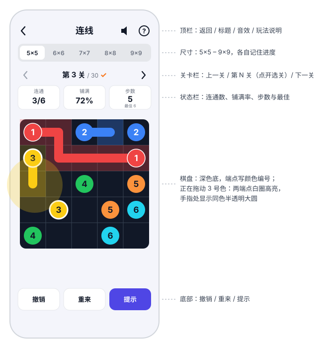
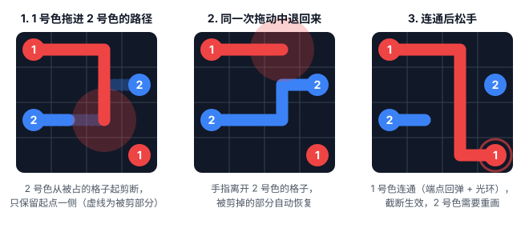
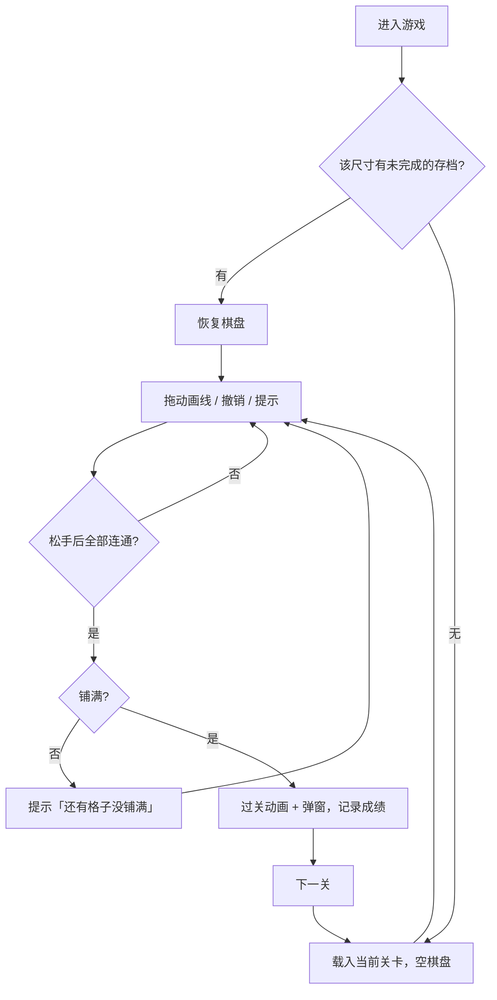

# 连线 · 产品设计文档

> 版本：v0.2（草案）　｜　所属项目：H5 游戏合集　｜　日期：2026-11-18

## 修订记录

| 版本 | 变更 |
| --- | --- |
| v0.1 | 初稿 |
| v0.2 | 按实现校正：生成算法由「哈密顿路径切段」改为「随机合并路径」（见 5.1）；各尺寸颜色数改为实测范围，调色板扩充到 12 色（见 2.1、9.2）；补充配图、测试项与边界情况 |

## 1. 概述

**连线**是一款 Flow Free 类的单人逻辑小游戏。棋盘上有若干对同色的端点，玩家用手指画出路径，把每一对同色端点连起来；路径之间不能交叉，并且最终要**铺满棋盘上的每一个格子**。

| 项 | 说明 |
| --- | --- |
| 平台 | 手机竖屏为主，兼容桌面浏览器；纳入现有 PWA，离线可玩 |
| 单局时长 | 5×5 约 30 秒，9×9 约 2–5 分钟 |
| 尺寸 | **5×5 / 6×6 / 7×7 / 8×8 / 9×9** 五档，每档若干固定关卡（见 2.1） |
| 设计原则 | **一根手指玩到底**：画线、改线、截断都在棋盘上拖动完成；撤销 / 重来 / 提示在底部 |
| 关卡 | 全部离线预生成，**每关唯一解**（见第 5 节） |

## 2. 核心规则

### 2.1 棋盘与关卡

| 尺寸 | 颜色（端点对）数 | 关卡数 |
| --- | --- | --- |
| 5×5 | 4–6 | 30 |
| 6×6 | 5–7 | 30 |
| 7×7 | 6–8 | 30 |
| 8×8 | 7–10 | 30 |
| 9×9 | 9–12 | 30 |

- 颜色数由生成算法自然得到（见 5.1），上表是允许的范围；颜色越多路径越短，唯一解越容易保证。
- 每档关卡按求解难度（求解器搜索的节点数）从易到难排序，玩家可以任选一关，不强制解锁。
- 关卡是固定的（不做随机变换），这样每一关的进度和最佳成绩都能稳定对应。

### 2.2 路径规则

- 路径只能**上下左右**走，不能斜走，不能穿过别的颜色的端点。
- 每种颜色只有一条路径，从它的一个端点出发；到达另一个同色端点即为**连通**。
- 一个格子同一时间只属于一条路径；画到别的颜色的路径上会**截断**对方（见 4.2）。
- 路径可以绕弯、可以贴着自己走，没有长度限制。

### 2.3 完成条件

同时满足以下两点即过关：

1. 每一对端点都已连通；
2. 每一个格子都被某条路径覆盖（铺满率 100%）。

所有端点都连通但还有空格时，不算过关，Toast 提示「还有格子没铺满」。

## 3. 界面布局



整个页面从上到下：**顶栏 → 尺寸切换 → 关卡栏 → 状态栏 → 棋盘 → 底部按钮**。

| 区域 | 内容 | 说明 |
| --- | --- | --- |
| 顶栏 | 返回、标题「连线」、音效开关、玩法说明 | 沿用合集顶栏规范 |
| 尺寸切换 | 「5×5 / 6×6 / 7×7 / 8×8 / 9×9」分段按钮 | 每个尺寸各自记住当前关卡与未完成的棋盘，切换不丢进度 |
| 关卡栏 | `‹`　**第 N 关 / 共 M 关**　`›` | 点中间文字打开关卡选择弹窗（见 4.4）；左右箭头切到上一关 / 下一关 |
| 状态栏 | 三格：**连通** `3/6`、**铺满** `72%`、**步数** `5`（下方小字「最佳 6」） | 实时更新 |
| 棋盘 | 正方形，深色底，n×n 格 | 尽量占满剩余空间，最大 560px |
| 底部按钮 | 「撤销」「重来」「提示」三等宽按钮 | 固定在底部，避开底部安全区；高度 ≥ 48px |

棋盘在浅色、深色主题下**都使用深色底**（`#111827`），保证彩色路径对比度一致（与「密码灯」相同的做法）。

棋盘边长：`S = clamp(240px, min(可用宽度 − 24px, 可用高度 − 16px), 560px)`，每格 `S / n`。9×9 在 iPhone SE（375 宽）上每格约 39px，仍大于 36px 的舒适触控尺寸；拖动时的手指位置以格子中心判定，不需要很精确。

## 4. 交互设计

### 4.1 画线



| 手势 | 效果 |
| --- | --- |
| 按下**端点** | 清空这个颜色原有的路径，从这个端点重新开始画 |
| 按下**已有路径的中间格** | 保留从起点到这一格的部分，剪掉后面的，从这一格继续画 |
| 按下空格 | 无反应 |
| 拖到相邻的空格 | 路径延伸一格 |
| 拖回上一格 | 路径回退一格 |
| 拖到自己路径上更早的格子 | 路径回退到那一格 |
| 拖到同色的另一个端点 | **连通**，路径在此结束；再往前拖无效（可以往回拖） |
| 拖到别的颜色的端点 | 无效，路径停在原处 |
| 拖到别的颜色的路径上 | 截断对方（见 4.2），路径延伸一格 |
| 松手 | 保留当前路径（不论是否连通） |

- 拖动以“格子”为单位：手指进入一个新格子才触发一步。手指移动很快、一次跨过多个格子时，按直线逐格补齐（先走主方向），保证路径连续。
- 拖动只认上下左右相邻的格子；斜向进入的格子按上述补齐规则拆成两步。
- 拖动过程中，手指位置显示一个当前颜色的半透明大圆（约 1.1 格半径），弥补手指遮挡；被拖动颜色的两个端点加白色描边高亮。
- 棋盘区域 `touch-action: none`，拖动时页面不会滚动或缩放。

### 4.2 截断

画到别的颜色路径上的某一格时，对方路径**从这一格起被剪断**，只保留它从起点端点到这一格之前的部分。

- **截断是临时的**：同一次拖动中，如果手指又退出了这些格子，对方被剪掉的部分会自动恢复（与 Flow Free 一致），方便玩家“试探”。
- 松手后截断才真正生效。
- 实现：拖动开始时记下所有路径的快照；每一步都用「快照 − 当前路径占用的格子」重新计算其他颜色的路径（各自截到第一个被占用的格子之前）。

### 4.3 撤销 / 重来 / 提示

| 按钮 | 作用 |
| --- | --- |
| 撤销 | 回到上一次松手（或上一次提示）之前的棋盘，可连续撤销，最多 200 步；没有可撤销的操作时置灰 |
| 重来 | 清空所有路径，步数、提示次数归零；棋盘上已有路径时先弹窗确认 |
| 提示 | 直接画出一条正确路径，并截断与它冲突的其他路径；可撤销 |

**提示选哪条**：优先选还没画对的颜色中，编号最小的那一条（“没画对”指当前路径与答案不完全一致，包括未连通、连通但走法不同）。全部画对时（理论上此时已过关）提示无效。

- 提示不限次数，但会记入本关「用了提示」，影响「完美」评价（见 7.2）。
- 提示画出的路径用 600ms 的闪烁动画标出。

### 4.4 关卡选择

点关卡栏中间的文字弹出关卡选择弹窗：

- 当前尺寸的所有关卡，5 列网格，按钮上显示关号；
- 已完成的关卡显示 ✓，完美完成的显示 ★，当前关卡高亮；
- 点任意一关进入，不需要解锁。
- 切换关卡时，如果当前棋盘上有路径且未过关，弹窗确认「切换关卡将清空本关的棋盘，确定吗？」。

### 4.5 步数

- 步数按 Flow Free 的规则计算：**每次松手后棋盘发生了变化，且这次画的颜色与上一次不同**，计 1 步；连续多次画同一种颜色只算 1 步。
- 理论最少步数 = 颜色数（每种颜色一笔画完）。
- 撤销不减少步数，但撤销后的下一次拖动无论颜色是否相同都计 1 步；提示不计步数。

### 4.6 键盘操作（桌面浏览器）

| 按键 | 作用 |
| --- | --- |
| `Ctrl` / `⌘` + `Z`，或 `Z` | 撤销 |
| `H` | 提示 |
| `R` | 重来 |
| `←` / `→` | 上一关 / 下一关 |

鼠标操作与触摸相同：按下左键拖动画线。

## 5. 关卡生成与校验

关卡由脚本 `scripts/gen-flow-bank.mjs` 离线生成，输出 `games/flow/levels.js`，游戏运行时只读题库、不做求解。

### 5.1 生成

1. **随机合并路径**：开始时每个格子各自是一条长度为 1 的路径；反复随机挑一条路径（70% 的概率挑当前最短的），把它的一端和相邻另一条路径的一端接起来，直到再也接不动为止。
2. **不贴自己**：合并后如果路径上两个不相邻的格子互相挨着（路径“贴着自己走”），放弃这次合并。贴着自己的路径通常可以被别的走法替代，是多解的主要来源。
3. **筛选**：所有路径都至少 3 格、颜色数在 2.1 的范围内才继续。每条路径就是一种颜色，两头就是端点，题目天然**有解且铺满**。
4. **唯一解校验**：用求解器（见 5.2）搜索最多 2 个解，只保留恰好 1 个解的题目。
5. 每档收集 60 个候选，按求解节点数排序后均匀抽取 30 关，难度从易到难平滑上升。

最初尝试的「随机哈密顿路径切段」在 7×7 以上唯一解比例极低（9×9 千分之一以下），改为上述方法后 9×9 约 3% 的随机样本可用，生成全部 150 关约 8 秒。脚本支持参数：`node scripts/gen-flow-bank.mjs [每档关数] [随机种子]`，同样的种子生成同样的题库。

### 5.2 求解器

`games/flow/solver.js`（只被出题脚本和测试引用，游戏页面不加载），深度优先搜索，统计解的个数（找到 2 个即停止）：

- 每种颜色从一个端点出发往前延伸；每一步选「可走方向最少」的颜色（MRV），只有 1 个方向时等同于强制步。
- 剪枝（每走一步检查）：
  - **死角**：任何空格的可用邻居（空格、未连通颜色的线头或目标端点）少于 2 个，失败；
  - **分区**：把空格按连通性分区，每个分区必须同时挨着某个未连通颜色的线头和它的目标端点，否则这个分区永远填不满；每个未连通颜色的线头和目标必须相邻或挨着同一个分区，否则连不上。
- 全部颜色连通且没有空格，记为 1 个解。
- 两条剪枝都是必要条件，不会误杀解；测试中用「关闭剪枝的穷举」在随机小棋盘上对拍验证。
- 题库 150 关全部校验约 0.1 秒，单关最多约 7000 个搜索节点。

### 5.3 题库格式

每关是一个长度 n² 的字符串，按行优先：大写字母 = 端点，小写字母 = 答案中路径经过的格子，字母序号 = 颜色编号（`A`/`a` 是 1 号色）。颜色按端点在棋盘上的行优先顺序编号。例如 5×5 第 1 关 `AaBbBCaaaAcDdeEcCdEFDddFf`，按行拆开是：

```
A a B b B
C a a a A
c D d e E
c C d E F
D d d F f
```

答案路径的走向由「从 1 号端点出发、经过同色所有格子到达另一个端点」唯一确定（题目唯一解保证了这一点），游戏载入时还原，供「提示」使用。

### 5.4 测试

`tests/flow.mjs`（`node tests/flow.mjs` 独立运行）：

- 画线规则：延伸、回退、连通后不能继续、不能穿过别的端点、按中间格续画；
- 截断规则：截断对方、同一次拖动中退出后恢复、松手后生效；
- 步数、撤销、重来、提示；完成判定（连通但未铺满不算过关）；
- 存档还原与篡改检测；
- 求解器：已知唯一解 / 多解 / 无解的小例子，以及剪枝与穷举对拍；
- 题库：每关格式合法、颜色数在范围内、答案路径合法且铺满、按答案画完即过关且步数 = 颜色数，并用求解器确认**唯一解**且解与答案一致。

## 6. 游戏流程



## 7. 结束弹窗与其他功能

### 7.1 过关弹窗

- 标题：「完美！」（满足 7.2 的完美条件）或「完成！」。
- 内容：「7×7 · 第 3 关　6 步」，以及最佳步数；首次过关显示「首次通关」，刷新最佳显示「🏆 新纪录」。
- 按钮：「查看棋盘」（关闭弹窗，棋盘只读，「撤销」置灰，底部「提示」变为「下一关」；「重来」可直接重玩本关，不再确认）、「下一关」。最后一关的「下一关」回到第 1 关。
- 已有成绩时，没破纪录显示「最佳 N 步」。

### 7.2 成绩

- **完成**：过关即可。
- **完美**：步数 = 颜色数，且没有用过提示。
- 每关记录：最少步数、是否完美。关卡选择弹窗中显示 ✓ / ★。

### 7.3 存档

| localStorage 键 | 内容 |
| --- | --- |
| `h5.flow.size` | 当前尺寸（5–9） |
| `h5.flow.level` | 每个尺寸当前所在关卡 `{ "5": 0, "6": 3, … }` |
| `h5.flow.progress` | 每关成绩 `{ "5": { "0": { "best": 5, "perfect": true } } }` |
| `h5.flow.state` | 每个尺寸未完成的棋盘 `{ "7": { v, level, paths, moves, hints, lastColor, undo } }` |
| `h5.flow.helpSeen` | 是否看过玩法说明（首次进入自动弹出） |

- 每次松手、撤销、提示、重来后立即写入存档；刷新后恢复棋盘、步数和撤销栈。
- 存档与题库不一致（关号越界、路径不合法等）时丢弃存档，空棋盘开局。
- 过关后清除该尺寸的存档。

### 7.4 玩法说明

顶栏「?」弹出，内容为第 2、4 节的精简版。首次进入自动弹出一次。

## 8. 动效与音效

| 时机 | 动效 | 音效（`js/sfx.js`） |
| --- | --- | --- |
| 按下端点 / 路径开始拖动 | 手指处出现半透明大圆；该色两端点描边高亮 | — |
| 一对端点连通 | 两个端点放大回弹（1 → 1.25 → 1，300ms）并带一圈扩散光环 | `clear`，音调随已连通数升高 |
| 截断别的路径 | 被截断的部分立即消失 | — |
| 松手但全部连通、仍有空格 | 空格闪烁一次 | `error` |
| 提示 | 提示的路径闪烁 600ms | `select` |
| 过关 | 所有路径的格子底色依次变亮，结束后弹窗 | `win` |

支持振动的设备上，连通时轻振 10ms（`navigator.vibrate`），随音效开关一起关闭。

## 9. 视觉规范

### 9.1 棋盘

| 元素 | 样式 |
| --- | --- |
| 棋盘底色 | `#111827`，圆角 14px |
| 格线 | `#374151`，1px |
| 端点 | 圆形，直径 0.68 格，颜色填充；中心用粗体写**颜色编号** 1–N（浅色端点用深色字，深色端点用白字） |
| 路径 | 线宽 0.34 格，圆角连接；经过的格子铺一层同色 22% 透明底 |
| 连通的颜色 | 路径格底色加深到 30%，端点外加一圈白色细描边 |

### 9.2 路径配色

| 编号 | 颜色 | 色值 |
| --- | --- | --- |
| 1 | 红 | `#ef4444` |
| 2 | 蓝 | `#3b82f6` |
| 3 | 黄 | `#facc15` |
| 4 | 绿 | `#22c55e` |
| 5 | 橙 | `#fb923c` |
| 6 | 青 | `#22d3ee` |
| 7 | 品红 | `#e879f9` |
| 8 | 棕 | `#a8743a` |
| 9 | 白 | `#e5e7eb` |
| 10 | 紫 | `#8b5cf6` |
| 11 | 浅粉 | `#f9a8d4` |
| 12 | 青柠 | `#a3e635` |

棋盘用 Canvas 绘制（按 `devicePixelRatio` 放大，保证高清屏清晰），拖动时每次指针移动只重绘一次。

**色弱友好**：

- 每个端点都写着颜色编号，即使分不清颜色，也能按「相同数字相连」来玩；
- 拖动时被拖颜色的两个端点白色描边高亮，直接告诉玩家要连到哪里；
- 配色顺序让最常见的红 / 绿混淆组（1 号红、4 号绿）中间隔开，并在亮度上拉开差距（红较暗、绿较亮）。

## 10. 边界情况

| 场景 | 处理 |
| --- | --- |
| 两根手指同时触摸 | 只跟踪第一根手指，其余忽略 |
| 拖到棋盘外 | 停在最后一个有效格子；回到棋盘内继续 |
| 拖动过程中切到后台 / `pointercancel` | 按松手处理，保留当前路径 |
| 连通后继续往前拖 | 无效；往回拖可以回退 |
| 从连通路径的中间格开始拖 | 剪掉后面的部分，路径变为未连通 |
| 按下的端点属于已经连通的颜色 | 清空并从这个端点重新开始画 |
| 在端点上轻点一下就松手 | 该颜色的路径被清空（棋盘有变化，计步、可撤销） |
| 在路径末端轻点一下就松手 | 棋盘不变，不计步 |
| 松手时棋盘与拖动前完全一样 | 不计步数，不进撤销栈 |
| 过关后拖动棋盘 | 忽略（棋盘只读） |
| 弹窗打开时 | 遮罩拦截所有操作 |
| 屏幕旋转 / 窗口尺寸变化 | 重新计算棋盘尺寸 |
| 存档损坏 | 丢弃存档，空棋盘开局 |

## 11. 决策记录

| 问题 | 结论 |
| --- | --- |
| 中文名 | 「连线」：简短直白，与 Flow Free 的玩法一致 |
| 关卡来源 | 离线生成 + 求解器校验唯一解，运行时只读题库（v0.1）；生成算法改为随机合并路径（v0.2） |
| 颜色数 | 不强求固定，按尺寸给范围，最多 12 色（v0.2） |
| 截断是否临时 | 同一次拖动内可恢复，松手才生效（与 Flow Free 一致，v0.1） |
| 步数口径 | 连续画同一颜色只算 1 步（Flow Free 规则，v0.1） |
| 是否需要解锁 | 不需要，任选关卡（v0.1） |
| 色弱支持 | 端点固定显示编号，不做额外开关（v0.1） |

### 待确认事项

1. **关卡数量**：每档 30 关，后续可用脚本追加；追加时注意只能在末尾追加，否则已有进度会错位。
2. **9×9 在小屏上的手感**：iPhone SE 上每格约 39px，需要真机确认拖动是否容易误入相邻格。

## 12. 后续可扩展

- 更大尺寸（10×10 以上）与「桥」「墙」等变体。
- 每日一题、限时模式。
- 分享过关截图。
