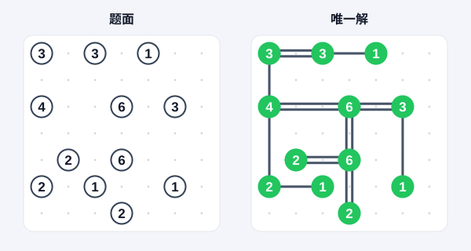
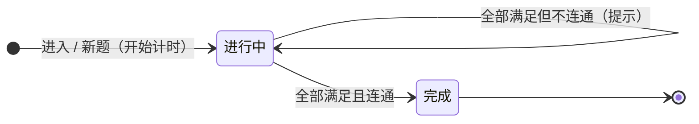
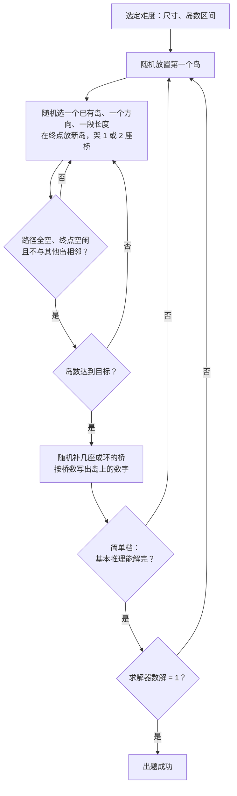
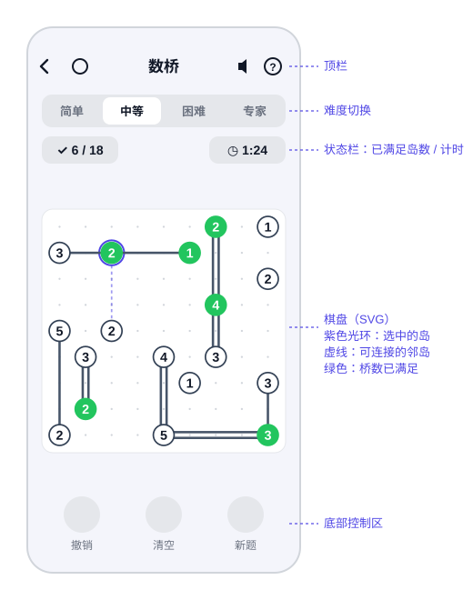
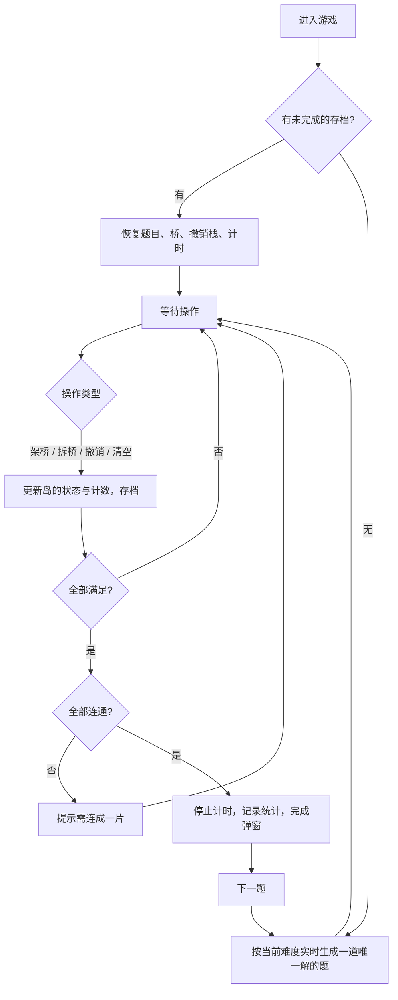

# 数桥 · 产品设计文档

> 版本：v0.1（草案）　｜　所属项目：H5 游戏合集　｜　日期：2026-11-18

## 修订记录

| 版本 | 变更 |
| --- | --- |
| v0.1 | 初稿：规则、难度与尺寸、出题与唯一解保证（实时生成 + 求解器校验）、界面、拖动 / 点选架桥、撤销、存档与统计、视觉与音效；已随首版实现核对 |

## 1. 概述

**数桥**（日文名 Hashiwokakero，英文常称 Bridges）是 Nikoli 出品的经典纸笔逻辑谜题。棋盘上散布着若干写有数字的圆圈，称为「岛」。玩家在岛与岛之间架桥，使每个岛连出的桥数恰好等于它的数字，并且所有岛最终连成一个整体。

| 项 | 说明 |
| --- | --- |
| 平台 | 手机竖屏为主，兼容桌面浏览器；纳入现有 PWA，离线可玩 |
| 单局时长 | 简单 1–3 分钟，中等 3–8 分钟，困难 6–15 分钟，专家 10–25 分钟 |
| 难度 | **简单 / 中等 / 困难 / 专家** 四档，按棋盘尺寸和岛数划分（见 3 节） |
| 设计原则 | **每题唯一解**；手机上**拖一下就能架桥**，也支持点选两个岛；重复操作循环切换桥数，不需要额外的「删除」按钮 |

## 2. 核心规则



左图为题面，右图为唯一解。绿色的岛表示桥数已经满足。

### 2.1 架桥规则

1. 桥只能**水平或垂直**地连接两个岛，中间不能隔着别的岛（只能连到某个方向上**最近**的那个岛）。
2. 两个岛之间最多架 **2 座**桥（单桥 / 双桥）。
3. 桥**不能交叉**：一座水平桥和一座垂直桥不能穿过同一个格子。
4. 每个岛连出的桥数（双桥算 2）**等于**岛上的数字。
5. 所有岛通过桥**连成一个整体**（任意两个岛之间都能沿着桥走到）。

满足以上 5 条即为完成。题目保证唯一解，所以「按规则完成」与「和答案一致」等价，判定时只按规则检查，不比对答案。

### 2.2 岛的状态

| 状态 | 条件 | 外观 |
| --- | --- | --- |
| 未满足 | 已连桥数 < 数字 | 白底（深色主题为深灰底），深色描边 |
| 已满足 | 已连桥数 = 数字 | **绿底**，数字变白 |
| 超出 | 已连桥数 > 数字 | **红底**，数字变白 |
| 选中 | 点选模式下被选中的岛 | 外圈主题色光环，可连接的邻岛显示浅色引导线 |

允许暂时「超出」，不强行拦截，方便玩家先架后改；超出的岛用红色提醒。

### 2.3 胜负

- 只有完成，没有失败。
- **完成**：所有岛都「已满足」且全部连通。完成后计时停止，棋盘只读，弹出完成弹窗。
- 所有岛都满足但**不连通**时（出现了「孤岛群」），不算完成：弹出提示「所有岛需要连成一片」，并让与最大岛群不相连的岛闪一下。



## 3. 难度与尺寸

| 难度 | 棋盘（列 × 行） | 岛数 | 推理要求 |
| --- | --- | --- | --- |
| 简单 | 7 × 7 | 8–12 | 只靠「基本推理」（见 4.3）就能解完，不需要试错 |
| 中等 | 9 × 9 | 14–20 | 唯一解；不强制无需试错 |
| 困难 | 11 × 11 | 22–30 | 唯一解；不强制无需试错 |
| 专家 | 13 × 13 | 30–40 | 唯一解；不强制无需试错 |

棋盘都是正方形，竖屏、横屏都不需要转置。难度按尺寸划分，大棋盘的难点主要在于岛多、视线长、需要同时考虑的约束多。实测中等及以上的题目绝大多数也能只靠基本推理解完（求解器分支次数平均 < 0.2），所以四档之间的差异主要来自规模。

## 4. 出题方案：保证唯一解

### 4.1 方案选择：开局实时生成

出题可选「随机生成 + 求解器校验唯一解」或「内置题库」。实测生成器在桌面 Node 上单题平均只要 **1–2ms**（13 × 13 也一样；`tests/hashi.mjs` 断言每档单题最长 < 500ms，给低端手机留足余量），所以采用**开局实时生成**，不需要题库：

- 每次开新题都在主线程直接调用生成器，不需要 Web Worker，也没有加载等待；
- 每道题都经求解器校验**恰好 1 个解**后才交给玩家；
- 题目数量不受限，不会重复；
- 存档中保存完整题面，刷新后继续同一道题。

### 4.2 生成流程



要点：

- 生成过程本身就构造了一个合法解（树状扩展保证连通，路径检查保证不交叉），所以题目**一定有解**。
- 新岛不与已有岛**上下左右相邻**，避免两个岛贴在一起、视觉上难以分辨。
- 数解时**题面只保留岛的位置和数字**，求解器重新枚举所有可能的连接，找到第 2 个解即停止。
- 单次最多尝试 2000 次；页面上失败会继续重试（实测几乎都在前几次成功）。

### 4.3 求解器

每对「互相看得见」的岛（同行或同列、中间没有别的岛）是一个变量，取值 0 / 1 / 2。求解器维护每个变量的取值范围 \([lo, hi]\)，反复做以下**基本推理**直到不再变化：

| 推理 | 说明 |
| --- | --- |
| 数字上下界 | 对每个岛：某个方向至少要 `数字 − 其他方向最多能连的桥数`，最多只能 `数字 − 其他方向至少已连的桥数` |
| 交叉排除 | 一座桥确定存在后，与它交叉的所有连接都只能是 0 |
| 连通剪枝 | 所有「还可能有桥」的连接必须能把全部岛连起来，否则无解 |
| 孤岛排除 | 已确定的桥组成的一个小岛群如果每个岛都已满足、但没有包含全部岛，则无解（例如两个 1 互连、两个 2 双桥互连） |

基本推理推不动时，选一个未确定的连接**分支试探**（回溯），用于数解。简单档要求全程不需要分支。

### 4.4 题目编码

一道题用一个长度为 `列 × 行` 的字符串表示，按行优先排列：`.` 表示空格，`1`–`8` 表示岛的数字。例如 7 × 7 的一道题是 49 个字符。存档只保存题面，不保存答案；完成判定只按规则检查。

## 5. 界面布局

整个页面从上到下分为：**顶栏 → 难度切换 → 状态栏 → 棋盘 → 底部控制区**。



### 5.1 各区域说明

| 区域 | 内容 | 说明 |
| --- | --- | --- |
| 顶栏 | 返回、重新开始（新题）、标题、音效开关、玩法说明 | 沿用扫雷的顶栏布局（左右各两个按钮） |
| 难度切换 | 「简单 / 中等 / 困难 / 专家」分段按钮 | 对局中切换会弹窗确认 |
| 状态栏 | 左：已满足的岛数 / 总岛数；右：计时 | 计时格式 `m:ss`，超过 1 小时显示 `h:mm:ss` |
| 棋盘 | 正方形，SVG 绘制 | 浅色网格点辅助定位；桥画在岛下方 |
| 底部控制区 | 撤销、清空、新题 | 固定在屏幕底部，避开底部安全区；无可撤销步骤时撤销按钮置灰 |

### 5.2 尺寸

以格子边长 **S** 为基准，棋盘宽高都是 `S × 格数`：

| 元素 | 尺寸 |
| --- | --- |
| 棋盘留白 | 四周各 0.18S，避免边上的岛贴边 |
| 岛 | 圆形，直径 0.8S，描边 0.06S；选中光环直径 0.96S |
| 数字 | 字号约 0.5S，粗体 |
| 单桥 | 线宽约 0.09S |
| 双桥 | 两条平行线，间距约 0.22S |

**自适应**：

```
可用宽度 = 屏幕宽度 − 左右边距
可用高度 = 屏幕高度 − 顶栏 − 难度切换 − 状态栏 − 底部控制区 − 安全区 − 边距
S = min(56px, 可用宽度 / (列数 + 0.36), 可用高度 / (行数 + 0.36))
```

| 屏幕 | 简单 S | 中等 S | 困难 S | 专家 S |
| --- | --- | --- | --- | --- |
| iPhone SE（375 × 667） | 47px | 37px | 30px | 26px |
| 大屏手机（430 × 932） | 55px | 43px | 35px | 30px |

专家档小屏上岛的直径只有约 21px，点选不够准，所以命中判定按**格子**而不是按圆圈（见 6.3），并且拖动架桥只需要大致方向正确。

## 6. 交互设计

### 6.1 拖动架桥（主要方式）

从一个岛**按下并拖向**上 / 下 / 左 / 右任意方向：

- 拖动超过约 0.35S 后，按水平 / 垂直中位移更大的方向锁定**目标岛**（该方向上最近的岛），显示一条半透明的预览线；
- 松手时，如果手指沿该方向已经拖过 `min(两岛距离 / 2, 1.2 格)`，则对这两岛之间的桥执行一次**循环切换**；否则取消。达到生效距离后预览线变深，提示「松手即生效」；
- 长桥不需要一路拖到对面，拖过约 1 格即可；
- 该方向没有岛时，不显示预览，松手无效果。

### 6.2 点选架桥

- 轻点一个岛：选中它（光环 + 到每个可连接邻岛的浅色引导线）；
- 再轻点它的某个邻岛：对两岛之间的桥执行一次循环切换，选中状态保留在**第一个岛**上，方便连续操作；
- 轻点选中的岛本身、轻点空白处：取消选中；
- 轻点一个不是邻岛的其他岛：改为选中这个岛。

### 6.3 直接点桥

轻点已经架好的桥（桥线附近 ±0.3S 的范围），对这座桥执行一次循环切换，用于快速改双桥或拆桥。

**命中判定**：落在某个岛所在的格子内算点中岛；落在空格内、且该格上有桥经过则算点中桥。

### 6.4 循环切换

每次对同一对岛操作，桥数按 **0 → 1 → 2 → 0** 循环。

- 从 0 变为 1 时，如果路径上已有交叉的桥，则**拒绝**：交叉的那座桥闪红一下，播放 `error` 音效，不计入撤销。
- 允许超出岛的数字（岛变红），不拦截。

### 6.5 撤销与清空

- **撤销**：撤回最近一次桥数变化（包括清空），可连续撤销到开局，步数不限。撤销栈随存档保存，刷新后仍可撤销。
- **清空**：移除所有桥，计时不清零；清空本身也可以撤销。棋盘上没有桥时清空按钮置灰。
- 完成后撤销 / 清空不可用。

### 6.6 键盘操作（桌面浏览器）

| 按键 | 作用 |
| --- | --- |
| 方向键 | 移动选中的岛（优先同一行 / 列上最近的岛，否则取该方向上最近的岛）；没有选中时先选中第一个岛 |
| `Shift` + 方向键 | 对选中的岛与该方向的邻岛执行一次循环切换 |
| `Esc` | 取消选中 |
| `Ctrl/⌘ + Z` 或 `U` | 撤销 |
| `N` | 新题 |

### 6.7 计时

- 进入题目即开始计时，完成时停止；
- 页面切到后台（`visibilitychange` 隐藏）时暂停，回来后继续；
- 内部按毫秒记录，最佳成绩精确到秒。

## 7. 结束弹窗与其他功能

- **完成弹窗**：标题「全部连通！」，显示难度、用时；打破纪录时显示「新纪录！」。下方显示该难度的完成数、最佳用时、平均用时。按钮「查看棋盘」「下一题」。
- **新题 / 切换难度**：本题已经有过操作（撤销栈非空）且未完成时，弹窗确认「放弃本题吗？」。放弃不计入统计（益智题没有「失败」）。
- **存档**：每次操作后把难度、题面、桥的状态、撤销栈、已用时间写入 `localStorage`，刷新或退出后可继续。已完成的题不保存。
- **统计**（按难度分别记录）：完成数、累计用时（用于平均）、最佳用时前 5 名及日期。
- **玩法说明**：点顶栏「?」弹出，内容为第 2、6 节的精简版。首次进入自动弹出一次。

### 7.1 本地存储键

| 键 | 内容 |
| --- | --- |
| `h5.hashi.state` | 当前对局存档（未完成时） |
| `h5.hashi.level` | 上次选择的难度 |
| `h5.hashi.stats` | 统计 |
| `h5.hashi.helpSeen` | 是否已看过玩法说明 |

## 8. 游戏流程



## 9. 动效与音效

| 时机 | 动效 | 音效（`js/sfx.js`） |
| --- | --- | --- |
| 架单桥 / 改双桥 | 桥线从起点岛向目标岛伸展（120ms） | `place` |
| 拆桥（2 → 0） | 桥线直接消失 | `select` |
| 岛变为已满足 | 岛轻微放大回弹（160ms） | — |
| 交叉被拒绝 | 挡路的桥闪红（300ms） | `error` |
| 撤销 / 清空 | 无额外动效 | `move` |
| 全部满足但不连通 | 不相连的岛闪一下 + 提示 | `error` |
| 完成 | 岛从左上到右下依次闪光，棋盘外圈发绿光 | `win` |

支持振动的设备上：架桥时轻振 10ms，可随音效开关一起关闭。

## 10. 视觉规范

棋盘跟随浅色 / 深色主题，岛采用「纸笔谜题」的圆圈风格。

| 用途 | 浅色主题 | 深色主题 |
| --- | --- | --- |
| 棋盘底色 | `#ffffff`（`--bg-elev`） | `#181c26`（`--bg-elev`） |
| 网格点 | `rgba(17,24,39,.14)` | `rgba(255,255,255,.14)` |
| 岛底色 / 描边 / 数字 | `#ffffff` / `#334155` / `#111827` | `#232a38` / `#94a3b8` / `#e5e7eb` |
| 已满足的岛 | `#22c55e` 底、白字 | 同左 |
| 超出的岛 | `#ef4444` 底、白字 | 同左 |
| 桥 | `#475569` | `#cbd5e1` |
| 选中光环 / 预览线 | `--primary`（半透明） | 同左 |

数字本身就能区分状态（满足后的绿色只是辅助），色弱用户不受影响。

## 11. 边界情况

| 场景 | 处理 |
| --- | --- |
| 拖向的方向没有岛 | 不显示预览，松手无效果 |
| 拖动时又出现第二根手指 | 取消本次拖动 |
| 架桥会交叉 | 拒绝，挡路的桥闪红 |
| 岛的桥数超出数字 | 允许，岛变红 |
| 全部满足但不连通 | 不算完成，提示并让孤立的岛群闪一下 |
| 撤销到开局后继续撤销 | 撤销按钮置灰，无反应 |
| 完成后操作棋盘 | 只读，无反应 |
| 弹窗打开时 | 遮罩拦截所有操作 |
| 对局中切到后台 / 锁屏 | 暂停计时，存档已写入 |
| 存档数据损坏或版本不兼容 | 存档中保存完整题面；版本号、题面长度、桥数取值、交叉校验任一失败则丢弃存档，开新题 |
| 刷新时存档里的题已经完成 | 丢弃存档，开新题 |

## 12. 技术方案

| 文件 | 职责 |
| --- | --- |
| `games/hashi/board.js` | 纯逻辑：解析题面、计算可连接的岛对和交叉关系、循环切换、撤销、满足 / 连通 / 完成判定、存档序列化。不依赖 DOM |
| `games/hashi/solver.js` | 纯逻辑：基本推理 + 回溯数解（找到第 2 个解即停止） |
| `games/hashi/generator.js` | 纯逻辑：随机生成唯一解题目（开局时直接调用） |
| `games/hashi/hashi.js` | 界面与交互：SVG 渲染、拖动 / 点选、弹窗、存档、统计 |
| `games/hashi/hashi.css`、`index.html` | 样式与页面结构，引用 `../../css/common.css` |
| `tests/hashi.mjs` | 独立测试：`node tests/hashi.mjs` |

## 13. 决策记录

| 问题 | 结论 |
| --- | --- |
| 实时生成还是题库 | 开局实时生成 + 求解器校验唯一解；单题约 1–2ms，不需要题库（v0.1） |
| 难度划分 | 按尺寸 7 / 9 / 11 / 13 四档；简单档额外要求无需试错（v0.1） |
| 拖动多远生效 | `min(两岛距离 / 2, 1.2 格)`，长桥不必拖到对面（v0.1） |
| 是否允许超出数字 | 允许，用红色提醒，不拦截（v0.1） |
| 交叉时的处理 | 拒绝架桥并闪红挡路的桥（v0.1） |
| 完成判定 | 只按规则判定，不比对答案（唯一解保证二者等价）（v0.1） |
| 放弃是否计入统计 | 不计入（v0.1） |

### 待确认事项

1. **专家档在小屏上的可玩性**：13 × 13 在 iPhone SE 上格子约 26px，需要真机试玩确认拖动手感；必要时专家档改为 11 × 15 的竖长棋盘。
2. **是否需要提示功能**：求解器已能给出「下一步可确定的桥」，可作为后续的提示功能。
3. **大棋盘的推理难度**：目前困难、专家档的难度主要来自规模；如需更难的题，可以按求解器分支次数筛选。

## 14. 接入合集

- 目录：`games/hashi/`，文件见 12 节。
- 在 `js/games.js` 的 `H5_GAMES` 中追加一项（`id: 'hashi'`，名称「数桥」，标签 `['益智', '逻辑']`），并在 `icons/` 下新增 `hashi.svg`。
- 修改 `sw.js` 顶部的 `VERSION`（由协调者统一处理）。
- 测试放在独立文件 `tests/hashi.mjs`，覆盖架桥规则（交叉、上限）、连通判定、撤销与存档、求解器与穷举数解一致、生成题目唯一解。

## 15. 后续可扩展

- **提示**：用求解器找出当前局面下一座可以确定的桥，高亮相关的岛并说明理由。
- **每日一题**：用日期作随机种子生成题目，所有人同一道题。
- **自定义尺寸**：允许选择长方形棋盘（如 10 × 14），更适合竖屏。
- **标记模式**：允许在岛上做「已完成」标记，或在两岛之间画「确定无桥」的小叉。
