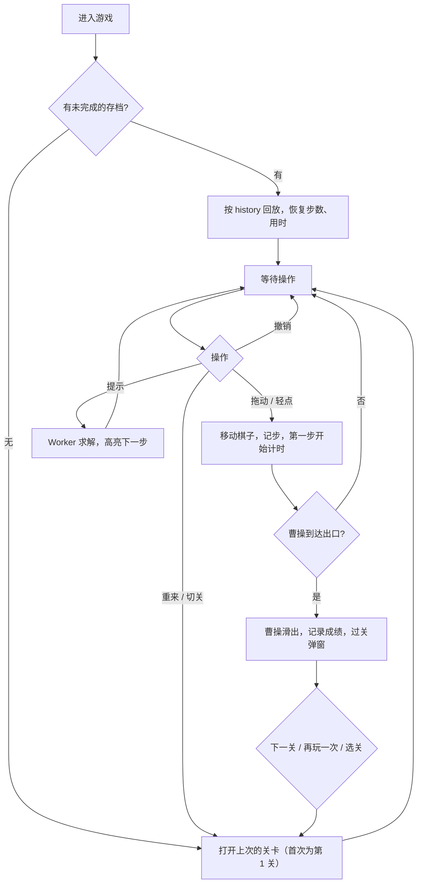

# 华容道 · 产品设计文档

> 版本：v0.1（初稿）　｜　所属项目：H5 游戏合集　｜　日期：2026-11-18

## 修订记录

| 版本 | 变更 |
| --- | --- |
| v0.1 | 初稿 |

## 1. 概述

**华容道**是中国传统的滑块谜题，取材于《三国演义》中曹操兵败、经华容道被关羽放走的故事。4 列 × 5 行的棋盘上摆着曹操、五员大将和四个小兵，玩家只能在空格之间平移棋子，目标是让曹操从棋盘底部正中的出口逃出去。

合集里已有的「**数字华容道**」（`games/klotski`）是 15 Puzzle 数字推盘，只是借了华容道的名字。本游戏是**经典的曹操版华容道**，两者是不同的游戏，名称、描述、图标都要区分清楚（见 12 节）。

| 项 | 说明 |
| --- | --- |
| 平台 | 手机竖屏为主，兼容桌面浏览器；纳入现有 PWA，离线可玩 |
| 单局时长 | 入门关 1–5 分钟，横刀立马等名局 10–30 分钟 |
| 关卡 | 内置 **38 个传统布局**，按最少步数从易到难排列，分 4 章（见 2.5） |
| 设计原则 | **拖到哪就走到哪**：手指拖动棋子即可，一次拖动可以走多格、可以拐弯；步数沿用传统计法，与流传的「横刀立马 81 步」一致 |

## 2. 核心规则

### 2.1 棋盘与棋子

棋盘 4 列 × 5 行，共 20 格。棋子共 10 枚，占满 18 格，留 2 个空格：

| 棋子 | 尺寸（宽 × 高） | 数量 | 说明 |
| --- | --- | --- | --- |
| 曹操 | 2 × 2 | 1 | 目标棋子 |
| 横将 | 2 × 1 | 视布局而定 | 横放的大将，横刀立马里只有关羽一员 |
| 竖将 | 1 × 2 | 视布局而定 | 竖放的大将 |
| 兵 | 1 × 1 | 4 | 小兵 |

大将共 5 员（横将 + 竖将 = 5），不同布局横竖的数量不同（横刀立马是 1 横 4 竖，前呼后拥是 5 横 0 竖）。

**名字**：曹操、兵的名字固定；大将中**第一员横将**（按从上到下、从左到右的顺序）叫「关羽」，其余大将按同样顺序依次叫「张飞、赵云、马超、黄忠」。名字只用于显示和提示文案，不影响规则。

### 2.2 移动规则

- 棋子只能**平移**，不能旋转，不能跳过其他棋子，不能移出棋盘。
- 棋子每次移动一格时，它要进入的格子必须是空格。
- 一枚棋子可以连续移动多格、可以拐弯，只要每一格都合法（例如兵可以先往下走一格，再往右走一格）。

### 2.3 步数计法

**同一枚棋子的一次连续移动算 1 步，不论走了几格、拐了几个弯。**具体是：

1. 一次拖动中，棋子可以经过任意条合法路径到达任意可达位置，算 1 步；
2. 连续两次（或更多次）移动的是**同一枚**棋子，合并为 1 步（等价于一次走到最终位置）；
3. 连续移动同一枚棋子后又**回到了这一步开始前的位置**，这一步取消，步数减 1。

这是华容道的传统计法（同济大学数学建模协会的统计、维基百科「華容道 (遊戲)」词条中的最少步数都按此计法），横刀立马最少 81 步就是这么算的。程序里的求解器采用相同计法（一步 = 一枚棋子移到它当前能到达的任意位置），所以界面上显示的「最少步数」与玩家的步数可以直接比较。

> 另一些计法是「每次直线移动算一步」或「每走一格算一步」，步数会更多（用同一求解器算，横刀立马分别为 90 步和 116 步）。本游戏不采用，原因见 11 节。

### 2.4 胜利

曹操到达**底部正中**（左上角在第 2 列、第 4 行，即占据底部两行的中间两列），正对出口，即为胜利。胜利后曹操从出口滑出棋盘，计时停止，棋盘不再响应操作。

不存在失败：任何局面都可以撤销或重来。

### 2.5 关卡

内置 38 个传统布局（源自民间流传的经典华容道布局集），每个都由求解器验证可解，**最少步数为精确值**，与公开资料一致。按最少步数升序排列，分为 4 章：

| 章 | 最少步数 | 关卡数 |
| --- | --- | --- |
| 入门 | ≤ 40 | 9 |
| 进阶 | 41 – 70 | 10 |
| 困难 | 71 – 90 | 12 |
| 大师 | > 90 | 7 |

完整关卡表：

| # | 布局 | 章 | 最少步数 |
| --- | --- | --- | --- |
| 1 | 前呼后拥 | 入门 | 22 |
| 2 | 比翼横空 | 入门 | 28 |
| 3 | 捷足先登 | 入门 | 32 |
| 4 | 勇闯五关 | 入门 | 34 |
| 5 | 兵临曹营 | 入门 | 34 |
| 6 | 五将逼宫 | 入门 | 36 |
| 7 | 一路顺风 | 入门 | 39 |
| 8 | 四将连关 | 入门 | 39 |
| 9 | 堵塞要道 | 入门 | 40 |
| 10 | 前挡后阻 | 进阶 | 42 |
| 11 | 雨声淅沥 | 进阶 | 47 |
| 12 | 左右布兵 | 进阶 | 54 |
| 13 | 四面楚歌 | 进阶 | 56 |
| 14 | 一路进军 | 进阶 | 58 |
| 15 | 齐头并进 | 进阶 | 60 |
| 16 | 围而不歼 | 进阶 | 62 |
| 17 | 插翅难飞 | 进阶 | 62 |
| 18 | 指挥若定 | 进阶 | 70 |
| 19 | 桃花园中 | 进阶 | 70 |
| 20 | 屯兵东路 | 困难 | 71 |
| 21 | 将拥曹营 | 困难 | 72 |
| 22 | 兵分三路 | 困难 | 72 |
| 23 | 双将挡路 | 困难 | 73 |
| 24 | 夹道藏兵 | 困难 | 75 |
| 25 | 四路进兵 | 困难 | 77 |
| 26 | 水泄不通 | 困难 | 79 |
| 27 | 横刀立马 | 困难 | 81 |
| 28 | 守口如瓶 | 困难 | 81 |
| 29 | 横马当关 | 困难 | 83 |
| 30 | 兵挡将阻 | 困难 | 87 |
| 31 | 入地无门 | 困难 | 87 |
| 32 | 层峦叠嶂 | 大师 | 98 |
| 33 | 近在咫尺 | 大师 | 98 |
| 34 | 守口如瓶（二） | 大师 | 99 |
| 35 | 层层设防 | 大师 | 102 |
| 36 | 瓮中之鳖 | 大师 | 103 |
| 37 | 层层设防（二） | 大师 | 120 |
| 38 | 峰回路转 | 大师 | 138 |

- 最少步数相同的关卡，保持布局集中原有的先后顺序。
- 「走投无路」是著名的**无解**布局，不收录。
- **全部关卡一开始就能玩**，不设解锁：这是传统谜题，很多玩家就是冲着横刀立马来的。
- **首次进入默认打开第 1 关**（前呼后拥）；之后进入时打开上次玩的关卡。有未完成存档时优先恢复存档。

布局数据写成文本，5 行、每行 4 个字符，用 `/` 分隔；同一个字母组成一枚棋子，`C` 为曹操，`.` 为空格。例如横刀立马：

```
aCCb      a b c e 为竖将，d 为关羽（横将），f g h i 为兵
aCCb
cdde
cfge
h..i
```

## 3. 界面布局

整个页面从上到下分为：**顶栏 → 关卡栏 → 状态栏 → 棋盘 → 底部控制区**。

```
┌────────────────────────────┐
│ ‹      华容道      🔊  ?  │  顶栏
│  ‹  第 27 关 · 横刀立马  ›  │  关卡栏（点中间打开选关）
│ ┌──────┬──────┬──────┐   │
│ │ 步数  │ 最少  │ 用时  │   │  状态栏
│ │  12  │  81  │ 01:24 │   │
│ └──────┴──────┴──────┘   │
│   ┏━━━━━━━━━━━━━━━━┓     │
│   ┃张 ┃ 曹  操 ┃赵 ┃     │
│   ┃飞 ┃        ┃云 ┃     │
│   ┃马 ┃ 关  羽 ┃黄 ┃     │  棋盘（4 × 5）
│   ┃超 ┃兵 ┃ 兵 ┃忠 ┃     │
│   ┃兵 ┃         ┃兵 ┃     │
│   ┗━━━━┛  出口  ┗━━━┛     │
│  [ 撤销 ] [ 重来 ] [ 提示 ] │  底部控制区
└────────────────────────────┘
```

### 3.1 各区域说明

| 区域 | 内容 | 说明 |
| --- | --- | --- |
| 顶栏 | 返回、标题、音效开关、玩法说明 | 沿用合集其他游戏的顶栏规范 |
| 关卡栏 | 左右箭头切换上一关 / 下一关；中间显示「第 N 关 · 布局名」，点击打开选关面板 | 第 1 关没有左箭头可用（置灰），最后一关同理 |
| 状态栏 | 三格：步数 / 最少 / 用时 | 「最少」格下方小字显示本关的最佳成绩（如「最佳 85」），没有通关过显示「未通关」 |
| 棋盘 | 4 × 5 的棋盘，四周有边框，**底边正中留出 2 格宽的出口** | 出口下方有「出口」两个小字 |
| 底部控制区 | 撤销、重来、提示三个按钮 | 固定在屏幕底部，避开底部安全区 |

### 3.2 棋盘尺寸

以格子边长 **S** 为基准：

```
棋盘可用宽度 = 屏幕宽度 − 左右边距 32px − 边框
棋盘可用高度 = 棋盘区域高度 − 上下边距 − 边框 − 出口文字
S = min(96px, 可用宽度 / 4, 可用高度 / 5)
```

- 棋子之间留约 S/24 的缝隙（棋子绘制时内缩），让相邻的同色棋子也能分清。
- 棋盘边框宽约 8px；出口处边框断开，宽 2S。
- 实测：iPhone SE（375 × 667）S = 70px；大屏手机（430 × 932）S = 95px；桌面（1280 × 800）封顶 96px；最小的 320 × 568 为 51px。

## 4. 交互设计

### 4.1 拖动（主要操作）

- 按住一枚棋子拖动，棋子**吸附**到离手指最近的**可达位置**（该棋子在其他棋子不动时能到达的所有位置，含拐弯可达的位置），松手后落定，算 1 步（见 2.3）。
- 拖动开始时算出可达位置集合，拖动过程中只在这些位置之间跳动，每次跳动有 90ms 的平移过渡。
- 拖回原位松手，不算步。
- 手指移动小于 8px 再松开视为**轻点**（见 4.2）。

### 4.2 轻点

| 情况 | 效果 |
| --- | --- |
| 棋子没有可去的位置 | 棋子左右轻抖，播放 `error` |
| 棋子只有 1 个可去的位置 | 直接走过去 |
| 棋子有多个可去的位置 | 选中该棋子（描边高亮），在每个可去位置显示虚线框；点虚线框走过去，点别处取消选中 |

### 4.3 撤销与重来

- **撤销**：撤回最近 1 步（按 2.3 合并后的步），不限次数；没有可撤销的步时按钮置灰。
- **重来**：回到本关开局。已走过步数且未通关时，弹窗确认「重新开始本关吗？」。
- 撤销、重来不清除本局已使用过提示的标记（见 4.4）。

### 4.4 提示

- 点「提示」，用 BFS 求解器从**当前局面**求最少步数解，高亮下一步要动的棋子，并在目标位置显示虚线框和箭头；同时显示一条轻提示「把 关羽 移到虚线框处，还需 N 步」。
- 玩家自己动手走；走了任意一步后提示消失。提示的那步正好就是一次合法的拖动或轻点（选中后点虚线框）。
- 求解在 Web Worker 中进行，不卡界面；计算期间按钮显示「计算中」并禁用。最难的局面在桌面约 0.25 秒完成（见 5.4），手机预计 1 秒以内（待真机确认）。
- 本局只要用过一次提示，通关后**不刷新最佳步数和最佳用时**，也不算「完美」，但仍记为「已通过」（见 7 节）。
- 当前局面已是最优路线上时，提示给出的「还需 N 步」加上已走步数等于最少步数。

### 4.5 桌面：鼠标与键盘

鼠标拖动、点击与手机相同。键盘：

| 按键 | 作用 |
| --- | --- |
| `Tab` / `Shift+Tab` | 依次聚焦棋子（聚焦的棋子显示主题色描边） |
| `Enter` / `Space` | 等同轻点聚焦的棋子（见 4.2） |
| 方向键 | 把选中的棋子朝该方向移动 1 格（连续按同一枚棋子合并为 1 步） |
| `Z` / `Ctrl+Z` / `Backspace` | 撤销 |
| `R` | 重来 |
| `H` | 提示 |
| `[` / `]` | 上一关 / 下一关 |

### 4.6 计时

- 第一步时开始计时，胜利时停止；显示「分:秒」，内部按毫秒记录。
- 页面切到后台时暂停计时，回来后继续。
- 不设时间上限。

### 4.7 动画期间的输入

- 胜利动画（曹操滑出）期间忽略所有输入。
- 拖动落定的过渡动画不阻塞下一次操作。

## 5. 判定逻辑

### 5.1 数据结构

```js
// 局面：棋子数组，下标即棋子身份（决定名字和颜色）
// pieces = [{ type: 'cao' | 'h' | 'v' | 's', x, y }]，(x, y) 为左上角
// grid：Int8Array(20)，每格记录占用它的棋子下标，-1 为空
// history：[{ index, from: [x, y], to: [x, y] }]，每项是合并后的一步
```

### 5.2 可达位置

对一枚棋子，从当前位置做 BFS：每次尝试上下左右平移 1 格，新位置的所有格子要么为空、要么属于它自己，就加入队列。得到的所有位置（不含原位）就是这一步能去的地方。

### 5.3 记一步

```js
function pushMove(history, index, from, to) {
  const last = history.at(-1);
  if (last?.index === index) {                     // 同一枚棋子连续移动：合并
    if (same(last.from, to)) return history.slice(0, -1);   // 走回原处：这一步取消
    return [...history.slice(0, -1), { index, from: last.from, to }];
  }
  return [...history, { index, from, to }];
}
```

合并后的一步一定也是一次合法的移动（中间经过的路径全是空格），所以撤销、存档回放时都可以按「一步 = 一次 moveTo」处理。

### 5.4 求解器

- 广度优先搜索，一步 = 任一棋子移到它的任一可达位置。
- 局面去重键：每格写棋子类型字母（`C/H/V/S/.`）组成 20 个字符。同类棋子互换视为同一局面；相邻同类的竖将 / 横将拼法唯一，不会混淆。
- 左右镜像的局面合并（出口在正中，镜像局面的最少步数相同），状态数减少约一半。
- 最难的峰回路转开局搜索约 2.1 万个局面，桌面单线程约 0.25 秒；横刀立马约 1.2 万个局面、0.12 秒。

### 5.5 测试要点

`tests/huarong.mjs`（可单独运行 `node tests/huarong.mjs`）：

- 布局解析：每关棋子数量、尺寸合法，恰好 2 个空格、1 个曹操、4 个兵、5 员大将；关卡 id 唯一。
- 移动规则：不能越界、不能重叠、不能跳过棋子；拐弯可达；可达集合与逐格搜索一致。
- 步数合并：同一棋子连续移动合并、走回原位取消、换棋子另起一步；回放 history 得到相同局面，非法 history 被拒绝。
- 胜利判定：只有曹操在底部正中才算胜利。
- **每一关都可解，求解器得到的最少步数与关卡数据中的标注一致**，且按最少步数升序排列；按解法逐步执行确实到达胜利局面。
- 提示：在最优路线上的局面，提示给出的剩余步数逐步减 1。

## 6. 游戏流程



## 7. 弹窗与其他功能

- **过关弹窗**：

| 内容 | 说明 |
| --- | --- |
| 标题 | 「曹操逃出华容道！」；未用提示且步数等于最少步数时为「完美通关！」 |
| 本次成绩 | 步数（最少 N 步）、用时 |
| 新纪录 | 本次步数或用时优于历史最佳时显示「新纪录！」；首次通关显示「首次通关」 |
| 提示说明 | 本局用过提示时显示「本局使用了提示，不刷新最佳成绩」 |
| 按钮 | 「选关」「再玩一次」「下一关」（主按钮）；最后一关没有「下一关」 |

- **选关面板**：按章分组，每章两列卡片。卡片显示关卡号、布局名、「最少 N 步」，以及状态：未通过（无标记）、已通过（✓ + 最佳步数）、完美（★）。顶部显示「已通过 12 / 38 · 完美 5」。当前关卡描边。
- **切换关卡**：不确认，当前关进度直接丢弃（随时可以重来）。
- **存档**：每一步后把「关卡 id + history + 已用时间 + 是否用过提示」写入 `localStorage`，恢复时按 history 回放校验。通关后存档清空。
- **成绩**（按关卡 id 记录）：是否通过、最佳步数、最佳用时、是否完美、首次通过日期。最佳步数和最佳用时分别记录，可以来自不同的通关。
- **玩法说明**：点顶栏「?」弹出，内容为第 2、4 节的精简版，重点讲清计步规则。首次进入自动弹出一次。

`localStorage` 键名（沿用 `h5.<游戏>.<用途>` 风格）：

| 键 | 内容 |
| --- | --- |
| `h5.huarong.state` | 当前对局：`{ v, level, history, elapsed, hinted }` |
| `h5.huarong.level` | 上次打开的关卡 id |
| `h5.huarong.records` | 各关成绩：`{ [id]: { best, bestTime, perfect, date } }` |
| `h5.huarong.helpSeen` | 是否看过玩法说明 |

## 8. 动效与音效

| 时机 | 动效 | 音效（`js/sfx.js`） |
| --- | --- | --- |
| 拖动中吸附到新位置 | 棋子平移 90ms | 不播放（太频繁） |
| 落定一步 | — | `move` |
| 轻点直接走 | 棋子平移 120ms | `move` |
| 选中棋子（多个去处） | 描边高亮，虚线框淡入 | `select` |
| 棋子无处可去 | 左右轻抖 | `error` |
| 撤销 | 反向平移 | `tap` |
| 提示 | 目标棋子描边呼吸闪烁，虚线框 + 箭头 | `select` |
| 胜利 | 曹操沿出口向下滑出棋盘（550ms，越过底边的部分被裁掉），棋盘边框发绿光；约 0.7 秒后弹出过关弹窗 | `win` |
| 完美 / 新纪录 | 弹窗中「完美」「新纪录！」放大回弹 | — |

振动（设备支持时，随音效开关一起关闭）：落定一步 8ms，胜利 `[30, 40, 60]`。

## 9. 视觉规范

棋子用**纯色圆角方块 + 白色名字**，按身份区分颜色，浅色、深色主题下保持一致：

| 用途 | 色值 |
| --- | --- |
| 棋盘底 | 跟随主题：`color-mix(--text 8%)` |
| 棋盘边框 | `#92400e`（深木色），深色主题 `#78350f` |
| 出口 | 边框断开处；下方「出口」小字 `--text-dim` |
| 曹操 | `#dc2626`，下沿阴影 `#991b1b` |
| 关羽 | `#16a34a`，下沿阴影 `#15803d` |
| 其他大将 | `#4f46e5`，下沿阴影 `#3730a3` |
| 兵 | `#f59e0b`，下沿阴影 `#b45309` |
| 选中 / 提示描边 | `--accent`（`#f97316`），3px |
| 可去位置虚线框 | `--accent`，2px 虚线，浅色填充 |

- 名字字号约 0.36S（曹操 0.42S），竖将的名字竖排。
- 用 DOM 绝对定位 + CSS `transform` 做移动动画；棋子只有 10 枚，不需要 canvas。
- 与数字华容道的区分：数字华容道是白底橙字的数字方块；华容道是彩色的人物棋子，棋盘带出口。

## 10. 边界情况

| 场景 | 处理 |
| --- | --- |
| 拖动中第二根手指按到另一枚棋子 | 只认第一根手指 |
| 拖动到棋盘外 | 仍按最近的可达位置吸附 |
| 连续移动同一枚棋子回到原位 | 这一步取消，步数减 1（见 2.3） |
| 撤销到开局再撤销 | 撤销按钮置灰，无效 |
| 提示计算中玩家又走了一步 | 结果返回时与当前局面不符，丢弃 |
| Worker 不可用（极少数环境） | 回退为主线程计算 |
| 胜利瞬间点撤销 | 胜利动画期间忽略；过关后不能撤销，只能再玩一次 |
| 切到后台 / 锁屏 | 暂停计时，存档已写入 |
| 旋转屏幕 / 改变窗口大小 | 重新计算 S，棋子无动画跳到新坐标 |
| 存档关卡 id 不存在或回放失败 | 丢弃存档，打开上次关卡（或第 1 关）的开局 |
| 关卡数据以后调整 | 成绩按关卡 id 保存；存档带版本号 `v`，版本不同时丢弃存档 |

## 11. 决策记录

| 问题 | 结论 |
| --- | --- |
| 步数计法 | 同一枚棋子的一次连续移动（任意格数、可拐弯）算 1 步，连续移动同一枚棋子合并（v0.1，见 2.3）。理由：与流传的最少步数一致，玩家可以和「81 步」直接比较；按格计步会惩罚拖动时多走一格的手误 |
| 关卡来源 | 38 个民间流传的传统布局，最少步数由求解器重算并与公开资料逐一核对（v0.1，见 2.5） |
| 关卡解锁 | 不设解锁，全部可玩（v0.1） |
| 首次进入的关卡 | 第 1 关「前呼后拥」（无存档、无上次关卡时）；有存档优先恢复（v0.2） |
| 提示 | BFS 求当前局面最优解的下一步，Worker 中计算；用过提示不刷新最佳成绩（v0.1，见 4.4） |
| 计时 | 计时，但成绩以步数为主；最佳用时单独记录（v0.1） |
| 与数字华容道的关系 | 独立游戏、独立目录和存档，不改动 `games/klotski`；主页继续叫「数字华容道」（v0.2） |

### 待确认事项

1. **拖动吸附手感**：吸附到最近可达位置时，棋子可能“穿过”拐角直接跳到目标，视觉上略突兀。真机试玩后考虑改为沿路径逐格过渡。

## 12. 接入合集

- 目录：`games/huarong/`，文件：
  - `index.html`、`huarong.css`；
  - `huarong.js`：界面、拖动 / 轻点 / 键盘输入、动画、存档、成绩、选关；
  - `engine.js`：纯逻辑（解析布局、可达位置、移动、步数合并、回放校验、胜利判定、BFS 求解），不依赖 DOM；
  - `levels.js`：38 个关卡数据（id、名称、最少步数、布局文本）；
  - `worker.js`：提示用的求解 Worker。
- 图标：`icons/huarong.svg`，红色曹操大方块在 4 × 5 棋盘中、底部出口，与数字华容道的数字方块图标区分。
- 由协调者在 `js/games.js` 的 `H5_GAMES` 中追加一项（`id: 'huarong'`，名称「华容道」，标签 `['益智', '单人']`），修改 `sw.js` 顶部的 `VERSION`，并视需要在 `tests/smoke.mjs` 中引入 `tests/huarong.mjs` 的用例、在 `README.md` 补充游戏列表。
- 测试：`tests/huarong.mjs`，覆盖 5.5 节列出的要点。

## 13. 后续可扩展

- **自摆棋局**：玩家自己摆布局，求解器判断是否可解并给出最少步数。
- **解法回放**：过关后回放自己的解法，或演示最少步数解法。
- **更多布局**：按棋子组合枚举全部开局，挑出最少步数高、形状好看的布局。
- **每日一局**：每天推荐一个布局。
