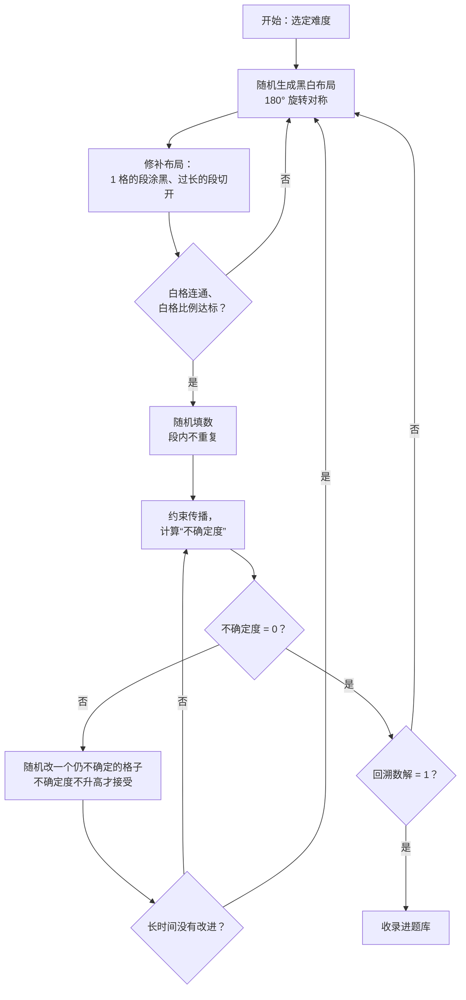
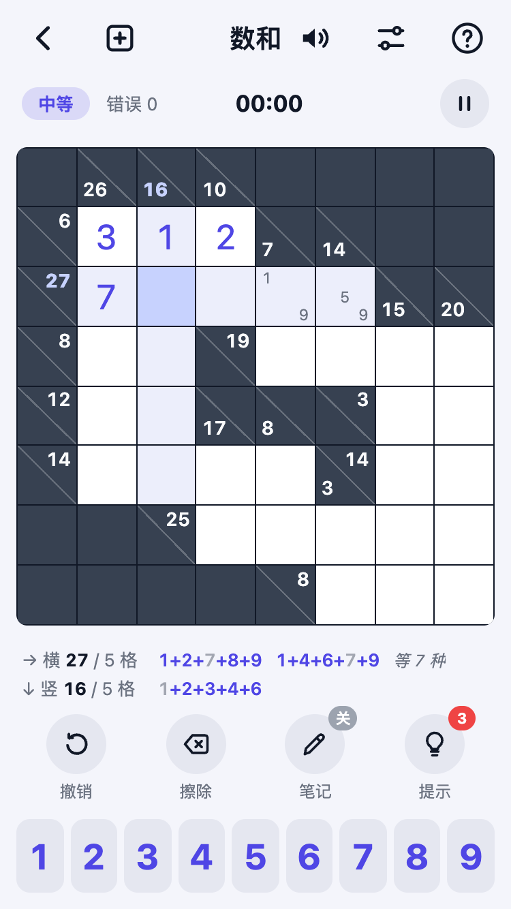
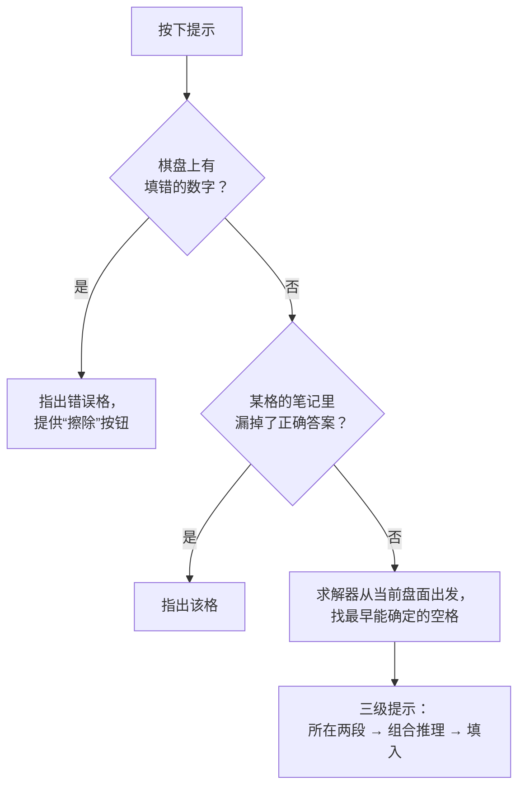
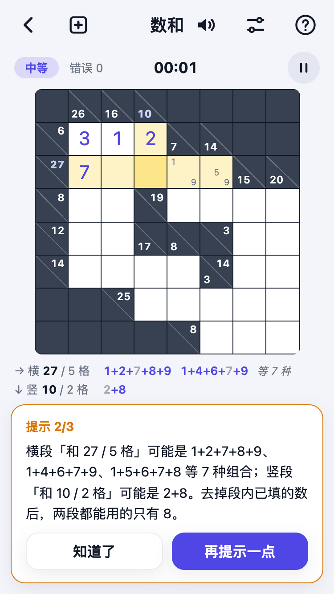
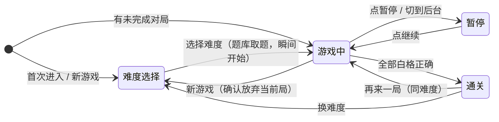

# 数和 · 产品设计文档

> 版本：v0.1（草案）　｜　所属项目：H5 游戏合集　｜　日期：2026-11-18

## 修订记录

| 版本 | 变更 |
| --- | --- |
| v0.1 | 初稿：规则、难度与尺寸、内置题库与唯一解保证、界面、组合提示、笔记、提示、存档与统计 |

## 1. 概述

**数和**（Kakuro，又称“交叉和”）是数独的近亲：棋盘像一张填字游戏，黑格里写着提示数，玩家在白格中填入 1–9，使每一段连续白格的数字之和等于它左边或上方提示格给出的数，并且同一段里数字不重复。

| 项 | 说明 |
| --- | --- |
| 平台 | 手机竖屏为主，兼容桌面浏览器；纳入现有 PWA，离线可玩 |
| 单局时长 | 2–5 分钟（简单）到 20 分钟以上（专家） |
| 难度 | **简单 / 中等 / 困难 / 专家** 四档，以棋盘尺寸区分 |
| 核心承诺 | **每道题都有且只有一个解，并且只靠逻辑推理就能解出，不需要猜** |
| 辅助功能 | 组合提示、笔记（候选数标记）、自动笔记、三级提示、撤销、擦除、错误检查、高亮所在段 |
| 设计原则 | 交互与数独保持一致（先选格再按数字），玩家在两款游戏之间切换零学习成本 |

## 2. 核心规则

- **棋盘**：n 行 × n 列的方格，分为**黑格**和**白格**。第 1 行和第 1 列永远是黑格。
- **段**：同一行里左右相连的一串白格叫一个**横段**，同一列里上下相连的一串白格叫一个**竖段**。每个白格恰好属于一个横段和一个竖段；每段长 2–9 格。
- **提示格**：紧挨在段前面的黑格（横段的左边、竖段的上方）写着这一段的**和**。提示格用一条从左上到右下的斜线分成两半：**右上角**的数是右边横段的和，**左下角**的数是下方竖段的和。没有段的一侧留空。
- **填数**：玩家在白格中填入 1–9。
- **约束**：
  1. 每段数字之和等于对应的提示数；
  2. 同一段内数字**不重复**（因此一段最多 9 格）。
- **胜利**：所有白格填满，且与答案一致（答案唯一，等价于满足全部约束）。
- **没有失败**：不设错误上限，玩家总能把一局下完。

### 2.1 组合（核心技巧）

数和的乐趣在于“**组合**”：一段的和与长度确定后，可能用到的数字往往很有限。

| 段 | 唯一组合 | 说明 |
| --- | --- | --- |
| 和 3，2 格 | 1 + 2 | 最小的两数之和 |
| 和 4，2 格 | 1 + 3 | 2 + 2 重复，不允许 |
| 和 16，2 格 | 7 + 9 | 8 + 8 重复，不允许 |
| 和 17，2 格 | 8 + 9 | 最大的两数之和 |
| 和 6，3 格 | 1 + 2 + 3 | |
| 和 24，3 格 | 7 + 8 + 9 | |
| 和 10，4 格 | 1 + 2 + 3 + 4 | |
| 和 30，4 格 | 6 + 7 + 8 + 9 | |

一个白格同时属于一个横段和一个竖段，**两段的可用数字取交集**，经常就只剩一个。例如横段“和 16 / 2 格”只能是 {7, 9}，竖段“和 6 / 3 格”只能是 {1, 2, 3}——两者没有交集说明推理有误；而横段 {7, 9} 与竖段“和 23 / 3 格”{6, 8, 9} 的交集是 9，这一格就确定了。

## 3. 难度体系

### 3.1 四档难度

数和的难度主要取决于**棋盘大小**：格子越多，推理链越长，需要同时考虑的段越多。

| 难度 | 棋盘（含提示行 / 列） | 最长段 | 白格约 | 目标时长 | 每局提示次数 |
| --- | --- | --- | --- | --- | --- |
| ★ 简单 | 6 × 6 | 4 格 | 15–18 | 2–5 分钟 | 3 |
| ★★ 中等 | 8 × 8 | 5 格 | 30–40 | 5–10 分钟 | 3 |
| ★★★ 困难 | 10 × 10 | 6 格 | 49–66 | 10–20 分钟 | 3 |
| ★★★★ 专家 | 12 × 12 | 6 格 | 73–92 | 20 分钟以上 | 3 |

- 所有档位的题目都满足“只靠推理可解完”（见 4.3），区别在于规模。白格数为当前题库的实际范围。
- 专家档如果允许 7 格以上的长段，满足“只靠推理”的题目非常难生成，题面也会显得松散，因此与困难档同样封顶 6 格。


难度选择页：每档显示星级、棋盘尺寸、最长段和该档最佳用时；有未完成的对局时底部出现「继续上一局」。

## 4. 出题方案：内置题库

与数独不同，数和**不做实时生成**，只用内置题库。原因：

- 数和的“唯一解”非常依赖填数的细节，随机生成一道 12 × 12 的合格题要尝试数百个布局、数千次调整，手机上耗时不可控（数秒到数十秒）；
- 数和**没有数独那样丰富的等价变换**：把数字重新映射会改变各段的和，左右 / 上下翻转会让提示格跑到段的另一头。只有**沿主对角线翻转**（横段与竖段互换）能保持题目合法。

因此题目由离线脚本生成、校验后打包进 PWA 缓存。

### 4.1 “必须有解”的三层含义

| 层次 | 含义 | 如何保证 |
| --- | --- | --- |
| ① 有解 | 至少存在一个合法填法 | 题目从一个**填好的合法盘面**推出提示数，盘面本身就是一个解 |
| ② 唯一解 | 只有一个合法填法 | 用回溯求解器数解，**找到第 2 个解就停止**，解数 ≠ 1 的题丢弃 |
| ③ 可推理 | 不需要试错猜测 | 只用“约束传播”（见 4.3）就能把每个白格缩到唯一候选，否则丢弃 |

### 4.2 生成流程



要点：

- **布局**：第 1 行、第 1 列固定为黑格，其余格按难度给定的概率随机放黑格，并保持 180° 旋转对称（传统数和的惯例，题面更美观）。长度为 1 的段不允许，涂黑；超过最长段限制的段从中间切开（两边各至少 2 格）。最后要求所有白格连通。
- **不确定度**：对当前填法推出的题面做约束传播后，所有白格剩余候选数的个数之和。等于 0 就说明“只靠推理就能解完”。
- **爬山调整**：随机填满的盘面几乎不可能直接满足要求。每次挑一个仍不确定的格子，换一个不与所在两段重复的数字（提示数随之改变），不确定度没有升高就保留，否则撤回。连续 500 次没有改进就放弃这个布局重来。
- **双重校验**：约束传播是“只做必然推论”的，传播能解完就必然唯一；脚本仍用独立的回溯求解器再数一次解，测试里也会对题库每道题重新校验。
- 生成脚本：`scripts/gen-kakuro-bank.mjs`，每档 60 道，用固定随机种子，结果可复现。

### 4.3 约束传播（逻辑求解器）

对每一段，求出每个格子“在存在某种合法填法的前提下”还能填哪些数，把不可能的候选划掉；某格的候选变少，就重新检查它所在的另一段，直到不再变化。

- 实现方式：按段内格子的顺序，以“已用数字的集合”为状态（最多 1024 种）做一次正向、一次反向扫描，得到每格的确切候选。这一步同时涵盖了“组合排除”“段内唯一位置”“和的上下界”等人类常用技巧。
- 同一个求解器服务于：出题校验、提示（第 7 节）、存档校验。

### 4.4 题库使用

- 每档 60 道，取题时随机决定是否沿主对角线翻转，相当于每档 120 道不同的题面。
- 记录每档已经玩过的题（`h5.kakuro.seen`），优先抽没玩过的；全部玩过后清空重新开始。

## 5. 界面布局

整个页面从上到下分为：**顶栏 → 信息栏 → 棋盘 → 组合栏 → 工具栏 → 数字键盘**，与数独一致，只多了一条组合栏。



图中状态（中等题，实机截图）：玩家选中了第 3 行第 3 列，它所在的横段（和 27）和竖段（和 16）浅色高亮，两个提示数变为浅色加粗；右侧两个空格里有灰色笔记。组合栏列出这两段与已填数字相容的组合，段里已填的 7、1 显示为灰色。

### 5.1 各区域说明

| 区域 | 内容 | 说明 |
| --- | --- | --- |
| 顶栏 | 返回、新游戏、标题、音效开关、设置、玩法说明 | 沿用数独的顶栏 |
| 信息栏 | 难度标签、错误次数、计时、暂停 | 计时格式 `mm:ss`，超过 1 小时显示 `h:mm:ss` |
| 棋盘 | n × n 格 | 正方形，宽度撑满屏幕（左右留边距） |
| 组合栏 | 选中格所在横段、竖段的“和 / 格数”与可能组合 | 见 6.3；可在设置里关闭 |
| 工具栏 | 撤销、擦除、笔记、提示 | 与数独相同 |
| 数字键盘 | 1–9 一行排开 | 不显示剩余个数（数和没有“每个数字出现 9 次”的概念） |

### 5.2 格子的视觉状态

| 状态 | 样式 |
| --- | --- |
| 黑格（无提示） | 深灰色块 |
| 提示格 | 深灰色块 + 左上到右下的浅色斜线；右上角为横段和，左下角为竖段和 |
| 提示格（所选格所在的段） | 对应的提示数变为主题浅色并加粗 |
| 提示格（该段和不符） | 对应的提示数变红 |
| 玩家填入 | 主题蓝色 |
| 填错 / 规则冲突 | 红色数字 + 浅红底 |
| 笔记 | 灰色小字，按 3 × 3 固定位置排列 |
| 选中格 | 深一些的蓝紫色底 |
| 所在横段 / 竖段 | 很浅的蓝紫色底 |

### 5.3 自适应

```
可用高度 = 屏幕高度 − 顶栏 − 信息栏 − 组合栏 − 工具栏 − 数字键盘 − 底部安全区 − 边距
B = clamp(260px, min(屏幕宽度 − 24px, 可用高度), 540px)
格子边长 ≈ B / n
```

| 屏幕 | 棋盘边长 | 简单 6 × 6 | 专家 12 × 12 |
| --- | --- | --- | --- |
| iPhone SE（375 × 667） | 约 351px | 58px | 29px |
| 大屏手机（430 × 932） | 约 406px | 67px | 34px |
| 桌面浏览器 | 封顶 540px | 90px | 45px |

专家档在小屏上格子约 29px。困难（10 × 10）与专家（12 × 12）提供**放大档**（与扫雷相同）：目标格子边长 40px，棋盘超出可视区后在棋盘区域内拖动滚动；右下角 🔍 按钮与双指捏合切换两档，不做连续缩放。简单 / 中等不显示放大按钮。

## 6. 交互设计

### 6.1 选中与高亮

基本操作与数独相同：**先选格，再按数字**。

1. 点击白格将其选中；点击黑格无效。
2. 点击数字键，向选中格填入数字；再次按下与格内相同的数字等同于擦除。
3. 选中格所在的横段、竖段浅色高亮，两段的提示数加粗（可在设置里关闭高亮）。

### 6.2 笔记（候选数标记）

与数独完全一致：

- 工具栏「笔记」切换笔记模式；笔记模式下点数字，在选中格里添加 / 去掉这个候选数。
- 候选数 1–9 按 3 × 3 固定位置显示。
- **自动清除**：填入数字后，同一横段、竖段笔记里的这个数字自动去掉（设置可关）。
- **填数覆盖笔记**：擦掉数字后原来的笔记恢复显示。
- **自动笔记**：长按「笔记」或在设置里点「自动笔记」，给所有空格填入“只看所在两段”时的候选数（两段各自与已填数字相容的组合取并集，再取交集，去掉段内已填的数）。会覆盖已有笔记，执行前确认；可以撤销。
- **快捷操作**：长按数字键临时写一次笔记。

### 6.3 组合提示（组合栏）

数和的核心技巧是“查组合表”，新手很难记住。组合栏把这张表直接放到眼前：

- 选中白格时，组合栏分两行显示：
  - `→ 横 16 / 2 格：7+9`
  - `↓ 竖 23 / 3 格：6+8+9`
- 只列出**与段内已填数字相容**的组合（已填的数必须出现在组合里，且已填数字没有重复）。
- 组合中**已经填在段里的数字**显示为灰色，提醒“剩下的格子从其余数字里选”。
- 组合按字典序排列（1+8、2+7、3+6…）。一行按宽度最多显示 4 种（组合越长显示越少），放不下时末尾写“等 N 种”。
- 没有相容的组合时显示红色“无可能组合”，说明这段已经填错了。
- 未选中格子时显示一行灰色说明：“选中白格，查看所在段的可能组合”。
- 设置里可关闭（关闭后组合栏隐藏，棋盘相应变大），给想要纯纸笔体验的玩家。

组合提示只是查表，**不消耗提示次数**，也不影响“完美通关”。

### 6.4 擦除与撤销

| 操作 | 行为 |
| --- | --- |
| 擦除 | 清除选中格的数字；如果只有笔记，就清空笔记 |
| 撤销 | 撤回上一步操作，包括填数、擦除、写/删笔记、自动笔记、提示填入；不限步数；会连带恢复被自动清除的笔记 |
| 重做 | 不单独提供按钮；桌面端支持 `Ctrl/⌘ + Shift + Z` |

### 6.5 错误检查

在设置里切换，默认为「即时纠错」：

| 模式 | 判定依据 | 表现 |
| --- | --- | --- |
| 即时纠错（默认） | 和**答案**比对 | 填错立即红色显示，错误次数 +1；段的和不符时提示数也变红 |
| 只查冲突 | 只看规则 | 同段数字重复时标红；某段**已填数字之和超过提示数**，或**填满后和不等于提示数**时，提示数变红；不计错误次数 |

### 6.6 键盘操作（桌面浏览器）

| 按键 | 作用 |
| --- | --- |
| 方向键 / WASD | 移动到该方向上最近的白格 |
| 1–9（含小键盘） | 填数；笔记模式下写笔记 |
| `Shift` + 1–9 | 临时写笔记 |
| 0、Backspace、Delete | 擦除 |
| N | 切换笔记模式 |
| H | 提示 |
| `Ctrl/⌘ + Z` | 撤销 |
| 空格 | 暂停 / 继续 |

## 7. 提示系统

与数独相同：每局 **3 次**，按下即消耗 1 次，分三级逐步揭示。

按下提示时，按以下顺序决定提示什么：



| 级别 | 内容 | 棋盘表现 |
| --- | --- | --- |
| 第 1 步 · 指方向 | “看看高亮的这一格和它所在的两段。” | 黄色高亮目标格所在的横段、竖段 |
| 第 2 步 · 讲方法 | “横段 和 16 / 2 格只能是 7+9，竖段 和 23 / 3 格只能是 6+8+9，两段都能用的只有 9。” | 目标格加深 |
| 第 3 步 · 给答案 | “已在第 3 行第 4 列填入 9。” | 自动填入，目标格闪烁绿色 |



提示第 2 步（实机截图）：目标格（深黄）所在的横段和竖段黄色高亮；目标格同时被选中，组合栏同步显示这两段的组合，与提示文字对照着看。

- “最早能确定”的含义：求解器按“轮”做约束传播（每轮所有段同时用上一轮的结果），第 1 轮就能确定的格子只需要看它所在的两段；需要第 2 轮及以后才能确定的，第 2 步改为说明“结合周围其他段先缩小候选，这一格只能是 d”。
- 提示开始时自动选中目标格，组合栏随之显示目标格两段的组合。
- 次数用完后提示按钮置灰，按下弹出 toast：“本局提示已用完”。
- 0 提示 0 错误通关记为“完美通关”。

## 8. 游戏流程



- **计时**：题目出现即开始；暂停、切到后台、打开弹窗或菜单时停止。
- **暂停**：棋盘被遮住，工具栏和键盘不可用。
- **新游戏**：当前局有进度时弹窗确认“放弃当前对局？”（中断该难度连胜）。
- **重做本题**：设置里提供，清空所有填入和笔记，计时归零，提示次数恢复。
- **通关**：最后一格填对时计时停止，白格按对角线顺序依次闪一遍，随后弹出通关弹窗（难度、用时、最佳用时、错误、使用提示）；按钮「换难度」「再来一局」。

## 9. 设置

| 设置项 | 默认 | 说明 |
| --- | --- | --- |
| 错误检查 | 即时纠错 | 可切换为“只查冲突”（见 6.5） |
| 高亮所在横段 / 竖段 | 开 | |
| 显示组合提示 | 开 | 关闭后隐藏组合栏 |
| 填数后自动清除笔记 | 开 | |
| 显示计时 | 开 | 关闭后只隐藏，仍在后台计时 |
| 音效 | 开 | 共用合集的全局音效开关 |
| 自动笔记 | — | 动作按钮 |
| 重做本题 | — | 动作按钮，需确认 |

## 10. 存档与统计

### 10.1 自动存档

- 每次操作后写入 `localStorage`，刷新、退出、断网都不丢进度。
- 键名：`h5.kakuro.state`（当前对局）、`h5.kakuro.settings`、`h5.kakuro.stats`、`h5.kakuro.diff`（上次选的难度）、`h5.kakuro.seen`（已玩过的题号）、`h5.kakuro.helpSeen`。
- 存档内容：难度、题号、是否翻转、答案盘面、玩家填入、笔记、撤销栈、已用时间、错误次数、提示次数。
- 恢复时校验盘面合法性（尺寸、段长、段内不重复）和各字段范围，不一致就丢弃并回到难度选择。

### 10.2 统计（按难度分别记录）

与数独相同：已完成局数、最佳用时（只统计 0 提示对局）、平均用时、完美通关次数、当前连胜 / 最长连胜。统计页从难度选择页进入。

## 11. 视觉规范

沿用数独的配色变量，新增黑格相关颜色：

| 元素 | 浅色主题 | 深色主题 |
| --- | --- | --- |
| 白格底色 | `#ffffff` | `#2b3546` |
| 格线 / 外框 | `#111827` | `#05070b` |
| 黑格 / 提示格 | `#374151` | `#121722` |
| 提示格斜线 | `#ffffff40` | `#ffffff30` |
| 提示数 | `#f9fafb` | `#d1d5db` |
| 提示数（所选段） | `#c7d2fe` 粗体 | `#a5b4fc` 粗体 |
| 提示数（和不符） | `#fca5a5` | `#f87171` |
| 玩家填入 | `#4f46e5` | `#a5b4fc` |
| 错误 | 字 `#dc2626`，底 `#fde2e2` | 字 `#f87171`，底 `#7f1d1d8c` |
| 选中格 | `#c7d2fe` | `#4338ca` |
| 所在段 | `#eceefb` | `#ffffff12` |
| 提示高亮 | `#fef3c7`，强调 `#fde68a` | `#78350f8c`，强调 `#b45309bf` |
| 数字字号 | 格子边长 × 0.58 | 同左 |
| 提示数字号 | 格子边长 × 0.32，最小 9px | 同左 |
| 笔记字号 | 格子边长 × 0.26，最小 7px | 同左 |

## 12. 动效与音效

| 时机 | 动效 | 音效 |
| --- | --- | --- |
| 填入数字 | 数字轻微放大回弹 | `place` |
| 填错（即时纠错） | 格子左右抖动 | `error` |
| 某段填满且正确 | 该段从提示格一端扫过一道亮光 | `chip` |
| 提示填入 | 目标格绿色闪烁 | `place` |
| 通关 | 白格按对角线依次闪烁 | `win` |

音效使用 `js/sfx.js`，遵循全局音效开关。系统开启“减少动态效果”时动效简化。

## 13. 边界情况

| 情况 | 处理 |
| --- | --- |
| 没选中格子就按数字 | toast “先选一个格子” |
| 点击黑格 | 不改变选中 |
| 填满全部白格但有错误 | 不弹通关；toast 提示“还有 N 处错误”（只查冲突模式提示“有冲突或错误”） |
| 存档损坏 / 版本不兼容 | 丢弃存档，回到难度选择页 |
| 题库某档全部玩过 | 清空已玩记录，重新抽取 |
| 提示时没有任何逻辑步可走 | 理论上不会发生（题目保证可推理）；兜底为直接填入一个随机空格的答案 |

## 14. 技术方案

沿用合集的约定：纯 HTML / CSS / 原生 JS（ES modules），无构建步骤，逻辑与界面分离。

```
games/kakuro/
├── index.html
├── kakuro.css
├── kakuro.js        # 界面、交互、计时、存档
├── board.js         # 纯逻辑：对局状态、填数 / 笔记 / 撤销、冲突与和的检查、组合栏数据、提示选择、存档校验
├── solver.js        # 纯逻辑：盘面结构（段）、组合表、约束传播、回溯数解、提示步骤
├── levels.js        # 难度档位参数（含离线出题用的布局参数）
└── puzzles.js       # 内置题库（每档 60 道，脚本生成）
scripts/gen-kakuro-bank.mjs   # 离线出题脚本（不随页面加载）
tests/kakuro.mjs              # 独立测试：node tests/kakuro.mjs
```

- 在 `js/games.js` 登记新游戏（由协调者统一处理）；`sw.js` 通过 `games.js` 的 `files` 列表预缓存，保证离线可玩。
- `solver.js`、`board.js` 不依赖 DOM，可在 Node 中直接测试。
- 测试覆盖：组合表、盘面结构、规则校验（重复、和不符）、完成判定、撤销恢复笔记、存档校验、题库每题合法 + 唯一解 + 只靠推理可解（含翻转后）。

## 15. 决策记录

| 决策 | 理由 |
| --- | --- |
| 只用内置题库，不做实时生成 | 合格题生成耗时不可控；数和缺少等价变换，但 60 道 × 翻转已够大多数玩家长期游玩 |
| 难度按棋盘尺寸分档 | 所有题都“只靠推理可解”，规模是最直观、最稳定的难度来源 |
| 要求题目无需猜测 | 与数独一致；也让提示系统任何时候都能给出“讲得通”的一步 |
| 提供组合栏 | 查组合表是数和最大的入门门槛；做成可关闭的辅助，不计入提示 |
| 交互全面复用数独 | 降低学习成本，也便于两款游戏一起维护 |
| 小屏放大 | 困难 / 专家提供固定 40px 放大档 + 拖动滚动；按钮与双指捏合切换（v0.2，对齐扫雷） |

### 待确认事项

1. **题库规模**：每档 60 道是否足够？如需更多，可直接用脚本扩充（专家档约 2–4 秒一道）。
2. 是否提供“**组合表**”弹窗（一次性列出所有和 / 格数的唯一组合），供进阶玩家记忆？

## 16. 后续可扩展

- 每日挑战（按日期选题）；
- 非正方形棋盘（如 10 × 14），更好地利用竖屏高度；
- 组合表速查弹窗；
- 更难的推理档：要求用到“区域求和”等跨段技巧才能解出的题。
