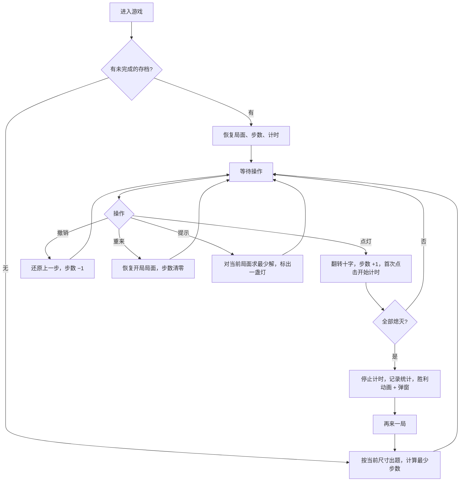

# 关灯 · 产品设计文档

> 版本：v0.1（草案）　｜　所属项目：H5 游戏合集　｜　日期：2026-11-18

## 修订记录

| 版本 | 变更 |
| --- | --- |
| v0.1 | 初稿 |

## 1. 概述

**关灯**（Lights Out）是一款经典的单人益智小游戏。方形棋盘上有若干盏灯，有的亮、有的灭。点击一盏灯，它自己和上下左右相邻的灯都会**翻转**（亮变灭、灭变亮），目标是用尽量少的步数把**所有灯都关掉**。

| 项 | 说明 |
| --- | --- |
| 平台 | 手机竖屏为主，兼容桌面浏览器；纳入现有 PWA，离线可玩 |
| 单局时长 | 3×3 约半分钟，5×5 约 2–5 分钟，7×7 约 5–15 分钟 |
| 尺寸 | **3×3 / 4×4 / 5×5 / 6×6 / 7×7** 五档，默认 5×5（经典尺寸） |
| 设计原则 | **一指就能玩**：棋盘上轻点即操作，撤销 / 重来 / 提示都在底部拇指区；每道题都**保证有解**，并告诉玩家最少要几步 |

**命名**：合集中已有「密码灯」（codelights，猜颜色的推理游戏）。本游戏的目标是把灯全部关掉，取名「**关灯**」，直接说明玩法，也和「密码灯」在字面上拉开距离（见第 11 节）。

## 2. 核心规则

### 2.1 翻转规则

- 棋盘为 n × n 个格子，每格一盏灯，只有**亮 / 灭**两种状态。
- 点击任意一盏灯（亮的、灭的都可以点），**它自己以及上、下、左、右相邻的灯**同时翻转。
- 边上的灯只有 3 个邻居，角上的灯只有 2 个邻居，超出棋盘的部分忽略，**不会绕到对边**。

```
点击中间（★）：           点击角落（★）：
. . . . .                 ★ ● . . .
. . ● . .                 ● . . . .
. ● ★ ● .                 . . . . .
. . ● . .
. . . . .                 ●/★ 表示被翻转的格子
```

两个重要性质（求解与提示都基于它们，见第 5 节）：

1. **顺序无关**：一组点击无论按什么顺序执行，结果都一样。
2. **点两次等于没点**：同一盏灯点两次，效果完全抵消。所以最优解里每盏灯最多点一次，「最少步数」就是最少要点几盏不同的灯。

### 2.2 尺寸

| 尺寸 | 格数 | 可解局面占比 | 出题最少步数（见 5.5） |
| --- | --- | --- | --- |
| 3×3 | 9 | 全部 | 3–5 步 |
| 4×4 | 16 | 1 / 16 | 4–7 步 |
| 5×5（默认） | 25 | 1 / 4 | 6–10 步 |
| 6×6 | 36 | 全部 | 8–13 步 |
| 7×7 | 49 | 全部 | 10–16 步 |

4×4 和 5×5 有大量随机局面是**无解**的（原因见 5.3），所以题目不能随机撒灯，必须用「从全灭开始随机点击」的方式生成（见 5.4）。

### 2.3 胜利

- 所有灯都熄灭的瞬间即胜利，停止计时，弹出胜利弹窗。
- 没有失败条件，也没有步数上限；玩家可以一直尝试，或用「重来」回到本题开头。
- **完美通关**：没有用过提示，且步数恰好等于本题的最少步数。

## 3. 界面布局

整个页面从上到下分为：**顶栏 → 尺寸切换 → 状态栏 → 棋盘 → 底部控制区**。

```
┌──────────────────────────────┐
│ ‹   ↻        关灯        🔊  ? │  顶栏
│ [3×3][4×4][5×5][6×6][7×7]    │  尺寸切换
│  步数 3   ·  最少 7 步 · 01:12 │  状态栏
│ ┌──────────────────────────┐ │
│ │  ■ □ □ ■ □                │ │
│ │  □ ■ ■ □ □                │ │  棋盘（深色底，正方形）
│ │  ...                      │ │
│ └──────────────────────────┘ │
│  [ ↶ 撤销 ][ ⟲ 重来 ][ 💡 提示 ] │  底部控制区
└──────────────────────────────┘
```

### 3.1 各区域说明

| 区域 | 内容 | 说明 |
| --- | --- | --- |
| 顶栏 | 返回、换一题、标题、音效开关、玩法说明 | 沿用合集其他游戏的顶栏规范；「换一题」用重新开始图标，放在左侧 |
| 尺寸切换 | 「3×3 / 4×4 / 5×5 / 6×6 / 7×7」分段按钮 | 对局中切换需确认（见第 7 节） |
| 状态栏 | 步数、最少步数、用时 | 「最少 N 步」是**本题开局**时的最少步数，整局不变 |
| 棋盘 | n × n 个灯格，深色底 | 浅色、深色主题下**都使用深色底**，与「密码灯」呼应，亮灯更醒目 |
| 底部控制区 | 「撤销」「重来」「提示」三个等宽按钮；胜利后替换为全宽「再来一局」 | 固定在屏幕底部，避开 iPhone 底部安全区 |

### 3.2 尺寸

以灯格边长 **S** 为基准：灯格间距 0.12S，棋盘内边距 0.25S，灯格圆角 0.16S。

```
棋盘边长 = S × (n + 0.12 × (n − 1) + 0.5)
S = clamp(28px, min(可用宽度, 可用高度) / (n + 0.12 × (n − 1) + 0.5), 84px)
```

| 屏幕 | 3×3 | 5×5 | 7×7 |
| --- | --- | --- | --- |
| iPhone SE（375 × 667） | 84px（封顶） | 约 57px | 约 41px |
| 大屏手机（430 × 932） | 84px（封顶） | 约 66px | 约 48px |

（可用宽度 = 屏幕宽度 − 左右边距 32px；竖屏下宽度是瓶颈。）7×7 在最小屏幕上也有 40px 以上，加上 0.12S 的间距，实际热区接近 `--tap`（48px），不需要缩放。

## 4. 交互设计

### 4.1 点灯

- **轻点**任意灯格：该格及上下左右翻转，步数 +1，播放 `tap` 音效。
- 第一次点击时开始计时。
- 胜利后棋盘只读，点击无反应。
- 灯格用 `<button>` 实现，避免被页面的“双击放大拦截”吞掉快速连点。

### 4.2 撤销

- 撤销上一次点击（等价于再点一次同一格），步数 −1。可以一直撤销到本题开头。
- 没有可撤销的步骤时按钮置灰。
- 撤销不影响计时，也不退回已用的提示次数。

### 4.3 重来

- 把棋盘恢复到本题开局的样子，清空步数和撤销记录。
- 题目不变，**计时不清零**（防止“看完答案重来刷时间”），提示次数也保留。
- 没走过任何一步时按钮置灰。

### 4.4 提示

- 按「提示」：根据**当前局面**重新计算最少步数解（见 5.3），在其中挑一盏灯，用白色虚线框闪烁标出，并 Toast 提示「还需最少 M 步」。
- 标出的灯在下一次点击（任意格）或撤销 / 重来后消失。提示框还在时再按「提示」不会重复计数。
- 选哪一盏：按阅读顺序（从上到下、从左到右）取解中的第一盏。由于顺序无关，按提示点下去，剩余最少步数一定 −1。
- 每用一次提示，本局提示次数 +1，按钮上显示已用次数。用过提示的胜局**不计入最佳用时和完美通关**，但仍计为胜局。

### 4.5 计时

- 第一次点击开始计时，胜利时停止；显示 `mm:ss`，超过 99:59 停在 99:59，内部继续计时。
- 页面切到后台（`visibilitychange` 隐藏）时暂停，回来后继续。

### 4.6 键盘操作（桌面浏览器）

| 按键 | 作用 |
| --- | --- |
| 方向键 | 移动键盘焦点（第一次按时焦点出现在中间格） |
| `Space` / `Enter` | 点击焦点格 |
| `Z` / `Backspace` | 撤销 |
| `R` | 重来 |
| `H` | 提示 |
| `N` | 换一题 |

## 5. 判定逻辑

### 5.1 数据结构

```js
// 一维数组，index = y * n + x
// lights:  Uint8Array(n * n)，1 = 亮
// start:   开局局面（重来时恢复）
// history: 已点击的格子下标，撤销时弹出
```

### 5.2 翻转

```js
function press(lights, n, i) {
  const x = i % n, y = (i / n) | 0;
  lights[i] ^= 1;
  if (x > 0) lights[i - 1] ^= 1;
  if (x < n - 1) lights[i + 1] ^= 1;
  if (y > 0) lights[i - n] ^= 1;
  if (y < n - 1) lights[i + n] ^= 1;
}
```

### 5.3 求解：GF(2) 高斯消元

把「每格点或不点」看成未知数 \(x_i \in \{0, 1\}\)。格子 j 最终是否翻转，等于 j 自己和邻居被点的次数之和的奇偶性，于是“把当前局面 b 全部关掉”等价于在二元域 GF(2) 上解线性方程组：

\[
A x = b \pmod 2
\]

其中 A 是 \(n^2 \times n^2\) 的矩阵，\(A_{ji} = 1\) 当且仅当点 i 会翻转 j。

- 对增广矩阵 \([A \mid b]\) 做高斯消元（加法即异或）。出现 \(0 = 1\) 的行则**无解**。
- A 不一定满秩。各尺寸的零空间维数（“无效果的点击组合”数量的 log₂）：

| 尺寸 | 3×3 | 4×4 | 5×5 | 6×6 | 7×7 |
| --- | --- | --- | --- | --- | --- |
| 零空间维数 k | 0 | 4 | 2 | 0 | 0 |
| 有解时解的个数 | 1 | 16 | 4 | 1 | 1 |

- **最少步数**：先得到一个特解（自由变量取 0），再枚举零空间的全部 \(2^k\) 种组合与特解相加，取 1 的个数最少的那个。k ≤ 4，最多枚举 16 种，瞬间完成。
- 5×5 时 A 的秩为 23，只有 \(2^{23}\) 种局面可解（占 1/4）；4×4 秩为 12，只占 1/16。这就是 2.2 中“随机撒灯多半无解”的原因。

### 5.4 出题

1. 从全灭开始，随机选 k 个**不同**的格子依次点击（k 在本尺寸的范围内随机，见下表）。点击得到的局面一定可以通过“再点一遍这些格子”还原，所以**必然有解**。
2. 用求解器算出最少步数 m。4×4、5×5 时 m 可能小于 k（零空间里有更短的解）。
3. 若 m 低于本尺寸的下限，重新生成（最多 50 次，之后接受当前结果）。

| 尺寸 | 随机点击数 k | 最少步数下限 |
| --- | --- | --- |
| 3×3 | 3–5 | 3 |
| 4×4 | 4–7 | 4 |
| 5×5 | 6–10 | 6 |
| 6×6 | 8–13 | 8 |
| 7×7 | 10–16 | 10 |

3×3、6×6、7×7 的 A 满秩，解唯一，m 恒等于 k。

### 5.5 难度预期

| 尺寸 | 预期 | 说明 |
| --- | --- | --- |
| 3×3 | 入门 | 局面小，凭直觉几步就能关完 |
| 4×4 / 5×5 | 中等 | 可以用“追灯法”（逐行把上一行的亮灯用下一行关掉）系统解题 |
| 6×6 / 7×7 | 较难 | 追灯到最后一行需要回头调整第一行，步数多，适合熟练玩家 |

## 6. 游戏流程



## 7. 结束弹窗与其他功能

- **胜利弹窗**：标题「全部关灯！」（完美通关时为「完美通关！」），显示尺寸、步数 / 最少步数、用时、提示次数；打破最佳用时时显示「新纪录！」。下方显示本尺寸的胜局数、完美局数、最佳用时。
- **查看棋盘**：关闭弹窗回看全灭的棋盘，底部按钮为「再来一局」。
- **换一题 / 尺寸切换**：
  - 本题还没点过任何一格，直接切换；
  - 已点过且未通关，弹窗确认「换一题将放弃本局，确定吗？」/「切换尺寸将放弃本局，确定吗？」，放弃计入总局数；
  - 已通关，直接切换。
  - 尺寸会记住，下次进入沿用。
- **存档**：每次点击、撤销、重来、提示后把尺寸、开局局面、点击记录、已用时间、提示次数写入 `localStorage`；刷新或退出后可继续。读取时用开局局面 + 点击记录重放并校验，数据不一致则丢弃。已通关的对局不保存。
- **统计**（按尺寸分别记录）：总局数（开始点击后完成或放弃）、胜局数、完美通关数、最佳用时（仅无提示胜局）。
- **玩法说明**：点顶栏「?」弹出，首次进入自动弹出一次。

`localStorage` 键名：

| 键 | 内容 |
| --- | --- |
| `h5.lightsout.state` | 当前对局存档 |
| `h5.lightsout.size` | 上次选择的尺寸 |
| `h5.lightsout.stats` | 统计，形如 `{ "5": { played, won, perfect, bestTime } }` |
| `h5.lightsout.helpSeen` | 是否已看过玩法说明 |

## 8. 动效与音效

| 时机 | 动效 | 音效（`js/sfx.js`） |
| --- | --- | --- |
| 点灯 | 被点的格子轻微按下回弹（120ms），十字范围的灯 150ms 内渐变亮 / 灭 | `tap` |
| 撤销 / 重来 | 变化的灯同样渐变 | `move` |
| 提示 | 目标灯白色虚线框以 0.8s 周期闪烁 | `select` |
| 无可撤销时按撤销（键盘） | — | `error` |
| 胜利 | 所有格子从被点的格子向外依次闪一下（按曼哈顿距离，每层 40ms），约 0.7s 后弹窗 | `win` |
| 切换尺寸 | 棋盘淡出淡入（200ms） | `select` |

支持振动的设备上，点灯轻振 10ms，随音效开关一起关闭。

## 9. 视觉规范

棋盘延续「密码灯」的**深色面板 + 发光灯**风格。

| 用途 | 色值 |
| --- | --- |
| 棋盘底色 | `#111827` |
| 灯 · 熄灭 | `#1f2937`，描边 `#374151` |
| 灯 · 亮 | `#facc15`（与密码灯的黄色一致），同色外发光 + 左上角白色高光条 |
| 提示框 | 白色虚线 `#ffffff`，闪烁 |
| 键盘焦点 | `#818cf8` 描边 2px |
| 状态栏 | 沿用分段按钮的浅灰底 `var(--border)` |

亮 / 灭除颜色外还有**亮度和发光**的明显区别，色弱用户也能区分。

## 10. 边界情况

| 场景 | 处理 |
| --- | --- |
| 生成的题目开局就全灭 | 不可能出现：最少步数下限 ≥ 3，全灭局面的最少步数为 0 |
| 生成多次都达不到下限 | 最多重试 50 次，之后接受当前结果（只要不是全灭） |
| 胜利动画期间操作 | 忽略 |
| 弹窗打开时 | 遮罩拦截所有操作 |
| 存档数据损坏、尺寸不支持、重放结果不一致 | 丢弃存档，开新题 |
| 快速连点同一格 | 每次都生效（两次即抵消），不做节流 |
| 屏幕旋转 / 窗口尺寸变化 | 重新计算 S |
| 提示后玩家点了别的格子 | 提示框消失；再按提示会针对新局面重新求解 |

## 11. 决策记录

| 问题 | 结论 |
| --- | --- |
| 中文名 | 「关灯」：目标是把灯关掉，名字即玩法；避免与「密码灯」同叫「×灯」的点亮类名称混淆（v0.1） |
| 尺寸范围 | 3×3 – 7×7 五档，默认 5×5；8×8 以上在手机上格子过小（v0.1） |
| 出题方式 | 从全灭随机点击生成，保证有解，并用最少步数下限过滤太简单的题（v0.1，见 5.4） |
| 「最少 N 步」指什么 | 本题开局时的最少步数，整局不变；提示时另报“当前还需最少 M 步”（v0.1） |
| 重来是否清零计时 | 不清零，提示次数也保留（v0.1） |
| 用提示后的成绩 | 计为胜局，但不计最佳用时和完美通关（v0.1） |
| 撤销次数 | 不限（v0.1） |

### 待确认事项

1. **提示的颗粒度**：目前每次只标一盏灯。可以考虑长按「提示」显示完整解（所有要点的格子），作为“看答案”。
2. **大尺寸难度**：7×7 最少步数 10–16，实际玩家可能需要很久。试玩后再调整下限，或增加 8×8 作为“挑战”档。

## 12. 接入合集

- 目录：`games/lightsout/`，文件 `index.html`、`lightsout.css`、`lightsout.js`（界面与交互）、`engine.js`（纯逻辑：翻转、出题、GF(2) 求解、撤销 / 重来、存档校验，不依赖 DOM）。
- 在 `js/games.js` 的 `H5_GAMES` 中追加一项（`id: 'lightsout'`，名称「关灯」，标签 `['益智', '单人']`），并在 `icons/` 下新增 `lightsout.svg`。
- 修改 `sw.js` 顶部的 `VERSION`。
- 测试：`tests/lightsout.mjs`（`node tests/lightsout.mjs` 独立运行），覆盖翻转规则、出题可解、求解器最少步数（与“追灯法”穷举结果对比）、提示、撤销 / 重来、存档校验。

## 13. 后续可扩展

- **每日一题**：用日期作随机种子，所有人同一题，比步数和用时。
- **变体**：环面（边缘绕到对边）、斜向翻转、三态灯（灭 → 红 → 绿 → 灭，GF(3)）。
- **自定义题目**：玩家自己摆灯，由求解器判断是否有解。
