# 扫雷 · 产品设计文档

> 版本：v0.2（草案）　｜　所属项目：H5 游戏合集　｜　日期：2026-11-17

## 修订记录

| 版本 | 变更 |
| --- | --- |
| v0.1 | 初稿 |
| v0.2 | 补充配图：整体布局、格子状态、第一下安全、自动展开、快速挖开、操作模式、缩放、结束棋盘、结束弹窗 |

## 1. 概述

**扫雷**是经典的单人逻辑游戏。棋盘上的格子里藏着若干地雷，玩家挖开格子，根据格子上显示的数字（周围 8 格内的地雷数）推理出地雷的位置，把所有不是地雷的格子都挖开就算胜利，挖到地雷则失败。

| 项 | 说明 |
| --- | --- |
| 平台 | 手机竖屏为主，兼容桌面浏览器；纳入现有 PWA，离线可玩 |
| 单局时长 | 初级 1–3 分钟，中级 3–8 分钟，高级 8–20 分钟 |
| 难度 | **初级 / 中级 / 高级** 三档，沿用 Windows 经典参数（见 2.1） |
| 设计原则 | **手机上不靠右键**：用「挖开 / 插旗」模式切换 + 长按完成全部操作；桌面端保留经典的左键 / 右键习惯 |

## 2. 核心规则

### 2.1 棋盘与难度

| 难度 | 尺寸（列 × 行） | 地雷数 | 地雷密度 |
| --- | --- | --- | --- |
| 初级 | 9 × 9 | 10 | 12.3% |
| 中级 | 16 × 16 | 40 | 15.6% |
| 高级 | **16 × 30**（竖屏） / 30 × 16（横屏、桌面） | 99 | 20.6% |

高级在经典版中是 30 列 × 16 行，宽度远大于手机竖屏，所以竖屏时**转置为 16 列 × 30 行**，地雷数和难度不变。转置只在**开局时**根据当前屏幕方向决定，对局中旋转屏幕不改变棋盘（见 10 节）。

### 2.2 格子

每个格子有以下状态：

| 状态 | 外观 | 说明 |
| --- | --- | --- |
| 未挖开 | 凸起的方块 | 初始状态 |
| 插旗 | 未挖开 + 🚩 | 玩家标记“这里是雷”；插旗的格子不能被挖开 |
| 已挖开 · 空白 | 平底，无内容 | 周围 8 格没有雷 |
| 已挖开 · 数字 | 平底 + 数字 1–8 | 数字 = 周围 8 格中的地雷数 |
| 地雷（仅结束时） | 💣 | 失败时揭晓；被踩中的那颗底色为红 |
| 错误旗（仅结束时） | 🚩 + 红色 ✕ | 失败时，插了旗但实际不是雷的格子 |

默认**不提供“问号”标记**（经典版的第三种标记），减少长按 / 右键的循环次数。可在设置中打开（见 7 节）。

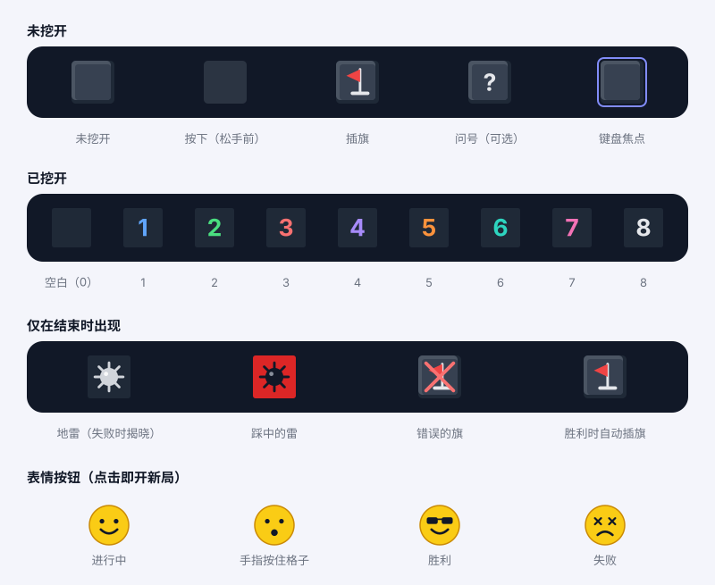

### 2.3 基本操作

| 操作 | 作用 |
| --- | --- |
| **挖开** | 挖开一个未挖开、未插旗的格子。是雷 → 失败；是数字 → 显示数字；是空白 → 自动展开（见 2.4） |
| **插旗 / 拔旗** | 在未挖开的格子上插旗，再操作一次拔掉 |
| **快速挖开**（Chord） | 对一个已挖开的数字格操作：如果它周围的旗数**等于**它的数字，一次性挖开周围所有未插旗的格子 |

快速挖开时，如果旗插错了，会挖到雷，按正常失败处理。旗数不等于数字时，快速挖开无效，周围未挖开的格子短暂闪一下作为提示。

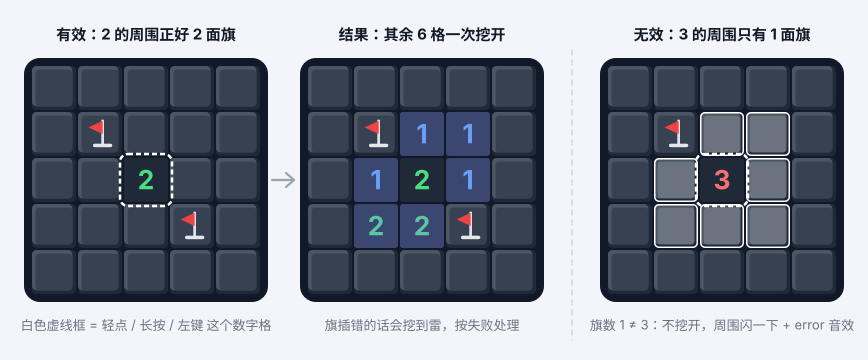

左图：数字 2 周围正好插了 2 面旗，按下后其余 6 格一次挖开（中图紫色高亮）。右图：数字 3 周围只有 1 面旗，快速挖开无效，周围未挖开的格子闪一下。

### 2.4 自动展开

挖开一个空白格（数字为 0）时，自动挖开它周围的 8 格；如果其中又有空白格，继续向外扩散，直到边界都是数字格为止。插旗的格子不会被自动展开挖开。

实现用 BFS 队列而不是递归，避免高级棋盘大片空白时栈溢出。

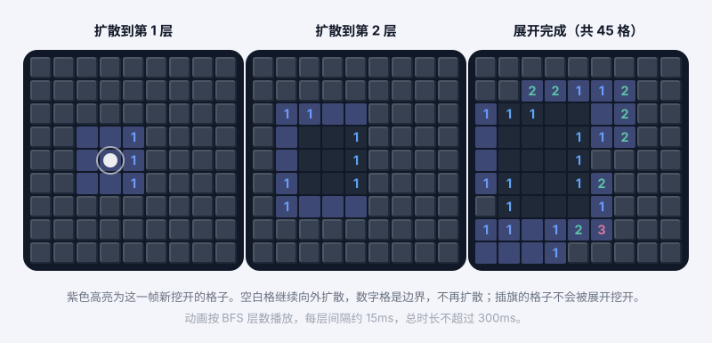

上图是同一次点击的三个动画帧，紫色为这一帧新挖开的格子。动画按 BFS 层数逐层播放（见 8 节）。

### 2.5 第一下必定安全

- 地雷**在第一次挖开时才生成**，而不是开局时。
- 第一次挖开的格子**及其周围 8 格**都不放雷，保证第一下一定是空白格，能展开出一片区域，不会开局就要猜。安全区内除了点击的那一格，其他格子仍可能显示数字（它们的雷在安全区外）。
- 如果第一下在角落或边上，排除的格子相应变少（4 格或 6 格）。
- 开局前插旗是允许的；生成地雷时忽略这些旗（旗下面可能有雷也可能没有）。

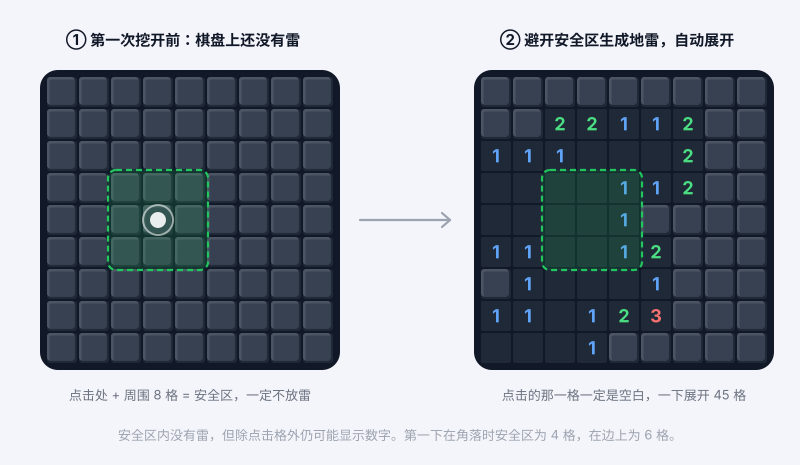

### 2.6 胜负

- **胜利**：所有**不是雷**的格子都已挖开。不要求把雷全部插上旗；胜利时自动给剩下的雷插旗。
- **失败**：挖开了一颗雷（包括快速挖开时挖到）。揭晓所有地雷，标出错误的旗，被踩中的雷底色为红。
- 结束后棋盘只读，不再响应挖开 / 插旗。

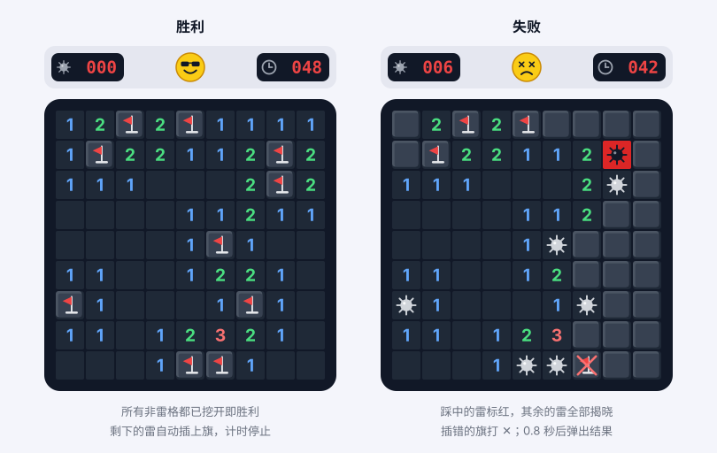

左图：胜利时剩下的雷自动插旗，表情变为 😎。右图：失败时踩中的雷底色变红，其余的雷全部揭晓，插错的旗打 ✕，表情变为 😵。

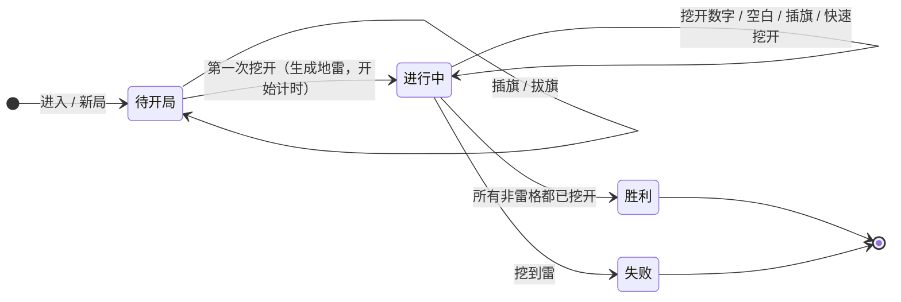

## 3. 界面布局

整个页面从上到下分为：**顶栏 → 难度切换 → 状态栏 → 棋盘 → 底部控制区**。

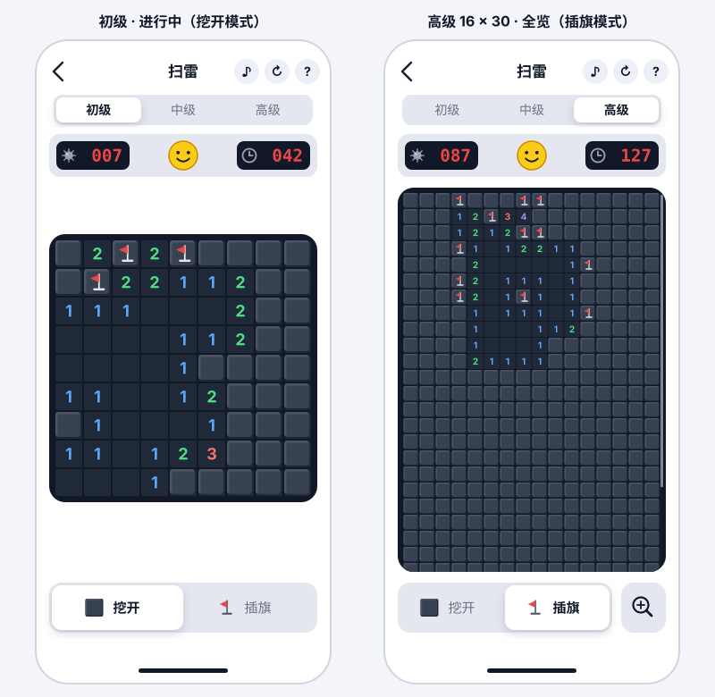

左图（初级）：挖开模式，已插 3 面旗，剩余雷数显示 007。棋盘不需要缩放，所以底部没有 🔍 按钮。右图（高级，竖屏 16 × 30）：插旗模式，全览档下棋盘超出一屏，右侧细条为滚动条；底部右侧为缩放按钮。

### 3.1 各区域说明

| 区域 | 内容 | 说明 |
| --- | --- | --- |
| 顶栏 | 返回、标题、音效开关、重新开始、玩法说明 | 沿用合集其他游戏的顶栏规范 |
| 难度切换 | 「初级 / 中级 / 高级」分段按钮 | 对局中切换会弹窗确认（见 7 节） |
| 状态栏 | 左：剩余雷数；中：表情按钮；右：计时 | 剩余雷数 = 地雷总数 − 已插旗数，可以为负数；表情按钮点击即开新局 |
| 棋盘 | 列 × 行的方格 | 游戏面板在浅色、深色主题下**都使用固定的棋盘配色**（见 9 节），保证数字颜色辨识度 |
| 底部控制区 | 「挖开 / 插旗」分段切换；缩放按钮（仅中级、高级显示） | 固定在屏幕底部，避开底部安全区 |

**表情按钮**：进行中 🙂；手指按住格子时 😮；胜利 😎；失败 😵（样式见 2.2 的配图）。

### 3.2 格子尺寸

以格子边长 **S** 为基准：

| 元素 | 尺寸 |
| --- | --- |
| 格子 | S × S，格子之间 1px 间隙 |
| 数字 | 字号约 0.6S，粗体 |
| 旗 / 雷图标 | 约 0.6S |
| 未挖开格子的凸起效果 | 上左高光、下右阴影，各约 S/12 |

**自适应**：全览档下宽度方向始终放得下（不出现横向滚动），高度方向最小 22px，放不下时纵向滚动：

```
棋盘可用宽度 = 屏幕宽度 − 左右边距
棋盘可用高度 = 屏幕高度 − 顶栏 − 难度切换 − 状态栏 − 底部控制区 − 安全区 − 边距
S_w = 可用宽度 / 列数
S_h = 可用高度 / 行数
S   = min(48px, S_w, max(22px, S_h))
```

实测尺寸：

| 屏幕 | 初级 S | 中级 S | 高级 S |
| --- | --- | --- | --- |
| iPhone SE（375 × 667） | 37px | 20px | 20px（16 × 30，纵向滚动） |
| 大屏手机（430 × 932） | 43px | 24px | 22px（16 × 30，略需纵向滚动） |
| 桌面（1280 × 800） | 48px | 31px | 31px（30 × 16） |

小屏上中级、高级的格子只有 20px 左右，需要精确点击时用放大档（见 3.3）。

### 3.3 缩放与滚动

中级、高级在小屏上格子只有 22px 左右，手指不好点准，所以提供**两档缩放**：

| 档位 | 格子大小 | 说明 |
| --- | --- | --- |
| 全览（默认） | 按 3.2 计算 | 尽量一屏放下整个棋盘 |
| 放大 | 固定 **40px** | 棋盘超出屏幕，在棋盘区域内**单指拖动滚动** |

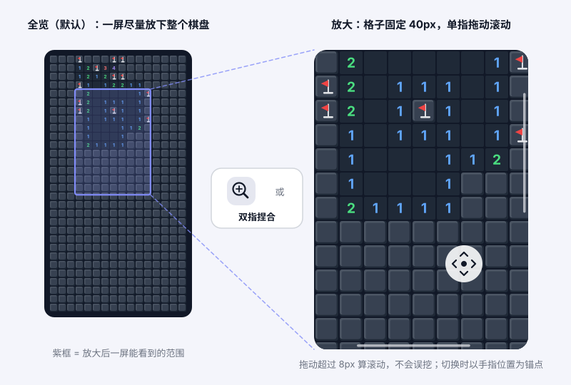

左图为高级棋盘的全览档，紫框是放大后一屏能看到的范围；右图为放大档，右侧和底部的细条是滚动条。

- 底部控制区右侧的 🔍 按钮在两档之间切换；**双指捏合**也可以切换（捏开 → 放大，捏合 → 全览），不做连续缩放。
- 切换时以手指位置（或屏幕中心）为锚点，保持该处的格子不动。
- 放大档下，单指拖动超过 8px 视为滚动，不触发挖开；按下后 8px 内抬起才算点击。
- 项目统一屏蔽了页面级缩放手势（`pwa.js`），棋盘区域的捏合由游戏自行处理。
- 初级不需要缩放，隐藏 🔍 按钮。

## 4. 交互设计

### 4.1 手机：操作模式

底部控制区的「⛏ 挖开 / 🚩 插旗」决定**轻点**格子的效果，**长按**（约 350ms）始终执行相反的操作：

| 当前模式 | 轻点未挖开格子 | 长按未挖开格子 | 轻点 / 长按已挖开的数字 |
| --- | --- | --- | --- |
| 挖开模式（默认） | 挖开 | 插旗 / 拔旗 | 快速挖开 |
| 插旗模式 | 插旗 / 拔旗 | 挖开 | 快速挖开 |

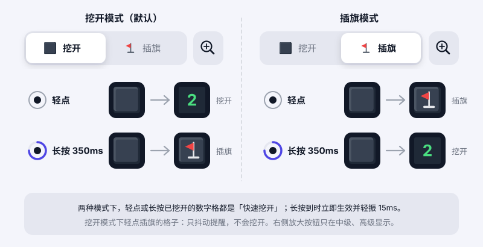

- 长按达到时长时立即执行（不等抬起），同时轻振 15ms 并让格子做一次按压动画，告诉玩家“已生效”。
- 长按过程中手指移出格子或开始滚动，则取消。
- 在插旗的格子上轻点（挖开模式）：无反应，格子轻微抖动提醒“先拔旗”。
- 模式选择保存在本机，下次打开保持上次的选择。
- 每局开始时**不**自动切回挖开模式。

### 4.2 桌面：鼠标与键盘

| 操作 | 作用 |
| --- | --- |
| 左键 | 挖开；对数字格为快速挖开 |
| 右键 | 插旗 / 拔旗（屏蔽浏览器右键菜单） |
| 中键，或左右键同时按下 | 快速挖开 |
| 左键按住不放 | 被按的格子显示为按下状态，表情变 😮；移开再松开则取消 |
| 快速挖开按住不放 | 周围 8 个未挖开格子一起显示为按下状态 |

键盘（可选，便于无鼠标操作）：

| 按键 | 作用 |
| --- | --- |
| 方向键 | 移动焦点格（焦点格显示描边） |
| `Space` / `Enter` | 挖开 / 快速挖开 |
| `F` | 插旗 / 拔旗 |
| `N` | 新局 |

### 4.3 点击判定

- 点击判定以**抬起**为准（长按除外），按下时只显示按下状态，方便玩家在松手前移走取消。
- 格子之间的 1px 间隙归属于最近的格子，不留点不中的死区。
- 踩雷、胜利动画播放期间忽略所有输入。自动展开的动画不阻塞操作：局面在动画开始前已经更新，玩家可以立刻继续点。

### 4.4 计时

- 第一次挖开时开始计时（插旗不开始计时），胜利或失败时停止。
- 显示整数秒，上限 999；内部按毫秒记录，最佳成绩精确到 0.1 秒。
- 页面切到后台（`visibilitychange` 隐藏）时**暂停计时**，回来后继续。暂停期间棋盘**不遮挡**——这是个人游戏，不做防作弊。

## 5. 判定逻辑

### 5.1 数据结构

```js
// 用一维数组存储，index = y * cols + x
// mine:     Uint8Array，1 = 有雷
// count:    Uint8Array，周围雷数 0–8（生成地雷后一次性算好）
// state:    Uint8Array，0 = 未挖开，1 = 已挖开，2 = 插旗，3 = 问号（可选）
```

### 5.2 生成地雷（第一次挖开时）

```js
function placeMines(cols, rows, mines, safeIndex) {
  const safe = new Set(neighbors(safeIndex, cols, rows)).add(safeIndex);
  const pool = [];
  for (let i = 0; i < cols * rows; i++) if (!safe.has(i)) pool.push(i);
  shuffle(pool);                       // Fisher–Yates
  const mine = new Uint8Array(cols * rows);
  for (let k = 0; k < mines; k++) mine[pool[k]] = 1;
  return mine;
}
```

候选格数量一定大于雷数（最小的初级是 81 − 9 = 72 > 10），不会出现放不下的情况。

### 5.3 挖开与自动展开

```js
function reveal(start) {
  const queue = [start];
  while (queue.length) {
    const i = queue.pop();
    if (state[i] !== HIDDEN) continue;
    state[i] = OPEN;
    opened++;
    if (count[i] === 0)
      for (const n of neighbors(i)) if (state[n] === HIDDEN) queue.push(n);
  }
}
```

插旗（`FLAG`）的格子不是 `HIDDEN`，自然不会被展开。

### 5.4 胜利判定

维护已挖开数 `opened`，当 `opened === cols × rows − mines` 时胜利。每次挖开后检查，无需扫描全盘。

### 5.5 难度预期

| 难度 | 预期胜率（普通玩家） | 说明 |
| --- | --- | --- |
| 初级 | 70%–90% | 偶尔需要猜 |
| 中级 | 40%–70% | 大部分可推理，残局常需 50/50 猜测 |
| 高级 | 20%–40% | 密度高，猜测次数多 |

经典扫雷**不保证无需猜测**，本版本保持一致。“无猜模式”作为后续扩展（见 12 节）。

## 6. 游戏流程

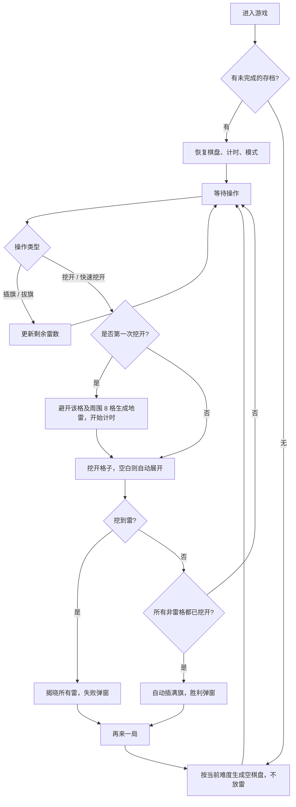

## 7. 结束弹窗与其他功能

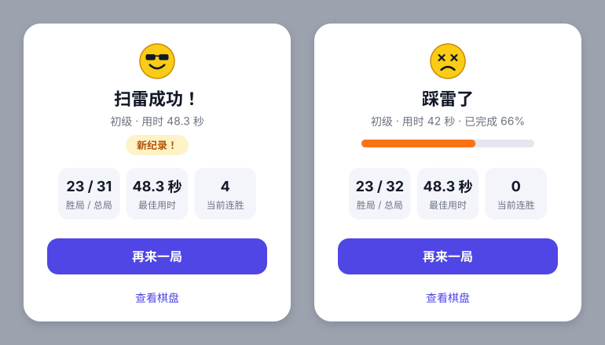

- **胜利弹窗**：标题「扫雷成功！」，显示用时、难度；如果打破纪录，显示「新纪录！」并高亮。下方显示该难度的胜局数 / 总局数、最佳用时、当前连胜。
- **失败弹窗**：标题「踩雷了」，显示用时、已挖开的进度百分比（已挖开数 / 非雷格总数），以及该难度的统计。弹窗**延迟约 0.8 秒**弹出，让玩家先看清雷的分布。
- **查看棋盘**：关闭弹窗后可以回看整个棋盘（只读），表情按钮保持 😎 / 😵，点它开新局。
- **难度切换 / 重新开始**：
  - 还没挖开过任何格子时，直接切换；
  - 已经挖开过格子且对局未结束时，弹窗确认「放弃本局吗？」，放弃计为一局失败；
  - 对局已结束时，直接切换。
- **存档**：每次挖开、插旗后把难度、棋盘方向、地雷布局、格子状态、已用时间写入 `localStorage`，刷新或退出后可继续。已结束的对局不保存。
- **统计**（按难度分别记录）：总局数、胜局数、最佳用时（前 5 名及日期）、当前连胜、最长连胜。高级的竖版 16 × 30 和横版 30 × 16 视为同一难度，统计合并。
- **设置**（玩法说明弹窗底部）：
  - 问号标记：默认关闭。打开后，右键 / 长按在「无 → 旗 → 问号 → 无」之间循环；问号不阻止挖开，不计入旗数；
  - 长按时长：短（250ms）/ 中（350ms，默认）/ 长（500ms）。
- **玩法说明**：点顶栏「?」弹出，内容为第 2、4 节的精简版，重点讲清手机上的模式切换和长按。首次进入游戏自动弹出一次。

## 8. 动效与音效

| 时机 | 动效 | 音效（`js/sfx.js`） |
| --- | --- | --- |
| 挖开单个格子 | 凸起变平，数字淡入（80ms） | `tap` |
| 自动展开一片 | 从起点按 BFS 层数向外扩散，每层间隔约 15ms，总时长上限 300ms | `move` |
| 插旗 / 拔旗 | 旗从上方落下并回弹（150ms）/ 淡出 | `place` / `select` |
| 快速挖开无效 | 周围未挖开的格子闪一下（150ms） | `error` |
| 在插旗格上轻点（挖开模式） | 格子左右抖动 | `error` |
| 切换挖开 / 插旗模式 | 分段按钮滑块平移 | `select` |
| 踩雷 | 被踩的雷变红并震动棋盘（200ms），其余雷按距离由近到远依次显现（总时长约 600ms），错误旗打 ✕ | `lose` |
| 胜利 | 剩余雷位置依次插旗，棋盘整体轻微发光 | `win` |
| 新纪录 | 弹窗中「新纪录！」字样放大回弹 | — |

支持振动的设备上：长按生效时轻振 15ms，踩雷时振动 `[60, 40, 120]`，可随音效开关一起关闭。

自动展开的音效只在每次操作时播放一次，不按格子数重复播放。

## 9. 视觉规范

棋盘采用**深色底的扁平化风格**，同时保留未挖开格子的轻微凸起，区分“挖过 / 没挖过”。

| 用途 | 色值 |
| --- | --- |
| 棋盘底色 / 格子间隙 | `#111827` |
| 未挖开格子 | `#374151`，高光 `#4b5563`，阴影 `#1f2937` |
| 未挖开格子 · 按下状态 | `#2b3442` |
| 已挖开格子 | `#1f2937` |
| 踩中的雷底色 | `#dc2626` |
| 旗 | `#ef4444`（旗面）+ `#e5e7eb`（旗杆） |
| 错误旗 ✕ | `#f87171` |
| 键盘焦点描边 | `#818cf8`，2px |

数字颜色沿用经典扫雷的配色习惯，针对深色底提亮：

| 数字 | 色值 |
| --- | --- |
| 1 | `#60a5fa`（蓝） |
| 2 | `#4ade80`（绿） |
| 3 | `#f87171`（红） |
| 4 | `#a78bfa`（紫） |
| 5 | `#fb923c`（橙） |
| 6 | `#2dd4bf`（青） |
| 7 | `#f472b6`（粉） |
| 8 | `#e5e7eb`（浅灰） |

经典版的 4（深蓝）、5（栗色）、7（黑色）在深色底上看不清，所以换成了紫、橙、粉。数字本身就能区分，不依赖颜色，色弱用户不受影响。

渲染方式：初级、中级用 DOM（CSS Grid）即可；高级 480 格也在可接受范围内，统一用 DOM，便于做按下状态和动画。如果真机上展开动画掉帧，再改为 canvas。

## 10. 边界情况

| 场景 | 处理 |
| --- | --- |
| 第一下点在角落 / 边上 | 安全区只排除实际存在的邻格，正常展开 |
| 开局前插旗，第一下挖开旗旁边 | 生成地雷时忽略旗；旗下有没有雷由随机决定 |
| 旗数超过雷数 | 允许，剩余雷数显示负数（如 `-02`） |
| 快速挖开时旗插错 | 挖到雷，按正常失败处理；该雷标红，错误旗打 ✕ |
| 快速挖开时旗数不等于数字 | 无效，周围未挖开格子闪一下 |
| 快速挖开触发了展开 | 每个被挖开的空白格都正常自动展开 |
| 对已挖开的空白格操作 | 无反应 |
| 长按过程中开始拖动（放大档） | 取消长按，转为滚动 |
| 动画过程中操作 | 踩雷、胜利动画期间忽略；展开动画期间正常响应 |
| 弹窗打开时 | 遮罩拦截所有操作 |
| 对局中旋转屏幕 | 棋盘方向不变（高级保持开局时的 16 × 30 或 30 × 16），只重新计算 S；放不下时自动进入可滚动状态 |
| 对局中切到后台 / 锁屏 | 暂停计时，存档已写入 |
| 计时超过 999 秒 | 显示停在 999，内部继续计时，统计照常记录 |
| 存档数据损坏或版本不兼容 | 丢弃存档，开新局 |
| 胜利的同时旗插错了位置 | 不可能出现：胜利时所有非雷格都已挖开，而插旗的格子不能被挖开，所以旗一定都在雷上 |

## 11. 决策记录

| 问题 | 结论 |
| --- | --- |
| 难度参数 | 沿用经典 9×9/10、16×16/40、30×16/99（v0.1） |
| 高级在竖屏放不下 | 竖屏开局时转置为 16 × 30，难度不变，统计合并（v0.1） |
| 手机上如何插旗 | 「挖开 / 插旗」模式切换 + 长按执行相反操作（v0.1，见 4.1） |
| 第一下是否安全 | 第一下及周围 8 格都无雷，保证开局有一片展开（v0.1，见 2.5） |
| 问号标记 | 默认关闭，可在设置中打开（v0.1） |
| 胜利是否要求插满旗 | 不要求，挖开所有非雷格即胜利，胜利时自动插满（v0.1） |
| 是否保证无需猜测 | 不保证，与经典一致；无猜模式留作扩展（v0.1） |
| 中途放弃 | 已挖开过格子才计为失败，影响连胜（v0.1） |

### 待确认事项

1. **长按时长**：350ms 是常见值，但部分玩家会觉得慢。试玩后再确认默认值，或改为默认 300ms。
2. **小屏高级的可玩性**：iPhone SE 上高级全览档格子只有 22px，主要靠放大档操作。需要真机试玩，确认拖动滚动和点击判定的手感，必要时把放大档改为 44px。
3. **中途放弃是否计为失败**：计为失败可以防止“开局不好就重开”刷胜率，但对休闲玩家不太友好。可以考虑只影响连胜、不计入总局数。

## 12. 接入合集

- 目录：`games/minesweeper/`，文件 `index.html`、`minesweeper.css`、`minesweeper.js`（界面与交互）、`board.js`（纯逻辑：生成地雷、展开、快速挖开、胜负判定，不依赖 DOM）。
- 在 `js/games.js` 的 `H5_GAMES` 中追加一项（`id: 'minesweeper'`，名称「扫雷」，标签 `['益智']`），并在 `icons/` 下新增 `minesweeper.svg`。
- 修改 `sw.js` 顶部的 `VERSION`。
- `tests/smoke.mjs` 增加 `board.js` 的测试：第一下及周围无雷、地雷数正确、数字计算正确、自动展开不越过数字格和旗、快速挖开的条件、胜利判定。

## 13. 后续可扩展

- **无猜模式**：生成地雷后用求解器验证从第一下开始能纯靠推理解完，不能则重新生成。
- **每日挑战**：同一天所有人同一张图（用日期作随机种子），比用时。
- **自定义难度**：自选行列数和地雷数。
- **回放**：记录每一步操作，结束后可以回放本局。
- **3BV 统计**：计算棋盘的最少点击次数，显示效率（3BV/s），给进阶玩家参考。
