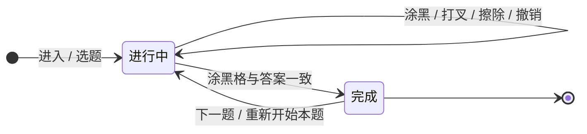
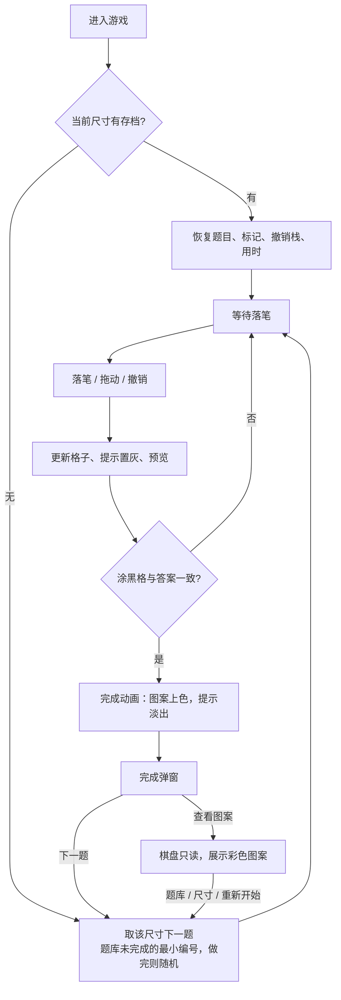

# 数织 · 产品设计文档

> 版本：v0.1（草案）　｜　所属项目：H5 游戏合集　｜　日期：2026-11-18

## 修订记录

| 版本 | 变更 |
| --- | --- |
| v0.1 | 初稿：规则、尺寸档位、题库与唯一解保证、涂黑 / 打叉两种笔、拖动连涂、提示数置灰、完成展示、存档与统计 |

## 1. 概述

**数织**（Nonogram，又称 Picross、绘图方块）是一款单人逻辑解谜游戏。棋盘每一行的左侧、每一列的上方都写着一串数字（**提示数**），表示这一行 / 列里连续涂黑的格子分成几段、每段多长。玩家根据提示推理出哪些格子要涂黑，全部涂对后会拼出一幅像素图。

| 项 | 说明 |
| --- | --- |
| 平台 | 手机竖屏为主，兼容桌面浏览器；纳入现有 PWA，离线可玩 |
| 单局时长 | 5 × 5 约 1 分钟，10 × 10 约 3–8 分钟，15 × 15 约 10–25 分钟 |
| 尺寸 | **5 × 5 / 10 × 10 / 15 × 15** 三档 |
| 核心承诺 | **每道题都有且只有一个解，并且只靠逐行逐列推理就能解出，不需要猜** |
| 设计原则 | **单手可玩**：底部切换「涂黑 / 打叉」两种笔，在棋盘上点一下或拖一下即可，不依赖长按和右键 |

## 2. 核心规则

### 2.1 提示数

- 每行左侧、每列上方各有一组提示数，按从左到右（从上到下）的顺序列出这一行（列）中**每一段连续涂黑格子的长度**。
- 相邻两段之间**至少隔一个空白格**；段与边界之间可以有任意个空白格（包括 0 个）。
- 一行完全没有涂黑的格子时，提示数显示为 **0**。

例：提示数 `3 1` 的一行 5 格，唯一的排法是 `■■■□■`；提示数 `2` 的一行 5 格有 4 种排法，需要结合列的提示才能确定。

### 2.2 格子

每个格子有三种状态，由玩家标记：

| 状态 | 外观 | 说明 |
| --- | --- | --- |
| 未操作 | 白色（深色主题为深灰）空格 | 初始状态，表示“还不确定” |
| 涂黑 | 主题色实心方块 | 玩家认为这一格要涂黑 |
| 打叉 | 灰色 ✕ | 玩家确定这一格是空白，作为推理时的记号 |

打叉只是辅助记号，**不参与胜负判定**——不打叉也能完成。

### 2.3 胜利

- 当玩家涂黑的格子与答案**完全一致**时立即完成（多涂、少涂都不算）。未操作和打叉的格子都视为空白。
- 因为每道题答案唯一，“涂黑格与答案一致”等价于“所有行列都满足提示数”。
- **没有失败**：不计错误次数、不设时间限制，玩家总能把一局做完。



## 3. 尺寸与题目

### 3.1 三档尺寸

| 尺寸 | 内置题数 | 每行（列）提示数最多 | 推理难度 |
| --- | --- | --- | --- |
| 5 × 5 | 12 | 3 | 入门：多数行列一眼可定 |
| 10 × 10 | 12 | 4 | 中等：需要行列交替推理 |
| 15 × 15 | 8 | 5 | 进阶：需要多轮交替推理，常用“重叠法”“边界推进” |

尺寸用顶部分段按钮切换。**三档尺寸各自保存进度**，切换尺寸不会丢失另一档正在做的题，因此切换不需要确认。

### 3.2 题目来源：内置题库 + 随机题

- **内置题库**（主要来源）：每道题是一幅手绘像素图（爱心、小猫、熊猫、城堡……），带名称和展示颜色。每档按固定顺序排列，编号 No.01、No.02……
- **随机题**（补充来源）：题库做完后，或玩家在题库页点「随机一题」时，实时生成一张随机图案。随机图案按左右对称的概率较高，看起来更像图形。
- 「下一题」的规则：取当前尺寸中**编号最小的未完成题**；该尺寸题库全部完成后，改为随机题。

### 3.3 唯一解与可推理保证

“必须有解”在数织里有三层含义，每道题（包括随机题）都必须全部满足：

| 层次 | 含义 | 如何保证 |
| --- | --- | --- |
| ① 有解 | 至少存在一种涂法满足所有提示 | 提示数由一幅现成的图计算得来，这幅图本身就是一个解 |
| ② 唯一解 | 只有这一种涂法 | 由 ③ 推出：只靠必然成立的推理就能确定每一格，不存在第二种可能 |
| ③ 可推理 | 不需要试错猜测 | 用**行列逻辑求解器**（见 6.2）只靠逐行逐列推理把题解完，且结果与原图一致 |

- 题库中的每幅图都在测试中用求解器校验；画好但卡住（需要猜）的图，按求解器给出的“最少改动”微调个别像素，直到可推理。
- 测试还用一个**独立的回溯计数器**（求解器 + 分支搜索，数到第 2 个解即停）再确认一次解数恰好为 1。
- 随机题：生成后立即校验，不满足就重新生成；另外要求每行每列都至少有一个涂黑格（全空行没有推理乐趣）。实测 15 × 15 平均 1 毫秒内即可得到一题，设 400 次重试上限，超过则改为从题库随机取一道。

## 4. 界面布局

整个页面从上到下分为：**顶栏 → 尺寸切换 → 状态栏 → 棋盘 → 底部工具栏**。

```
┌──────────────────────────────┐
│ ‹  ▦      数织       🔊  ?  │ 顶栏
│ [ 5×5 | 10×10 | 15×15 ]      │ 尺寸切换
│  No.03 · ？？？      02:15   │ 状态栏
│ ┌────┬────────────────────┐  │
│ │预览│   列提示（竖排）    │  │
│ ├────┼────────────────────┤  │
│ │行提│                    │  │
│ │示（│      格子区域      │  │ 棋盘
│ │横排│                    │  │
│ │）  │                    │  │
│ └────┴────────────────────┘  │
│  ↶   [ ■ 涂黑 | ✕ 打叉 ]  ⟲  │ 底部工具栏
└──────────────────────────────┘
```

### 4.1 各区域说明

| 区域 | 内容 | 说明 |
| --- | --- | --- |
| 顶栏 | 返回、题库、标题、音效开关、玩法说明 | 沿用合集其他游戏的顶栏规范；「题库」按钮放在左侧（同扫雷的重新开始按钮位置） |
| 尺寸切换 | 「5×5 / 10×10 / 15×15」分段按钮 | 切换即时生效，不需要确认（见 3.1） |
| 状态栏 | 左：题号与名称；右：计时 | 未完成的题名称显示为「？？？」，完成后才揭晓；随机题显示「随机题」 |
| 棋盘 | 左上角预览、列提示、行提示、格子区域 | 左上角的小预览实时显示玩家已涂黑的图案 |
| 底部工具栏 | 撤销、「涂黑 / 打叉」分段切换、重新开始本题 | 固定在屏幕底部，避开底部安全区；分段切换在拇指最容易够到的中间 |

### 4.2 棋盘结构

- **提示区**：列提示竖排、底端对齐；行提示横排、右端对齐。提示区底色比格子略深，与格子区明确分开。
- **格线**：细线分隔每一格；**每 5 格画一条粗线**（10 × 10、15 × 15），便于数格子；外框为最粗的线。
- **当前行列高亮**：手指按住（或键盘焦点所在）的格子，其所在行和列整条浅色高亮，对应的行提示、列提示也高亮，方便对照数字。

### 4.3 尺寸自适应

以格子边长 **S** 为基准，提示区的尺寸随 S 缩放：

| 元素 | 尺寸 |
| --- | --- |
| 格子 | S × S |
| 提示数字 | 字号 clamp(10px, 0.5S, 18px)，粗体，等宽数字 |
| 行提示每个数字的宽度 | 一位数 max(11px, 0.6S)，两位数 max(15px, 0.9S)，逐个数字累加 |
| 列提示每个数字的高度 | max(11px, 0.6S)；宽度就是一格 S，两位数略收紧字距 |
| 行提示区宽度 / 列提示区高度 | 按本题最长的那组提示数计算 |

**计算方法**：S 从上限开始逐 1px 减小，直到“行提示区宽度 + 列数 × S”放得进可用宽度、“列提示区高度 + 行数 × S”放得进可用高度。S 上限 48px，下限 16px；到下限仍放不下时允许棋盘区域滚动。

实测尺寸（不同题目的提示数长度不同，S 有小幅差异；题库内所有题均无需滚动）：

| 屏幕 | 5 × 5 S | 10 × 10 S | 15 × 15 S |
| --- | --- | --- | --- |
| iPhone SE（375 × 667） | 48px | 26–30px | 18–21px |
| 大屏手机（430 × 932） | 48px | 30–35px | 21–25px |
| 桌面（1280 × 800） | 48px | 44–48px | 30–33px |

15 × 15 在小屏上格子较小。10 × 10 与 15 × 15 提供**放大档**（与扫雷相同）：目标格子边长 40px，棋盘超出可视区后在棋盘区域内拖动滚动；右下角 🔍 按钮与双指捏合切换两档，不做连续缩放。放大后格子上仍可拖动连涂。5 × 5 不显示放大按钮。

## 5. 交互设计

### 5.1 两种笔

底部的「■ 涂黑 / ✕ 打叉」决定在格子上操作时用哪种笔，选择保存在本机。

| 起点格当前状态 | 用涂黑笔 | 用打叉笔 |
| --- | --- | --- |
| 未操作 | 涂黑 | 打叉 |
| 已涂黑 | **擦除**（恢复未操作） | 改为打叉 |
| 已打叉 | 改为涂黑 | **擦除**（恢复未操作） |

即：用同一种笔点已经标过的格子是擦除；用另一种笔点则是改写。不需要单独的橡皮擦。

### 5.2 拖动连涂

按住一个格子后拖动，可以沿**同一行或同一列**连续操作：

- **起点决定本笔的动作**（按 5.1 的表）：本笔所有经过的格子都做同一种动作。
- **方向锁定**：手指第一次离开起点格时，按水平 / 竖直哪个方向移动得多，锁定为沿行或沿列；之后手指偏离也只投影到这一行（列）上。这样斜着划也不会涂歪。
- **只改合适的格子**：
  - 标记笔（起点未操作）：只改未操作的格子，**不覆盖**已有的另一种标记——可以放心从涂黑格旁边拖过去打叉；
  - 擦除（起点与笔同类）：只擦同一种标记；
  - 改写（起点是另一种标记）：未操作格和起点同类的格子都改成当前笔。
- **可回退**：拖动途中往回拉，超出当前范围的格子恢复原状，松手时才最终确定。
- 一笔（从按下到松手）算**一步**撤销。

### 5.3 手机与桌面

| 操作 | 手机 | 桌面 |
| --- | --- | --- |
| 用当前笔操作 | 轻点 / 拖动 | 左键点击 / 拖动 |
| 用另一种笔操作 | 先切换底部的笔 | **右键**点击 / 拖动（屏蔽浏览器右键菜单） |
| 撤销 | 底部「↶」 | 同左，或 `Ctrl/⌘ + Z`、`U` |

键盘（可选，便于无鼠标操作）：

| 按键 | 作用 |
| --- | --- |
| 方向键 | 移动焦点格（焦点格显示描边，所在行列高亮） |
| `Space` / `Enter` | 用当前笔操作焦点格 |
| `F` / `X` | 用涂黑笔 / 打叉笔操作焦点格 |
| `Tab` | 切换当前笔 |
| `Ctrl/⌘ + Z`、`U` | 撤销 |

### 5.4 其他

- **撤销**：不限步数（存档中保留最近 200 步）。撤销栈为空时按钮置灰。
- **重新开始本题**：清空所有标记、计时归零。有标记时弹窗确认。
- **计时**：第一次落笔开始计时；完成时停止；页面切到后台时暂停，回来继续。显示 `mm:ss`。
- **完成后**棋盘只读，不再响应落笔，撤销按钮置灰；「重新开始本题」可以清空后再做一遍。

## 6. 判定逻辑

### 6.1 数据结构

```js
// 一维数组，index = y * w + x
// puzzle.sol:   Uint8Array，1 = 答案中涂黑
// rowClues / colClues: number[][]，每行 / 每列的提示数，全空为 []
// game.cells:   Uint8Array，0 = 未操作，1 = 涂黑，2 = 打叉
// game.undo:    [[index, 旧值], ...][]，每一笔一项
```

### 6.2 行列逻辑求解器

**单行推理**：给定一行的提示数和已经确定的格子，枚举所有合法排法，凡是在每一种排法里都涂黑的格子必定涂黑，都空白的必定空白。用动态规划实现，不逐一枚举：

```js
// can[k][i]：从第 i 格开始，能否合法放下第 k 段及之后的所有段
// 转移：第 i 格留白 → can[k][i+1]；
//      或第 k 段从 i 开始（i..i+len-1 都不是已知白，下一格不是已知黑）→ can[k+1][i+len+1]
// 再从 (0, 0) 正向走一遍可达状态，记录每格“可能黑”“可能白”
```

复杂度 O(长度 × 段数)，15 格的一行不到 1 微秒级。

**整盘求解**：所有行列先各做一次单行推理；之后只重新处理“有格子刚被确定”的行列，直到没有新进展。结果：

| 结果 | 含义 |
| --- | --- |
| `solved` | 所有格子都确定 → 唯一解且可推理 |
| `stuck` | 还有格子无法确定 → 需要猜（可能多解），题目不合格 |
| `contradiction` | 某行无合法排法 → 提示数自相矛盾 |

**解数计数**（仅测试用）：在 `stuck` 的局面上任选一个未知格分别假设黑 / 白，递归求解，数到第 2 个解就停。

### 6.3 提示数置灰

每次落笔后重新计算受影响的那一行和那一列：

1. **整行满足**：这一行涂黑格组成的段与提示数完全一致 → 整组提示置灰。不打叉也会生效。
2. **从两端推进**：从左（上）端开始往里扫，只要还没遇到“未操作”的格子，凡是被打叉或边界封闭的完整段，依次与提示数从头对应；长度一致就把对应的数字置灰，一旦对不上就停止。从右（下）端同样处理。
3. 涂黑段的数量已经多于提示数时，不置灰任何数字。

置灰只说明“这一行的标记与数字对得上”，**不代表填对了**（例如提示 `2`、玩家涂在错误位置也会置灰），这与常见数织应用一致，不提供答案比对。

### 6.4 胜利判定

每一笔结束后，比较所有格子“是否涂黑”与答案，一致则完成。225 格逐一比较开销可忽略。

## 7. 游戏流程



## 8. 完成弹窗与其他功能

- **完成动画**：涂黑格按从左上到右下的对角线顺序依次变为该题的展示颜色，空白格和打叉记号淡去，格线变淡，提示区变淡，拼出一幅干净的彩色像素图（约 1 秒）。
- **完成弹窗**：标题「完成！」；中间是彩色的图案缩略图和名称（如「熊猫」）；下面一行显示尺寸和用时；打破该题纪录时显示「新纪录！」。底部统计：该尺寸已完成题数 / 题库总数、该题最佳用时、随机题完成数。按钮「查看图案」（关闭弹窗，留在棋盘上欣赏）和「下一题」。
- **题库**：点顶栏左侧按钮打开。显示当前尺寸的所有题目卡片：
  - 已完成：彩色缩略图 + 名称 + 最佳用时；
  - 未完成：灰色问号 + 编号，正在做且有标记的题注明「进行中」；
  - 正在做的题加主题色边框；
  - 底部「随机一题」按钮。
  - 换题时如果当前题已有标记，弹窗确认「放弃当前进度？」。
- **存档**：每一笔结束、撤销、切到后台时写入 `localStorage`。按尺寸分别保存一局：题号（随机题保存整幅图）、格子标记、撤销栈（最近 200 步）、已用时间。已完成的题不保存进度。
- **统计**：每道题题库题记录最佳用时与首次完成日期；随机题按尺寸记录完成数。
- **玩法说明**：点顶栏「?」弹出，首次进入自动弹出一次。内容为第 2、5 节的精简版。

本地存储键名：

| 键 | 内容 |
| --- | --- |
| `h5.nonogram.size` | 当前尺寸 |
| `h5.nonogram.tool` | 当前笔：`fill` / `cross` |
| `h5.nonogram.state` | 各尺寸的进行中存档 `{ 5: {...}, 10: {...}, 15: {...} }` |
| `h5.nonogram.solved` | 题库题完成记录 `{ 题号: { t: 最佳秒数, date } }` |
| `h5.nonogram.stats` | 随机题完成数 `{ 5: n, 10: n, 15: n }` |
| `h5.nonogram.helpSeen` | 是否看过玩法说明 |

## 9. 动效与音效

| 时机 | 动效 | 音效（`js/sfx.js`） |
| --- | --- | --- |
| 涂黑一格 | 方块从 70% 放大到 100%（100ms） | 起笔 `place`，拖动中每新增一格 `tap`（低音量） |
| 打叉一格 | ✕ 淡入 | 起笔 `tap` |
| 擦除 | 淡出 | 起笔 `select` |
| 某行 / 列提示刚好全部置灰 | 该组提示数字轻微闪亮 | `clear`（行列越多音调越高，封顶） |
| 撤销 | 被恢复的格子闪一下 | `move` |
| 切换笔 | 分段按钮切换 | `select` |
| 完成 | 图案按对角线依次上色，棋盘外框发光 | `win` |
| 新纪录 | 弹窗中「新纪录！」放大回弹 | — |

支持振动的设备上，起笔时轻振 10ms，完成时振动 `[20, 40, 20]`，随音效开关一起关闭。系统开启“减少动态效果”时，取消放大和上色的逐格延迟。

## 10. 视觉规范

棋盘采用“纸面”风格，跟随浅色 / 深色主题，与数独一致。

| 用途 | 浅色主题 | 深色主题 |
| --- | --- | --- |
| 格子底色 | `#ffffff` | `#1f2937` |
| 细格线 | `#d1d5db` | `#374151` |
| 每 5 格粗线 | `#6b7280` | `#6b7280` |
| 外框 | `#111827` | `#9ca3af` |
| 涂黑 | `#4338ca` | `#a5b4fc` |
| 打叉 | `#9ca3af` | `#6b7280` |
| 提示区底色 | `#eceefb` | `#161b26` |
| 提示数字 | `#111827` | `#e5e7eb` |
| 已满足的提示数字 | 同上，透明度 30% | 同左 |
| 当前行列高亮（格子 / 提示） | `#eef0ff` / `#c7d2fe` | `rgba(129,140,248,0.12)` / `rgba(129,140,248,0.35)` |
| 键盘焦点描边 | `#818cf8`，2px | 同左 |

- 涂黑格之间保留细格线，避免大片涂黑时数不清格数；完成后格线淡出，图案连成整体。
- 完成后的图案颜色取题库中每道题的 `color`；随机题统一使用主题色。
- 提示数字用 `font-variant-numeric: tabular-nums`，两位数（10–15）不挤压。

## 11. 边界情况

| 场景 | 处理 |
| --- | --- |
| 从涂黑格旁边拖过去打叉 | 打叉笔起点为未操作格时只改未操作格，不覆盖涂黑 |
| 拖动时手指斜着走 | 按第一次离开起点格的方向锁定行 / 列，之后只投影到该行（列） |
| 拖出棋盘外 | 投影到边界格，继续有效；松手时提交 |
| 拖动经过的格子都不需要改（例如沿一排涂黑格拖打叉笔） | 只有起点一格变化；没有变化的格子不播放音效 |
| 多指触摸 | 只跟踪第一根手指，其他手指忽略 |
| 完成后继续点格子 | 无反应；底部撤销置灰 |
| 0 提示的行 / 列 | 显示「0」并始终置灰（行内有涂黑时恢复正常颜色） |
| 切换尺寸 | 即时切换，各尺寸进度独立保存 |
| 换题（题库 / 随机）时当前题有标记 | 弹窗确认放弃 |
| 弹窗打开时 | 遮罩拦截所有操作 |
| 对局中旋转屏幕 / 窗口大小变化 | 重新计算 S，不影响进度 |
| 对局中切到后台 / 锁屏 | 暂停计时，存档已写入 |
| 存档损坏、版本不兼容、题库题被修改 | 丢弃该尺寸的存档，开该尺寸下一题 |
| 随机出题连续失败 | 400 次后改为从题库随机取一题（实测不会发生） |

## 12. 决策记录

| 问题 | 结论 |
| --- | --- |
| 尺寸档位 | 5 × 5 / 10 × 10 / 15 × 15（v0.1） |
| 题目来源 | 手绘题库为主，随机题为补充；都用求解器保证可推理（v0.1，见 3.3） |
| 是否允许需要猜的题 | 不允许，只用单行推理可解的题（v0.1） |
| 手机上如何打叉 | 底部「涂黑 / 打叉」切换，不用长按（v0.1，见 5.1） |
| 擦除方式 | 用同种笔点同种标记即擦除，不单设橡皮擦（v0.1） |
| 拖动方向 | 锁定为单行或单列（v0.1，见 5.2） |
| 是否纠错 | 不提供即时纠错和错误计数，与纸笔数织一致（v0.1） |
| 尺寸切换 | 各尺寸独立存档，切换不确认（v0.1） |
| 渲染方式 | DOM（CSS Grid）。15 × 15 共 225 格，性能足够，便于做动画和高亮（v0.1） |
| 小屏放大 | 10 × 10 / 15 × 15 提供固定 40px 放大档 + 拖动滚动；按钮与双指捏合切换（v0.2，对齐扫雷） |

### 待确认事项

1. **是否提供提示 / 检查**：当前不提供。可考虑“检查错误”按钮（标出与答案不符的涂黑格，每局限次）。
2. **随机题难度**：随机题普遍比手绘题容易（密度较高）。如需更难的随机题，可按求解轮数筛选。

## 13. 接入合集

- 目录：`games/nonogram/`，文件 `index.html`、`nonogram.css`、`nonogram.js`（界面与交互）、`logic.js`（纯逻辑：提示数、行列求解器、解数计数、随机出题、玩家盘面操作、存档，不依赖 DOM）、`puzzles.js`（内置题库）。
- 在 `js/games.js` 的 `H5_GAMES` 中追加一项（`id: 'nonogram'`，名称「数织」，标签 `['益智', '逻辑']`），图标 `icons/nonogram.svg`。
- 修改 `sw.js` 顶部的 `VERSION`。
- 测试：`tests/nonogram.mjs`（可独立运行 `node tests/nonogram.mjs`）覆盖单行推理、整盘求解、提示数置灰、拖动与撤销、胜利判定、存档还原，以及**题库每道题可纯逻辑解出且解数恰好为 1**、随机出题全部合格。

## 14. 后续可扩展

- **彩色数织**：每段带颜色，相邻不同色的段之间可以不隔空格。
- **每日一题**：用日期做随机种子，同一天所有人同一张随机图。
- **更多尺寸**：20 × 20 及以上，配合放大档和分区滚动。
- **自定义题目**：玩家自己画像素图，校验可推理后生成分享链接。
- **相册**：把已完成的图案集中展示，按尺寸分组。
