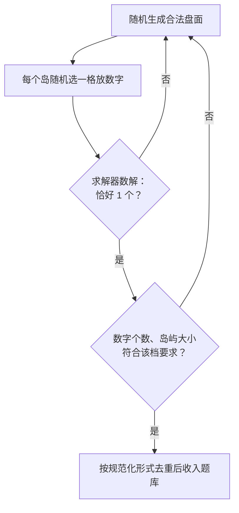
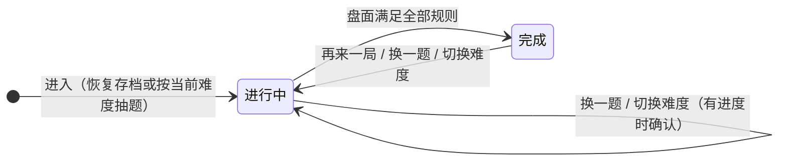

# 数墙 · 产品设计文档

> 版本：v0.1（草案）　｜　所属项目：H5 游戏合集　｜　日期：2026-11-18

## 修订记录

| 版本 | 变更 |
| --- | --- |
| v0.1 | 初稿：规则、三档尺寸、内置题库与唯一解保证、涂色交互（点击循环 + 拖动连涂）、违规提示、撤销、计时、存档与统计 |

## 1. 概述

**数墙**（Nurikabe，日本 Nikoli 出版的经典逻辑谜题）在方格盘面上给出若干数字。玩家把一部分格子涂黑，黑格连成一面「墙」，墙把剩下的白格分隔成一个个「岛」，每个岛的大小恰好等于岛上的数字。

| 项 | 说明 |
| --- | --- |
| 平台 | 手机竖屏为主，兼容桌面浏览器；纳入现有 PWA，离线可玩 |
| 单局时长 | 5 × 5 约 1–3 分钟，7 × 7 约 3–8 分钟，10 × 10 约 8–20 分钟 |
| 难度 | **5 × 5 / 7 × 7 / 10 × 10** 三档尺寸（见 3 节） |
| 核心承诺 | **每道题都有且只有一个解**：全部来自离线生成、经求解器校验唯一解的内置题库 |
| 辅助功能 | 白点标记、拖动连涂、违规提示、撤销 / 重做、清空 |
| 设计原则 | 单手可玩：一种手势（轻点 / 拖动）完成全部操作，不依赖长按和右键 |

## 2. 核心规则

### 2.1 规则

1. 每个格子最终要么是**黑格**（墙），要么是**白格**（岛）。数字格一定是白格。
2. **墙连通**：所有黑格必须上下左右连成一整片。
3. **无 2 × 2 黑块**：任何 2 × 2 的区域不能全是黑格。
4. **岛屿**：上下左右相连的白格组成一个岛。每个岛**恰好包含一个数字**，岛的格子数**等于**这个数字。
5. 没有数字的白格必须属于某个有数字的岛（由第 4 条推出：不存在没有数字的岛）。

### 2.2 示例

一道 5 × 5 的题（取自题库，唯一解）：

```
题面            答案（■ 黑格，· 白格）
. . . . 2       ■ ■ ■ · 2
. . 4 . .       ■ · 4 ■ ■
. . . . 1       ■ ■ · ■ 1
2 . . . .       2 ■ · ■ ■
. . . . 1       · ■ ■ ■ 1
```

4 号岛是 (2,2)(2,3)(3,3)(4,3) 四格（行, 列从 1 计）；两个 2 号岛分别向左、向下各占一格；两个 1 就是自己。所有黑格连成一片，没有 2 × 2 黑块。

### 2.3 胜负

- **完成**：盘面满足 2.1 的全部规则。判定时把「未涂黑」的格子（空格、白点）都视为白格，所以玩家**不必**把白格全部点上白点。
- 因为题目唯一解，满足规则即等于与答案一致。
- **没有失败**：不设错误上限，玩家总能把一局做完。

## 3. 难度与题库

### 3.1 三档尺寸

| 难度 | 尺寸 | 最大岛屿 | 每题数字数 | 题库数量 |
| --- | --- | --- | --- | --- |
| 简单 | 5 × 5 | 5 | 3–7 | 40 |
| 中等 | 7 × 7 | 7 | 6–12 | 40 |
| 困难 | 10 × 10 | 9 | 14–22 | 40 |

数字均为 1–9 的个位数，题面字符串每格一个字符即可存下。

### 3.2 出题方案：内置题库 + 等价变换

数墙的实时生成需要「随机造盘面 → 选数字 → 数解」反复重试，10 × 10 偶尔要数秒，所以和数独的兜底方案一样，**全部走内置题库**：



- **生成合法盘面**：从全黑开始，不断找一个 2 × 2 全黑块，把其中某一格改白；改白的前提是墙仍然连通、合并后的岛不超过该档的最大岛屿。直到没有 2 × 2 全黑块为止。5 × 5、7 × 7 会以一定概率优先改白「贴着已有岛」的格子，再随机额外改白几格，让岛屿大小更有变化、减少大小为 1 的岛。
- **数解**：对每个数字枚举所有可能的岛屿形状（含该数字、大小正确、不含也不贴着其他数字），再做「每个数字选一种形状」的回溯搜索：
  - 先选候选形状最少的数字；
  - 选定后，与它重叠或相邻的其他候选全部剔除，有数字没有候选立即回溯；
  - 每个节点先传播到稳定：某数字所有候选的公共格一定属于它，其他数字的候选不能碰到这些格及其邻格；某个 2 × 2 只有一个数字能覆盖时，这个数字只保留覆盖它的候选；
  - 剪枝：某个 2 × 2 区域不可能再有白格 → 回溯；「肯定是黑格」的格子不能落在同一片可能的墙里 → 回溯；
  - 找到第 2 个解就立即停止；出题时搜索节点超过 2 万的题视为太难算，直接丢弃（10 × 10 约 1% 的随机题面能通过，40 道约需 35 秒）。
- 测试里另用一个与求解器无关的朴素穷举（逐格试黑白）复核全部 5 × 5 题和 200 道随机题面，保证求解器的解数判断可靠。
- 脚本：`node scripts/gen-nurikabe-bank.mjs`，输出 `games/nurikabe/puzzles.js`，每道题存题面和答案两个字符串。
- **等价变换**：开局时对题库题随机做旋转 / 翻转（正方形共 8 种），不影响唯一解，让 40 道题变成 320 种题面。
- **避免重复**：本机记录每档最近玩过的 10 道题，抽题时跳过。

### 3.3 题号

状态栏显示题号（如「#17」），即题库序号 + 1，方便玩家交流。变换不改变题号。

## 4. 界面布局

整个页面从上到下分为：**顶栏 → 难度切换 → 状态栏 → 棋盘 → 底部工具栏**。

### 4.1 各区域说明

| 区域 | 内容 | 说明 |
| --- | --- | --- |
| 顶栏 | 返回、重新开始、标题、音效开关、玩法说明 | 沿用合集其他游戏的顶栏规范（同扫雷） |
| 难度切换 | 「5×5 / 7×7 / 10×10」分段按钮 | 对局中切换会弹窗确认（见 7 节） |
| 状态栏 | 左：题号；中：进度（已涂黑数 / 答案黑格数）；右：计时 `mm:ss` | |
| 棋盘 | N × N 方格 | 浅色、深色主题下都使用**固定的棋盘配色**（见 9 节） |
| 底部工具栏 | 撤销、重做、清空、换一题 | 固定在屏幕底部，避开底部安全区 |

### 4.2 格子尺寸

```
可用宽度 = 屏幕宽度 − 左右边距
可用高度 = 屏幕高度 − 顶栏 − 难度切换 − 状态栏 − 工具栏 − 安全区 − 边距
S = clamp(24px, floor(min(可用宽度, 可用高度) / N), 64px)
```

| 屏幕 | 5 × 5 | 7 × 7 | 10 × 10 |
| --- | --- | --- | --- |
| iPhone SE（375 × 667） | 64px | 49px | 34px |
| 大屏手机（430 × 932） | 64px | 57px | 39px |
| 桌面（1280 × 800） | 64px | 64px | 53px（高度受限） |

10 × 10 在小屏上格子约 34px，手指可以点准，不提供缩放。

## 5. 交互设计

### 5.1 格子状态

| 状态 | 外观 | 说明 |
| --- | --- | --- |
| 空 | 浅色方块 | 初始状态 |
| 黑格 | 深色方块 | 玩家判定为墙 |
| 白点 | 浅色方块 + 中心小圆点 | 玩家标记「这里一定是白格」，仅作记号，判定时与空格等价 |
| 数字格 | 白底 + 粗体数字 | 题目给出，不可操作 |

### 5.2 点击与拖动

- **轻点**：在「空 → 黑格 → 白点 → 空」之间循环。
- **拖动连涂**：按下时按上面的循环算出起点格的**目标状态**，手指划过的其他格子都设为同一目标状态（不再各自循环）。例如从空格开始拖，划过的格子全部涂黑；从黑格开始拖，划过的格子全部变为白点。
- 拖动经过数字格时跳过。
- 一次按下到抬起算**一步**，撤销时整笔一起撤回。
- 拖动时只在**进入新格子**时生效，在同一格内来回移动不会反复切换。
- 桌面端：左键同上；**右键**轻点 / 拖动直接在「白点 ↔ 空」之间切换（屏蔽浏览器右键菜单）。

### 5.3 键盘（桌面，可选）

| 按键 | 作用 |
| --- | --- |
| 方向键 | 移动焦点格 |
| `Space` / `Enter` | 循环切换焦点格 |
| `X` | 焦点格涂黑 / 取消 |
| `.` | 焦点格白点 / 取消 |
| `Ctrl/⌘ + Z`、`Ctrl/⌘ + Shift + Z` | 撤销 / 重做 |

### 5.4 撤销与重做

- 撤销栈记录每一步（一笔拖动或一次点击）改动的格子及前后状态，不限步数；「清空」也作为一步，可以撤销。
- 有新操作时清空重做栈。
- 撤销栈随存档保存，刷新后仍可撤销。

### 5.5 计时

- 进入对局即开始计时，完成时停止。
- 页面切到后台（`visibilitychange` 隐藏）或弹窗打开时暂停。
- 显示 `mm:ss`，超过 1 小时显示 `h:mm:ss`；最佳成绩精确到 0.1 秒。

## 6. 违规提示

违规提示**只看规则、不看答案**——它只告诉玩家「这样肯定不对」，不会泄露答案。可在设置中关闭，默认开启。

| 违规 | 判定 | 表现 |
| --- | --- | --- |
| 2 × 2 黑块 | 某个 2 × 2 区域 4 格都是黑格 | 这 4 格染红 |
| 岛屿超数 | 由「数字格 + 白点」连成的区域格数大于其中的数字 | 区域内数字变红，白点变红 |
| 一岛多数 | 由「数字格 + 白点」连成的区域里有 2 个及以上数字 | 同上 |
| 岛屿被封死 | 某数字所在的「非黑格」连通区域格数小于数字（周围已被墙围死，长不够） | 数字变红 |

说明：

- 只用「数字格 + 白点」计算岛屿大小，空格不计入。这样玩家点白点时能即时知道岛是否已经超了。
- 墙不连通**不**实时提示：做题过程中墙经常暂时断开，提示会干扰；完成时统一判定。
- 违规不阻止操作，也不计错误次数。

## 7. 游戏流程



- **完成**：最后一步满足规则的瞬间停止计时，未涂黑的空格自动显示为白点，棋盘整体发光，约 0.6 秒后弹出完成弹窗。完成后棋盘只读。
- **完成弹窗**：标题「完成！」，显示难度、题号、用时；打破纪录时显示「新纪录！」。下方显示该难度的完成局数、最佳用时、平均用时。按钮「查看棋盘」「再来一局」。
- **换一题 / 切换难度 / 重新开始**：
  - 还没有任何操作时直接执行；
  - 有操作且未完成时弹窗确认「放弃本题吗？」；放弃不计入统计；
  - 已完成时直接执行。
- 「重新开始」（顶栏）清空本题的所有操作并把计时归零，题目不变；「换一题」从题库再抽一道。
- **清空**（工具栏）：清除所有黑格和白点，计时不归零，可撤销。

## 8. 存档、统计与设置

### 8.1 存档

每次操作后写入 `localStorage`（复用 `js/pwa.js` 的 `storage`），键名统一前缀 `h5.nurikabe.`：

| 键 | 内容 |
| --- | --- |
| `h5.nurikabe.state` | 当前对局：难度、题号、变换编号、格子状态、撤销 / 重做栈、已用时间；已完成的对局不保存 |
| `h5.nurikabe.level` | 上次选择的难度 |
| `h5.nurikabe.stats` | 按难度的统计 |
| `h5.nurikabe.recent` | 每档最近玩过的题号 |
| `h5.nurikabe.settings` | 设置 |
| `h5.nurikabe.helpSeen` | 是否已看过玩法说明 |

存档数据损坏、题号超出题库或尺寸不符时丢弃存档，开新局。

### 8.2 统计（按难度分别记录）

| 指标 | 说明 |
| --- | --- |
| 完成局数 | |
| 最佳用时 | 前 5 名及日期 |
| 平均用时 | 总用时 / 完成局数 |

### 8.3 设置（玩法说明弹窗底部）

| 设置项 | 默认 | 说明 |
| --- | --- | --- |
| 违规提示 | 开 | 见 6 节 |

## 9. 视觉规范

棋盘固定使用浅色纸面风格，深色主题下同样保持，保证黑白对比。

| 用途 | 色值 |
| --- | --- |
| 棋盘底色 / 格线 | `#94a3b8` |
| 空格 / 白点格 | `#f8fafc` |
| 白点 | `#64748b`，直径约 0.2S |
| 黑格 | `#1e293b` |
| 数字格 | `#ffffff`，数字 `#111827`，字号约 0.55S，粗体 |
| 违规黑块 | `#dc2626` 系红色（黑格叠加红色） |
| 违规数字 / 白点 | `#dc2626` |
| 键盘焦点描边 | `#6366f1`，2px |
| 完成发光 | `#22c55e` |

### 9.1 动效与音效

| 时机 | 动效 | 音效（`js/sfx.js`） |
| --- | --- | --- |
| 涂黑 | 格子缩放回弹（100ms） | `place` |
| 白点 / 清除 | 无 | `tap` |
| 拖动连涂 | 每进入一格同上，音效节流 | 同上 |
| 新出现违规 | 违规格闪一下 | `error` |
| 撤销 / 重做 | 无 | `select` |
| 完成 | 棋盘发光，黑格依次轻闪 | `win` |

系统开启「减少动态效果」时关闭动画。

## 10. 边界情况

| 场景 | 处理 |
| --- | --- |
| 点到数字格 | 无反应 |
| 拖动出棋盘再回来 | 继续生效；抬起才结束本笔 |
| 拖动中途多指触摸 | 忽略第二指，当前笔照常进行 |
| 一笔没有改动任何格子 | 不入撤销栈 |
| 撤销到完成前 | 不会发生：完成后棋盘只读，撤销按钮禁用 |
| 弹窗打开时 | 遮罩拦截所有操作，计时暂停 |
| 切到后台 / 锁屏 | 暂停计时，存档已写入 |
| 存档损坏 | 丢弃存档，开新局 |
| 题库题号超出（题库更新后） | 丢弃存档，开新局 |

## 11. 技术方案

```
games/nurikabe/
├── index.html
├── nurikabe.css
├── nurikabe.js      # 界面、交互、计时、存档
├── board.js         # 纯逻辑：盘面、状态循环、撤销栈、违规检测、完成判定、等价变换
├── solver.js        # 纯逻辑：枚举岛屿形状 + 回溯数解（离线脚本与测试使用）
├── generator.js     # 纯逻辑：随机合法盘面、放数字（离线脚本使用）
└── puzzles.js       # 内置题库（脚本生成）
scripts/gen-nurikabe-bank.mjs
tests/nurikabe.mjs
```

- 运行时只加载 `index.html`、`nurikabe.css`、`nurikabe.js`、`board.js`、`puzzles.js`；`solver.js`、`generator.js` 不被页面引用，不需要加入 PWA 预缓存。
- 接入合集：在 `js/games.js` 的 `H5_GAMES` 中追加一项（`id: 'nurikabe'`，名称「数墙」，`files` 为上面 5 个运行时文件），图标 `icons/nurikabe.svg`；修改 `sw.js` 顶部的 `VERSION`。
- 测试 `node tests/nurikabe.mjs`：状态循环、拖动目标状态、撤销 / 重做、各类违规检测、完成判定、等价变换保持唯一解、**题库每道题求解器解数恰好为 1 且与存储的答案一致**。

## 12. 决策记录

| 问题 | 结论 |
| --- | --- |
| 实时出题还是题库 | 全部走内置题库 + 8 种等价变换（v0.1，见 3.2） |
| 难度划分 | 按尺寸分 5 × 5 / 7 × 7 / 10 × 10 三档（v0.1） |
| 点击方式 | 单击循环「空 → 黑 → 白点」，拖动沿用起点的目标状态（v0.1，见 5.2） |
| 完成是否要求点满白点 | 不要求，未涂黑即视为白格（v0.1） |
| 墙不连通是否实时提示 | 不提示，完成时判定（v0.1） |
| 放弃是否计入统计 | 不计入，数墙没有失败概念（v0.1） |

### 待确认事项

1. **难度分档**：当前只按尺寸分档，同尺寸题目难度差异可能较大。后续可以用逻辑求解器评级（参考数独），在同尺寸下再分「普通 / 挑战」。
2. **提示功能**：是否提供「检查」（标出与答案不符的黑格）或逐步提示？当前不提供。

## 13. 后续可扩展

- 逻辑求解器评级与逐步提示；
- 每日一题；
- 更大尺寸（12 × 12、15 × 15，需要缩放）；
- 题库扩充与在线更新。
