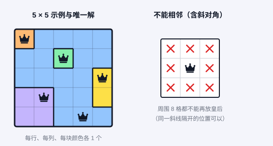
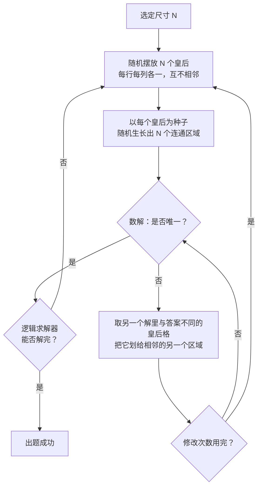
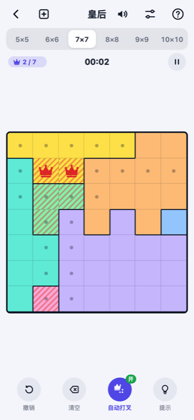
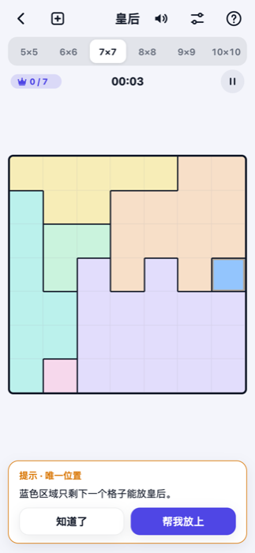
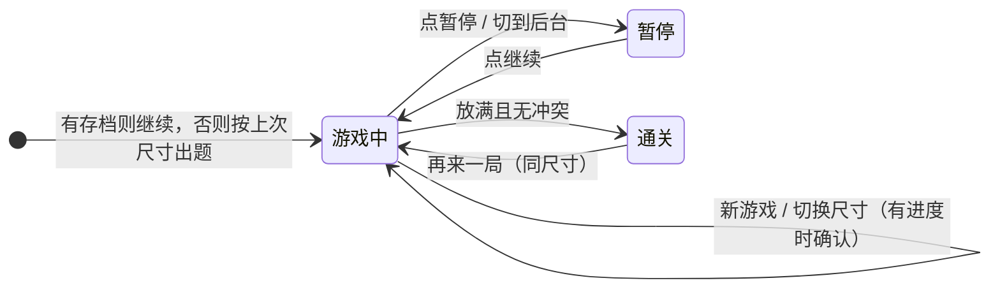

# 皇后 · 产品设计文档

> 版本：v0.2（草案）　｜　所属项目：H5 游戏合集　｜　日期：2026-11-18

## 修订记录

| 版本 | 变更 |
| --- | --- |
| v0.1 | 初稿：规则、尺寸档位、出题与唯一解保证、逻辑求解与提示、界面、交互（轻点循环 / 双击 / 拖动打叉）、自动打叉、存档与统计；「星战」2 星模式列为后续规划 |
| v0.2 | 随首版实现更新：调色板改为按区分度排序、小棋盘只取前 N 色（见 11.1）；提示高亮改为“压暗无关格子”（见 7）；补充实测出题耗时与界面截图 |

## 1. 概述

**皇后**（又称星战 Star Battle 的单星版，因 LinkedIn 每日谜题「Queens」流行）是一款网格逻辑游戏。N × N 的棋盘被划分成 N 块颜色不同的区域，玩家要放下 N 个皇后，使**每行、每列、每个色块恰好一个皇后**，并且**任意两个皇后不能相邻**（包括斜对角）。

| 项 | 说明 |
| --- | --- |
| 平台 | 手机竖屏为主，兼容桌面浏览器；纳入现有 PWA，离线可玩 |
| 单局时长 | 5 × 5 约 30 秒，10 × 10 约 3–8 分钟 |
| 档位 | 按棋盘尺寸分 **5 × 5 到 10 × 10** 共 6 档 |
| 核心承诺 | **每道题有且只有一个解，并且只靠逻辑推理就能解出，不需要猜** |
| 辅助功能 | 打叉标记、拖动连续打叉、自动打叉、冲突实时高亮、撤销、讲方法的提示 |
| 设计原则 | 单手可玩：轻点即可完成全部操作；颜色之外再用粗边界和花纹区分，色弱友好 |

**命名**：合集里叫「皇后」——比「星战」更直观（中文玩家熟悉“八皇后”），图标上画皇冠。“星战”留给后续的 2 星进阶模式（见 14 节）。

## 2. 核心规则



- **棋盘**：N 行 × N 列（N = 5…10），划分为 N 个**四连通**的彩色区域（色块）。
- **放置**：玩家在格子里放皇后；也可以打叉（✕），表示“这里肯定不放”，叉只是笔记，不参与判定。
- **约束**：
  1. 每一行恰好 1 个皇后；
  2. 每一列恰好 1 个皇后；
  3. 每个色块恰好 1 个皇后；
  4. 任意两个皇后**不相邻**：上下左右和四个斜对角都不行。
- **胜利**：放满 N 个皇后且没有任何冲突。因为题目唯一解，满足规则即等于答案。
- **没有失败**：不设错误上限，不比对答案，只按规则实时提示冲突。

> 与国际象棋“八皇后”的区别：同一斜线上可以有多个皇后，只禁止**紧挨着**的斜对角。

## 3. 尺寸档位

| 档位 | 难度感受 | 目标时长 |
| --- | --- | --- |
| 5 × 5 | 入门，教学 | < 1 分钟 |
| 6 × 6 | 简单 | 1–2 分钟 |
| 7 × 7 | 中等（默认） | 2–3 分钟 |
| 8 × 8 | 中等 | 2–4 分钟 |
| 9 × 9 | 困难 | 3–6 分钟 |
| 10 × 10 | 困难 | 4–8 分钟 |

难度主要随尺寸增长；同一尺寸内不再细分。求解器会给每道题评级（见 4.3 用到的最难技巧），v0.1 只用于内部统计和测试，不展示给玩家。

## 4. 出题方案：保证有解、唯一解、可推理

| 层次 | 含义 | 如何保证 |
| --- | --- | --- |
| ① 有解 | 至少存在一个合法摆法 | 先随机摆好答案，再围绕答案划分区域，答案天然满足 |
| ② 唯一解 | 只有一种摆法 | 回溯求解器数解（找到第 2 个就停），不唯一就**局部修改区域**直到唯一 |
| ③ 可推理 | 不需要试错 | 逻辑求解器只用 4.3 的技巧从空盘解完，解不完就丢弃重来 |

### 4.1 生成流程



要点：

- **随机摆答案**：逐行回溯，每行随机列序，要求列不重复且与上一行的列差 ≥ 2（不相邻）。
- **区域生长**：每个区域有一个随机“生长权重”，每一步按权重挑一个区域，把它边界外的一个随机空格并进来。权重差异让区域大小有大有小——小区域正是推理的突破口。
- **修复多解**：多解时拿到第二个解 S2，挑一个 S2 有皇后、答案没有的格子 c，把 c 改划给相邻的另一个区域（要求 c 原区域去掉 c 后仍连通）。答案不受影响（c 不是答案格），而 S2 的区域计数被破坏。通常几次修改就能唯一。
- **数解**：逐行回溯，按列、区域、与上一行相邻三个条件剪枝，找到 2 个解即停。10 × 10 单次数解 < 1ms。

### 4.2 出题位置与性能

- 出题在 **Web Worker** 中进行（`worker.js`），不阻塞界面；Worker 不可用时退回主线程同步生成。
- 实测（Node，M 系列芯片）平均生成耗时：5–8 档约 1–2ms，9 × 9 约 5ms，10 × 10 约 30ms，最慢一次不到 100ms，所以**不内置题库**；超过 300ms 才显示“正在出题…”遮罩，避免闪烁。
- 生成器接受随机数函数参数，测试中用固定种子复现。

### 4.3 逻辑求解器（同时服务于评级和提示）

求解器在“候选格”上推理：候选格 = 没有打叉、也没有被任何皇后攻击（同行、同列、同色块、相邻）的空格。按以下技巧从易到难寻找下一步：

| 级别 | 技巧 | 说明 | 结果 |
| --- | --- | --- | --- |
| 0 | 皇后排除 | 已放皇后的同行、同列、同色块和相邻 8 格都不能再放 | 打叉 |
| 1 | 唯一位置 | 某行 / 列 / 色块只剩一个候选格 | 放皇后 |
| 2 | 区块排除 | 某色块的候选格全在同一行（列）→ 该行（列）其他格不能放；反之某行（列）的候选格全在同一色块 → 该色块其他格不能放 | 打叉 |
| 3 | 预判排除 | 假设在某格放皇后，会让另一行 / 列 / 色块失去全部候选 → 这一格不能放 | 打叉 |
| 4 | 组合排除 | k 个色块的候选格恰好落在 k 行（列）内 → 这 k 行（列）的其他格不能放；行、列之间同理 | 打叉 |

- **评级**：从空盘反复“找最简单的一步并执行”直到解完，记录用到的最高级别；中途无步可走判定为“需要猜”，丢弃该题。
- **级别 0** 只在玩家关闭了“自动打叉”、盘面上还有被皇后攻击但没打叉的空格时才作为提示出现。

## 5. 界面布局

整个页面从上到下：**顶栏 → 尺寸选择 → 信息栏 → 棋盘 → 工具栏**。



图中状态：第 2 行两个皇后同色且相邻，皇冠变红、格子出现红色斜纹；它们攻击范围内的空格显示小圆点（自动打叉）；左侧绿色区域和底部粉色单格区域因为已无处可放，整块显示斜纹。

| 区域 | 内容 | 说明 |
| --- | --- | --- |
| 顶栏 | 返回、新游戏、标题、音效开关、设置、玩法说明 | 沿用合集顶栏规范 |
| 尺寸选择 | 5 / 6 / 7 / 8 / 9 / 10 分段按钮 | 对局中切换需确认 |
| 信息栏 | 已放皇后数 `3 / 8`、计时、暂停 | 计时 `mm:ss`，超过 1 小时 `h:mm:ss` |
| 棋盘 | N × N 彩色格 | 正方形，宽度撑满屏幕（左右留边距），最大 520px |
| 工具栏 | 撤销、清空、自动打叉（开关）、提示 | 圆形图标 + 文字，与数独工具栏一致 |

### 5.1 棋盘尺寸

```
B = min(屏幕宽度 − 24px, 可用高度, 520px)，格子边长 = B / N
```

10 × 10 在 iPhone SE（375 宽）上格子约 35px，满足手指点击。

### 5.2 格子的视觉状态

| 状态 | 样式 |
| --- | --- |
| 空 | 色块底色 |
| 打叉（玩家） | 深灰 ✕，格子边长 × 0.36 |
| 自动叉（被皇后攻击） | 浅灰小圆点（区别于玩家的 ✕；仅在“自动打叉”开启时显示） |
| 皇后 | 深色皇冠图标，格子边长 × 0.62 |
| 冲突皇后 | 皇冠变红 + 格子红色斜纹 |
| 无解区域 | 某行 / 列 / 色块已无可放位置且没有皇后：该区域所有格子红色斜纹 |
| 键盘焦点 | 主题色 2px 描边 |
| 提示目标 | 黄色描边闪烁；提示涉及的行 / 列 / 色块保持原色，其余格子压暗 |

色块之间画 **2.5px 深色粗线**，同一色块内部为 1px 细线。即使完全不看颜色，也能靠粗线分辨区域。

## 6. 交互设计

### 6.1 轻点循环

| 操作 | 效果 |
| --- | --- |
| **轻点** | 空 → ✕ → 皇后 → 空，循环 |
| **双击**（350ms 内同一格点两下） | 直接放皇后（无论原来是什么）；已是皇后则保持 |
| **按住拖动** | 从空格开始拖：经过的空格全部打叉；从 ✕ 开始拖：经过的 ✕ 全部擦掉。皇后不受影响 |
| 鼠标右键 | 切换皇后 / 空 |

- 双击 = 第一下的效果被撤回后再放皇后，撤销栈里只算**一步**。
- 拖动整个过程在撤销栈里算一步。
- 棋盘区域 `touch-action: none`，拖动不会滚动页面。

### 6.2 自动打叉

- 工具栏开关，默认**开**。
- 开启时，被已放皇后攻击的空格显示**浅灰小圆点**（不是真正的叉，不进撤销栈）；移走皇后，圆点随之消失。
- 关闭时只显示玩家自己打的叉，适合想自己动手推理的玩家。

### 6.3 冲突高亮

实时检查，可在设置中关闭：

- 两个皇后同行 / 同列 / 同色块 / 相邻 → 两者都标红；
- 某行 / 列 / 色块没有皇后，且所有格子都被打叉或被皇后攻击 → 整个区域红色斜纹（“这里已经放不下了”）。

### 6.4 撤销与清空

| 操作 | 行为 |
| --- | --- |
| 撤销 | 撤回上一步（轻点、双击、拖动、提示执行、清空都各算一步），不限步数；`Ctrl/⌘ + Z` |
| 清空 | 弹窗确认后清除全部皇后和叉；可以撤销；计时不归零 |

### 6.5 键盘（桌面）

| 按键 | 作用 |
| --- | --- |
| 方向键 | 移动焦点格 |
| 空格 / Enter | 轻点循环 |
| Q | 放 / 取皇后 |
| X | 打叉 / 取消叉 |
| Backspace / Delete | 清空该格 |
| H | 提示 |
| `Ctrl/⌘ + Z` | 撤销 |
| P | 暂停 / 继续 |

## 7. 提示系统

按下提示时：

1. **先纠错**：有皇后放在非答案格上 → 指出“这个皇后的位置不对”，提供“移除”按钮；有叉打在答案格上 → 指出“这一格不应该打叉”。
2. **否则讲下一步**：调用逻辑求解器，从 4.3 的技巧里找当前最简单的一步，用文字说明；棋盘上压暗无关格子，只留下相关的行 / 列 / 色块，目标格加黄框。
3. 玩家可以点「知道了」自己动手，或点「帮我放上 / 帮我标上 / 帮我移除」由系统执行，执行算一步可撤销。
4. 提示面板临时替换工具栏的位置；任何棋盘操作都会关闭提示。



- 提示**不限次数**，但通关弹窗显示使用次数；**最佳用时只统计 0 提示的对局**。
- 文案示例：
  - 唯一位置：“第 3 行只剩一个格子能放皇后。”
  - 区块排除：“紫色区域的可放位置都在第 2 列，所以第 2 列的其他格子都不能放。”
  - 预判排除：“如果在这里放皇后，橙色区域就没有位置了。”
  - 组合排除：“这 2 个区域的可放位置都在第 4、5 行，所以这两行的其他格子都不能放。”
- 色块的名称在文案里用颜色名（“紫色区域”），同时棋盘高亮，色弱玩家看高亮即可。

## 8. 游戏流程



- **计时**：题目显示后开始；暂停、切后台、打开设置 / 玩法说明时停止。
- **暂停**：棋盘被遮住，点击继续。
- **通关**：最后一个皇后放下的瞬间计时停止，皇后逐个放大闪烁（约 0.8 秒），随后弹出通关弹窗：尺寸、用时、最佳用时（破纪录显示“新纪录”）、提示次数；按钮「查看棋盘」「再来一局」。
- **放弃**：有进度时开新局需确认；放弃不计入统计（休闲向，不设连胜惩罚）。

## 9. 设置

| 设置项 | 默认 | 说明 |
| --- | --- | --- |
| 自动打叉 | 开 | 同工具栏开关（见 6.2） |
| 冲突高亮 | 开 | 关闭后只在放满时提示“还有冲突” |
| 显示计时 | 开 | 关闭后只隐藏，仍计时用于统计 |
| 音效 | 开 | 共用合集全局音效开关 |
| 重做本题 | — | 清空盘面、计时归零、提示计数归零，需确认 |
| 查看统计 | — | 打开统计弹窗 |

## 10. 存档与统计

### 10.1 自动存档

- 每次操作后写入 `localStorage`，复用 `js/pwa.js` 的 `storage`。键名：

| 键 | 内容 |
| --- | --- |
| `h5.queens.state` | 当前对局：尺寸、区域、配色、答案、盘面、撤销栈、已用时间、提示次数 |
| `h5.queens.size` | 上次选择的尺寸 |
| `h5.queens.settings` | 设置项 |
| `h5.queens.stats` | 统计 |
| `h5.queens.helpSeen` | 是否看过玩法说明（首次进入自动弹出） |

- 只保留一局；已通关的对局不保存。存档损坏 / 版本不符时丢弃并开新局。

### 10.2 统计（按尺寸分别记录）

| 指标 | 说明 |
| --- | --- |
| 完成局数 | |
| 最佳用时 | 只统计 0 提示对局 |
| 平均用时 | 所有完成局 |
| 无提示通关 | 0 提示完成的局数 |

## 11. 视觉规范

### 11.1 色块配色（色弱友好）

10 色浅色调色板（Tailwind 300 色阶为主），按**区分度从高到低排序**：N × N 棋盘只取前 N 种颜色，再随机分配给各区域。这样 5–8 档不会出现“棕 / 橙”“白 / 灰”这类相近色，9、10 档才用到最后两色。

| # | 名称 | 浅色主题 | 深色主题 |
| --- | --- | --- | --- |
| 1 | 橙色 | `#fdba74` | `#c2864a` |
| 2 | 蓝色 | `#93c5fd` | `#5b8fc9` |
| 3 | 绿色 | `#86efac` | `#4fa872` |
| 4 | 黄色 | `#fde047` | `#b8a22a` |
| 5 | 紫色 | `#c4b5fd` | `#8b78c9` |
| 6 | 粉色 | `#f9a8d4` | `#c06a99` |
| 7 | 青色 | `#5eead4` | `#2f9e8c` |
| 8 | 灰色 | `#d1d5db` | `#7b818c` |
| 9 | 白色 | `#f8fafc` | `#b8bec9` |
| 10 | 棕色 | `#c69c6d` | `#8f6a45` |

- 区域粗边界 `#111827`（深色主题 `#0b0e14`），相邻两格各画 1.25px 合成 2.5px，画在提示压暗层之上；格内细线 `rgba(17,24,39,0.18)`。
- 皇冠 `#111827`，冲突时 `#dc2626`；冲突斜纹 `rgba(220,38,38,0.45)`。
- 颜色之外的冗余编码：粗边界区分区域，斜纹（而非纯红底）表示冲突，皇冠 / ✕ / 圆点三种形状区分格子状态。

### 11.2 其他

页面背景、按钮、弹窗沿用 `common.css`；工具栏、信息栏与数独保持一致的尺寸和配色。

## 12. 动效与音效

| 时机 | 动效 | 音效（`js/sfx.js`） |
| --- | --- | --- |
| 打叉 | ✕ 淡入 | `tap` |
| 放皇后 | 皇冠放大回弹（160ms） | `place` |
| 移除 / 擦除 | — | `select` |
| 出现新冲突 | 冲突皇后左右抖动 | `error` |
| 拖动打叉 | 每经过一格 ✕ 淡入 | 首格 `tap`，之后不重复 |
| 打开提示 | 目标格黄框闪烁，无关格子压暗 | `select` |
| 某行 / 列 / 色块完成 | — | — （避免泄露对错） |
| 通关 | 皇后依次放大闪烁，棋盘外框发绿光 | `win` |

系统开启“减少动态效果”时取消动画。

## 13. 边界情况

| 情况 | 处理 |
| --- | --- |
| 放满 N 个但有冲突 | 不通关；冲突高亮开启时冲突已标红，关闭时 toast“还有冲突” |
| 皇后数超过 N | 允许（冲突会标红），不硬性阻止 |
| 双击已有皇后的格 | 保持皇后 |
| 拖动出棋盘 | 停止标记；回到棋盘继续 |
| 多指触控 | 只响应第一根手指 |
| 生成超时 / Worker 报错 | 退回主线程同步生成 |
| 页面切到后台 | 自动暂停计时并存档 |
| 存档损坏 / 版本不兼容 | 丢弃存档并开新局 |
| 已通关后操作棋盘 | 棋盘只读；顶栏“新游戏”或弹窗“再来一局”开局 |

## 14. 技术方案

沿用合集约定：纯 HTML / CSS / 原生 JS（ES modules），无构建步骤，纯逻辑与 DOM 分离。

```
games/queens/
├── index.html
├── queens.css
├── queens.js        # 界面、交互、计时、存档、提示面板
├── board.js         # 纯逻辑：盘面、规则校验、冲突检测、自动叉、通关判定、撤销
├── solver.js        # 纯逻辑：回溯数解 + 逻辑求解器（下一步、评级）
├── generator.js     # 纯逻辑：随机答案、区域生长、唯一化修复
└── worker.js        # Web Worker 入口
```

- 测试：`tests/queens.mjs`（`node tests/queens.mjs` 独立运行），覆盖规则校验、冲突、通关判定、撤销、各尺寸生成唯一解且可逻辑解完、提示步骤永不与答案矛盾。
- 接入合集（由协调者处理）：`js/games.js` 追加条目、`sw.js` 更新 `VERSION`、`tests/smoke.mjs` 可 import 本测试。

## 15. 决策记录

| 决策 | 理由 |
| --- | --- |
| 名称用「皇后」 | 比“星战”直观；2 星版再用“星战”命名 |
| 实时生成、不做题库 | 各尺寸生成都在毫秒级，题目无限且不重复；省去离线脚本 |
| 要求逻辑可解 | 保证不用猜，也让提示任何时候都能给出“讲得通”的一步 |
| 判定按规则而非比对答案 | 唯一解下二者等价；按规则判定才能对“放错但暂不冲突”保持沉默，保留推理乐趣 |
| 自动叉用圆点、不进撤销栈 | 与玩家的 ✕ 区分；移动皇后时自动更新，不污染撤销历史 |
| 提示不限次数，但影响最佳用时 | 休闲向；纪录保持公平 |
| 尺寸即难度 | 与 LinkedIn Queens 习惯一致，玩家一眼能懂 |

### 待确认事项

1. 是否需要在尺寸之外再分“简单 / 困难”（按评级筛题）？当前不分。
2. 是否提供“每日一题”（日期做随机种子，全体玩家同题）？
3. 色弱模式是否再加“区域字母编号”？当前靠粗边界。

## 16. 后续可扩展

- **星战 2 星模式**：10 × 10，每行 / 列 / 色块 2 颗星，星之间不相邻。`board.js` 的规则校验已按“每单元 k 个”参数化；需扩展生成器（每区域含 2 个答案星的区域生长）和逻辑技巧（2 星的区块 / 组合排除）。
- 每日一题与打卡日历；
- 区域字母编号（色弱增强）；
- 解题回放。
