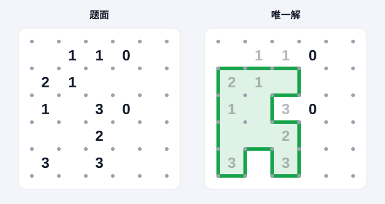
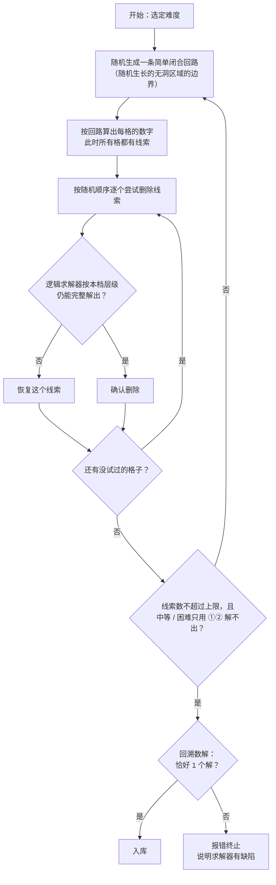
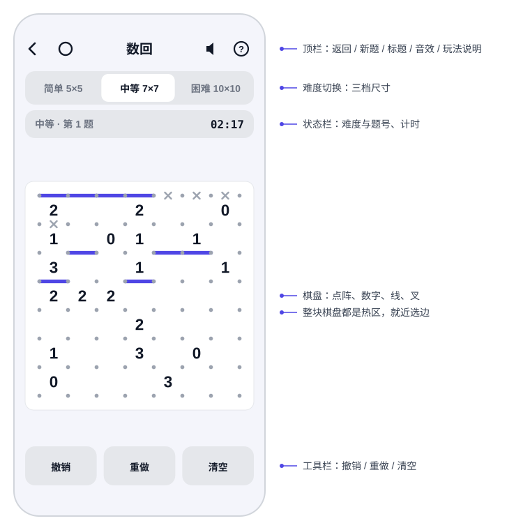
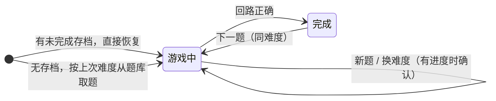

# 数回 · 产品设计文档

> 版本：v0.1（草案）　｜　所属项目：H5 游戏合集　｜　日期：2026-11-18

## 修订记录

| 版本 | 变更 |
| --- | --- |
| v0.1 | 初稿：规则、三档难度、内置题库与唯一解保证、界面、画线 / 打叉 / 拖动画线、违规提示、撤销、存档与统计；配图：规则示例、整体布局 |

## 1. 概述

**数回**（Slitherlink，又名「环线」）是日本 Nikoli 推广的纸笔逻辑谜题。棋盘是一片点阵，部分格子里写着 0–3 的数字。玩家在相邻两点之间连线，最终画出**一条**不交叉、不分叉的闭合回路，使每个数字恰好等于它四条边中被回路经过的条数。

| 项 | 说明 |
| --- | --- |
| 平台 | 手机竖屏为主，兼容桌面浏览器；纳入现有 PWA，离线可玩 |
| 单局时长 | 简单 1–3 分钟，中等 3–8 分钟，困难 8–20 分钟 |
| 难度 | **简单 5 × 5 / 中等 7 × 7 / 困难 10 × 10** 三档（见 3 节） |
| 核心承诺 | **每道题都有且只有一个解，并且只靠推理就能解出，不需要猜** |
| 辅助功能 | 打叉标记、拖动连续画线、违规提示、撤销 / 重做、清空 |
| 设计原则 | **手机上点得准**：整块棋盘都是热区，手指落在哪条边附近就操作哪条边；连续的线可以一笔拖出来 |

## 2. 核心规则

### 2.1 术语

| 术语 | 说明 |
| --- | --- |
| 点 | 棋盘上 (行数 + 1) × (列数 + 1) 个格点 |
| 边 | 相邻两个点之间的线段，是玩家操作的对象。5 × 5 有 60 条，7 × 7 有 112 条，10 × 10 有 220 条 |
| 格子 | 四个点围成的小方格，可能写有 0–3 的**线索数字**，也可能是空白 |
| 回路 | 玩家画出的线 |

### 2.2 规则

1. 所有画上的线必须连成**一条闭合回路**；
2. 回路**不交叉、不分叉**：每个点要么不经过（0 条线），要么恰好经过一次（2 条线）；
3. 写有数字的格子，它的四条边里**恰好**有这么多条属于回路；空白格不限制；
4. 回路不必经过所有点，也不必经过所有格子。



左图为一道 5 × 5 的简单题（来自内置题库），右图为它的唯一解。

### 2.3 边的三种状态

| 状态 | 外观 | 说明 |
| --- | --- | --- |
| 空 | 不显示 | 初始状态，还没决定 |
| 线 | 主题色粗线 | 玩家认为这条边属于回路 |
| 叉 | 灰色小 × | 玩家认为这条边**不**属于回路；只是笔记，不影响判定 |

### 2.4 胜利

- 所有「线」恰好构成一条闭合回路，并且每个数字都恰好满足，即为完成。「叉」和「空」都视为不属于回路，不要求把剩下的边都打上叉。
- 因为题目唯一解，满足规则就等于和答案一致，判定时不需要存答案。
- 没有失败，玩家总能把一局做完。

## 3. 难度体系

| 难度 | 尺寸 | 推理要求 | 线索数（参考） | 目标时长 |
| --- | --- | --- | --- | --- |
| ★ 简单 | 5 × 5 | 只用**基础规则**（见 3.1 ①②） | 8–15 个（上限 15） | 1–3 分钟 |
| ★★ 中等 | 7 × 7 | 基础规则 + **一步试探**（见 3.1 ③），且必须用到试探 | 15–23 个（上限 24） | 3–8 分钟 |
| ★★★ 困难 | 10 × 10 | 基础规则 + 一步试探，且必须用到试探 | 29–45 个（上限 46） | 8–20 分钟 |

线索数为当前题库的实际范围。删线索后仍超过上限的题（回路形状导致大部分线索都删不掉）过于直白，直接丢弃重出。

### 3.1 逻辑求解器的推理层级

难度不是单看尺寸，而是用逻辑求解器解题，按**需要用到的最难推理**分档：

| 层级 | 内容 | 对应的人类技巧 |
| --- | --- | --- |
| ① 数字规则 | 某格已画线数 = 数字 → 其余边打叉；已画线数 + 未定边数 = 数字 → 其余边画线 | 0 周围全叉、3 角上的推导等 |
| ② 点规则 | 某点已有 2 条线 → 其余打叉；有 1 条线且只剩 1 条未定边 → 画线；没有线且只剩 1 条未定边 → 打叉；**提前闭合**：连上会形成一个小圈、而棋盘上还有别的线 → 打叉 | 不分叉、不走死路、不提前成环 |
| ③ 一步试探 | 假设某条未定边为线（或叉），只用 ①② 推下去，若出现矛盾就确定为相反状态 | 相邻 3、对角 3、斜向传递等常见定式都能被一步试探覆盖 |

试探只有一层（不嵌套），因此困难题也不会需要“深度猜测”。

## 4. 出题方案：内置题库

10 × 10 在手机上实时生成并评级可能需要数秒，且出题质量需要人工以外的统一把关，所以采用**离线生成、内置题库**的方案（与数独的题库兜底做法一致）。

### 4.1 生成流程



要点：

- **回路生成**：从一个随机格子开始，随机向外“长”格子，得到一块区域，回路就是区域的边界。每加一格都检查：区域内部不能有洞（否则边界不止一条），也不能出现两个格子只在一个角上相接（否则边界在该点交叉）。区域大小取总格数的 40%–65%，形状曲折才好玩。
- **唯一解**：逻辑求解器只做“必然成立”的推导，只要它能把整题推完并得到合法回路，这个解就是唯一的。出题脚本和测试再用**回溯数解器**（每个节点先做一步试探剪枝，找到第 2 个解即停）复核每道题解数恰好为 1。数解器本身在 2×2–4×4 小盘面上与“枚举所有区域”的独立穷举结果逐一对照测试，保证剪枝不会漏解。
- **耗时**：整套题库（120 道）生成约 4 秒，复核约 0.1 秒。
- **最少线索**：每个线索都尝试删一次，删不掉才保留，所以入库题在本档层级下是“删任何一个都解不出”的。

### 4.2 题库与等价变换

- 每档 **40 道**，由 `scripts/gen-slitherlink-bank.mjs` 生成，写入 `games/slitherlink/puzzles.js`，打包进 PWA 缓存。
- 开局时从本档题库中挑一道**最近没玩过**的题（记录最近玩过的一半题号），再做 8 种对称变换之一（旋转 0° / 90° / 180° / 270°，各自可再镜像）。变换不改变唯一性和难度，每档实际有 320 种题面。
- 状态栏显示「第 N 题」（N 为题库序号），便于反馈问题。

## 5. 界面布局

整个页面从上到下分为：**顶栏 → 难度切换 → 状态栏 → 棋盘 → 底部工具栏**。



图为中等难度进行中的状态：已画了几段线，右上角几条边打了叉。

### 5.1 各区域说明

| 区域 | 内容 | 说明 |
| --- | --- | --- |
| 顶栏 | 返回、新题、标题、音效开关、玩法说明 | 沿用合集其他游戏的顶栏规范（与扫雷一致，左侧为返回和新题） |
| 难度切换 | 「简单 5×5 / 中等 7×7 / 困难 10×10」分段按钮 | 当前题已有操作且未完成时，切换弹窗确认 |
| 状态栏 | 左：难度与题号；右：计时 | 计时 `mm:ss`，超过 1 小时显示 `h:mm:ss` |
| 棋盘 | 点阵、数字、线、叉 | 正方形，尽量撑满可用空间 |
| 底部工具栏 | 撤销、重做、清空 | 固定在屏幕底部，避开安全区；不可用时置灰 |

### 5.2 自适应

以格子边长 **S** 为基准，棋盘四周各留 0.5S 边距（也属于点击热区）：

```
可用宽度 = 屏幕宽度 − 左右边距
可用高度 = 屏幕高度 − 顶栏 − 难度切换 − 状态栏 − 工具栏 − 安全区 − 边距
S = min(72px, 可用宽度 / (列数 + 1), 可用高度 / (行数 + 1))
```

| 屏幕 | 简单 S | 中等 S | 困难 S |
| --- | --- | --- | --- |
| iPhone SE（375 × 667） | 59px | 44px | 32px |
| 大屏手机（430 × 932） | 69px | 52px | 38px |
| 桌面（1280 × 800） | 72px | 54px | 39px（受高度限制） |

困难档在小屏上 S 约 32px，配合 6.1 的“就近选边”，每条边的热区约为 S² / 2 ≈ 500px²，足够手指点中，所以不做缩放。

## 6. 交互设计

### 6.1 选边：就近原则

- 整个棋盘（含四周 0.5S 边距）都是热区，不存在点不中的空隙。
- 手指落点离哪条边最近，就操作哪条边：先比较落点到最近的横格线和竖格线的距离，取更近的方向，再按落点所在的格子确定是哪一段。
- 按下时这条边显示半透明的预选高亮，抬起才生效；按住后移动超过 0.25S（至少 8px）视为拖动（见 6.3）。

### 6.2 轻点、长按与右键

| 操作 | 作用 |
| --- | --- |
| **轻点** | 在「空 → 线 → 叉 → 空」之间循环 |
| **长按**（约 350ms） | 直接切换叉：空 / 线 → 叉，叉 → 空。到时立即生效并轻振 15ms |
| 鼠标左键 | 同轻点 |
| 鼠标右键 | 同长按（屏蔽浏览器右键菜单） |

### 6.3 拖动画线

- 按住后拖动，手指经过的格点依次连成线，一笔就能画出一长段回路。
- 拖动的**第一条边**决定本笔是“画”还是“擦”：第一条边原来是线 → 本笔把经过的边都擦成空；否则 → 本笔把经过的边都画成线（叉会被覆盖）。
- 手指需要靠近格点（距离小于约 0.4S）才算“到达”，避免在边的中段来回抖动误画。手指移动太快跳过了格点时，按横向、纵向逐步补齐中间的边。
- 本笔中沿刚画的边**原路退回**，会撤掉这段（像橡皮筋一样）。
- 一整笔算作一步，撤销时整笔撤回。

### 6.4 撤销、重做、清空

| 操作 | 行为 |
| --- | --- |
| 撤销 | 撤回上一步（一次轻点、一次长按或一整笔拖动）；不限步数（存档中最多保留 500 步） |
| 重做 | 恢复刚撤销的步骤；有新操作后重做栈清空 |
| 清空 | 清除本题所有线和叉，算作一步，可以撤销，所以不弹确认 |

桌面快捷键：`Ctrl/⌘ + Z` 撤销，`Ctrl/⌘ + Shift + Z` 或 `Ctrl/⌘ + Y` 重做，`N` 新题。

### 6.5 违规提示

实时检查，只提示**确定违反规则**的情况，不提示“可能画错了”（不对照答案）：

| 违规 | 判定 | 表现 |
| --- | --- | --- |
| 数字超出 | 某格已画线数 > 数字 | 数字变红 |
| 数字无法满足 | 某格已画线数 + 未打叉的边数 < 数字 | 数字变红 |
| 分叉 | 某点有 3 条或以上的线 | 该点变红并放大 |
| 死路 | 某点只有 1 条线，其余边都打了叉 | 该点变红并放大 |
| 提前闭合 | 某段线自己围成了圈，但圈外还有别的线 | 这个圈的线变为橙色 |

- 数字已恰好满足时变淡，帮助玩家看清还剩哪些数字要处理。0 开局时就“满足”，为了不让它一开始就被忽略，0 要四条边都打了叉才变淡。
- 「违规提示」可在玩法说明底部的设置里关闭；关闭后数字变淡仍保留。
- 回路已经闭合成一条、但还有数字不满足时，toast 提示「回路已闭合，但还有数字没满足」。

### 6.6 计时

- 题目显示出来即开始计时，完成时停止。
- 页面切到后台（`visibilitychange` 隐藏）时暂停，回来后继续；不遮挡棋盘。
- 内部按毫秒记录，最佳成绩精确到 0.1 秒。

## 7. 判定逻辑

### 7.1 数据结构

```js
// 边：先横边后竖边，一维数组
//   横边 h(r, c)：r ∈ [0, rows]，c ∈ [0, cols)，index = r * cols + c
//   竖边 v(r, c)：r ∈ [0, rows)，c ∈ [0, cols]，index = H + r * (cols + 1) + c，H = (rows + 1) * cols
// 点：index = r * (cols + 1) + c
// clues: Int8Array(rows * cols)，-1 为空白格
// edges: Uint8Array(E)，0 空 / 1 线 / 2 叉
```

### 7.2 完成判定

1. 每个点的线数都是 0 或 2；
2. 所有线连通（从任意一条线出发沿线走，能走遍全部的线）；
3. 每个数字格的线数等于数字。

满足 1、2 时线一定构成一条简单闭合回路。每一笔结束后检查一次。

### 7.3 胜利表现

回路变为绿色，回路内部的格子铺上浅绿色底（按射线奇偶判断格子是否在回路内），剩余的叉淡出；约 0.9 秒后弹出完成弹窗。

## 8. 游戏流程



## 9. 结束弹窗、存档与统计

- **完成弹窗**：标题「完成！」，显示难度、题号、用时；打破纪录时显示「新纪录！」。下方显示该难度的完成局数、最佳用时、平均用时。按钮：「查看棋盘」（关闭弹窗，棋盘只读）、「下一题」。
- **新题 / 换难度**：当前题有过操作且未完成时，弹窗确认「放弃本题？」；放弃不计入统计（没有失败的概念）。
- **存档**：每一步操作后把难度、题号、题面（变换后）、边状态、撤销 / 重做栈、已用时间写入 `localStorage`；已完成的对局不保存。存档损坏或与题库不一致时丢弃，开新题。
- **统计**（按难度分别记录）：完成局数、最佳用时（前 5 名及日期）、总用时（用于平均）。
- **设置**（玩法说明弹窗底部）：违规提示 开 / 关（默认开）。
- **玩法说明**：点顶栏「?」弹出，首次进入自动弹出一次。

localStorage 键名：

| 键 | 内容 |
| --- | --- |
| `h5.slitherlink.state` | 未完成对局存档 |
| `h5.slitherlink.level` | 上次选择的难度 |
| `h5.slitherlink.recent` | 每档最近玩过的题号 |
| `h5.slitherlink.settings` | 设置 |
| `h5.slitherlink.stats` | 统计 |
| `h5.slitherlink.helpSeen` | 是否已看过玩法说明 |

## 10. 动效与音效

| 时机 | 动效 | 音效（`js/sfx.js`） |
| --- | --- | --- |
| 画线 | 线从中点向两端展开（120ms） | `place` |
| 擦线 / 去叉 | 淡出 | `select` |
| 打叉 | × 缩放弹出 | `tap` |
| 拖动画线 | 每画一段展开一次 | 每段 `move`（25ms 内去重） |
| 撤销 / 重做 / 清空 | — | `select` |
| 无可撤销 / 重做 | 按钮轻微抖动 | `error` |
| 出现新的违规 | 违规的数字 / 点闪一下 | `error` |
| 完成 | 回路变绿，内部格子依次铺色 | `win` |
| 新纪录 | 弹窗中「新纪录！」放大回弹 | — |

系统开启“减少动态效果”时关闭展开、铺色动画。

## 11. 视觉规范

棋盘随系统浅色 / 深色主题变化：

| 用途 | 浅色 | 深色 |
| --- | --- | --- |
| 棋盘底色 | `#ffffff` | `#1f2937` |
| 点 | `#9ca3af` | `#6b7280` |
| 数字 | `#111827` | `#e5e7eb` |
| 已满足的数字 | 同上，不透明度 0.3（0 需四边都打叉） | 同左 |
| 线 | `#4f46e5` | `#818cf8` |
| 叉 | `#9ca3af` | `#6b7280` |
| 违规（数字、点） | `#ef4444` | `#f87171` |
| 提前闭合的圈 | `#f97316` | `#fb923c` |
| 完成时的回路 / 内部 | `#16a34a` / `#16a34a22` | `#4ade80` / `#4ade8026` |
| 按下预选 | 线色，不透明度 0.3 | 同左 |

尺寸（以 S 为基准）：点半径 0.07S（最小 2.5px），线宽 0.13S，叉为 0.22S 见方、线宽 0.06S，数字字号 0.55S 粗体。

渲染使用一张 SVG（`viewBox` 以格子为单位），每条边一个 `<line>`，每个叉一个 `<path>`，状态变化只改属性 / class；10 × 10 共 220 条边，性能无压力。

## 12. 边界情况

| 场景 | 处理 |
| --- | --- |
| 落点在棋盘外 0.5S 以外 | 不响应 |
| 落点正好在格点上 | 横竖距离相等时取横边 |
| 拖动起点离格点较远 | 以离落点最近的格点作为起点 |
| 拖动中第二根手指按下 | 忽略第二根手指，本笔照常进行 |
| 拖动中途离开棋盘 | 继续跟踪（指针捕获），吸附到离手指最近的棋盘格点 |
| 拖动被系统打断（来电、手势） | 已画的部分保留，照常算作一步 |
| 完成后操作棋盘 | 只读，不响应 |
| 已完成又撤销 | 不允许，完成后撤销 / 重做 / 清空置灰 |
| 弹窗打开时 | 遮罩拦截所有操作 |
| 旋转屏幕 / 窗口缩放 | 重新计算 S，盘面不变 |
| 对局中切到后台 / 锁屏 | 暂停计时，存档已写入 |
| 存档损坏或题库更新后不一致 | 丢弃存档，开新题 |

## 13. 技术方案

沿用合集的约定：纯 HTML / CSS / 原生 JS（ES modules），无构建步骤，逻辑与界面分离。

```
games/slitherlink/
├── index.html
├── slitherlink.css
├── slitherlink.js   # 界面、交互、计时、存档
├── board.js         # 纯逻辑：几何索引、边状态、撤销栈、违规检查、完成判定、对称变换、选题
├── puzzles.js       # 内置题库（每档 40 道，脚本生成，请勿手改）
├── solver.js        # 纯逻辑：逻辑求解器（分层评级）+ 回溯数解器（仅离线脚本与测试使用）
└── generator.js     # 纯逻辑：随机回路、删线索（仅离线脚本使用）
scripts/gen-slitherlink-bank.mjs   # 生成题库：node scripts/gen-slitherlink-bank.mjs [每档题数]
tests/slitherlink.mjs              # 独立测试：node tests/slitherlink.mjs
```

- 页面只加载 `board.js` 和 `puzzles.js`；`solver.js`、`generator.js` 不进 PWA 预缓存。
- 测试覆盖：几何索引、违规检查、完成判定、撤销 / 重做、存档还原、对称变换、拖动路径补齐；题库每道题（含 8 种变换中的随机一种）回溯数解恰好 1 个解，并能被对应层级的逻辑求解器解出。

## 14. 决策记录

| 问题 | 结论 |
| --- | --- |
| 实时生成还是题库 | 内置题库 + 对称变换（v0.1，见 4 节） |
| 唯一解如何保证 | 生成时逻辑求解器能完整推出；测试再用回溯数解独立复核（v0.1） |
| 轻点的循环顺序 | 空 → 线 → 叉 → 空；长按 / 右键直接切换叉（v0.1） |
| 手机上边太细点不中 | 整块棋盘就近选边 + 拖动画线，不做缩放（v0.1） |
| 违规提示的范围 | 只提示确定违反规则的情况，不对照答案（v0.1） |
| 是否提供提示功能 | 首版不提供，留作扩展（v0.1） |
| 放弃是否计入统计 | 不计入，统计只记完成的局（v0.1） |

### 待确认事项

1. **困难档时长**：10 × 10 一步试探的题对新手可能偏难，试玩后考虑在中等与困难之间加一档「7 × 7 少线索」或「10 × 10 仅基础规则」。
2. **轻点循环顺序**：部分玩家习惯「空 → 叉 → 线」，可考虑做成设置项。
3. **题库规模**：每档 40 道 × 8 种变换，重度玩家仍可能认出重复题，可按需扩充。

## 15. 接入合集

- 在 `js/games.js` 的 `H5_GAMES` 中追加一项（`id: 'slitherlink'`，名称「数回」，标签 `['益智', '逻辑']`），`files` 为 `index.html`、`slitherlink.css`、`slitherlink.js`、`board.js`、`puzzles.js`；图标 `icons/slitherlink.svg`。
- 修改 `sw.js` 顶部的 `VERSION`（由协调者统一处理）。

## 16. 后续可扩展

- **提示**：用逻辑求解器找出当前最简单的一步，高亮相关数字和边。
- **每日一题**：按日期从题库取题，比用时。
- **更多尺寸**：15 × 15、矩形盘面（变换时只用不改变长宽的 4 种对称）。
- **自动打叉**：数字满足后自动给其余边打叉（可选）。
- **回放**：完成后按时间轴回放画线过程。
