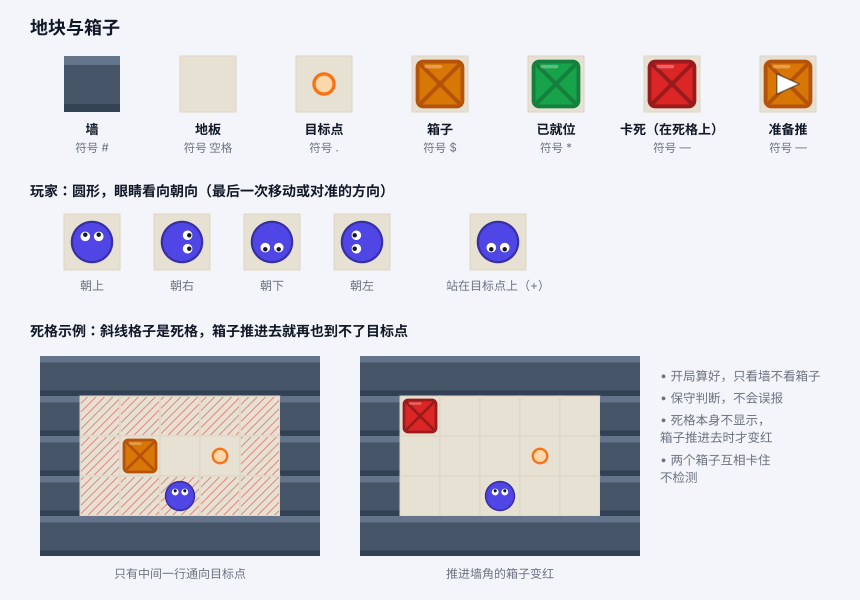
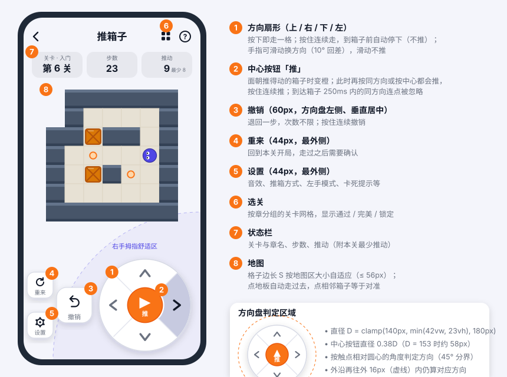
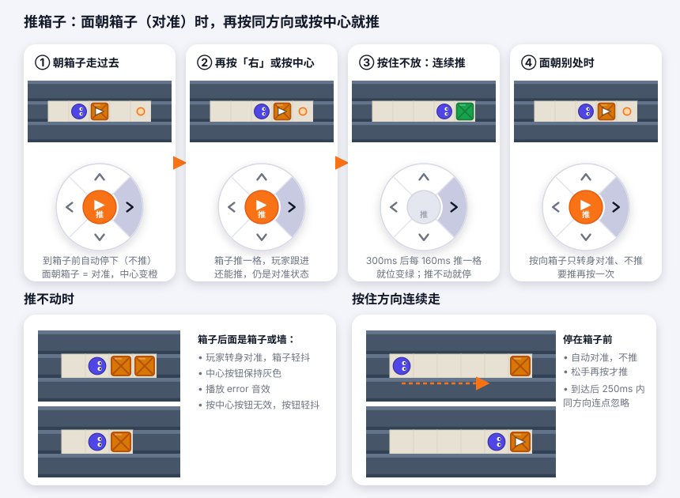
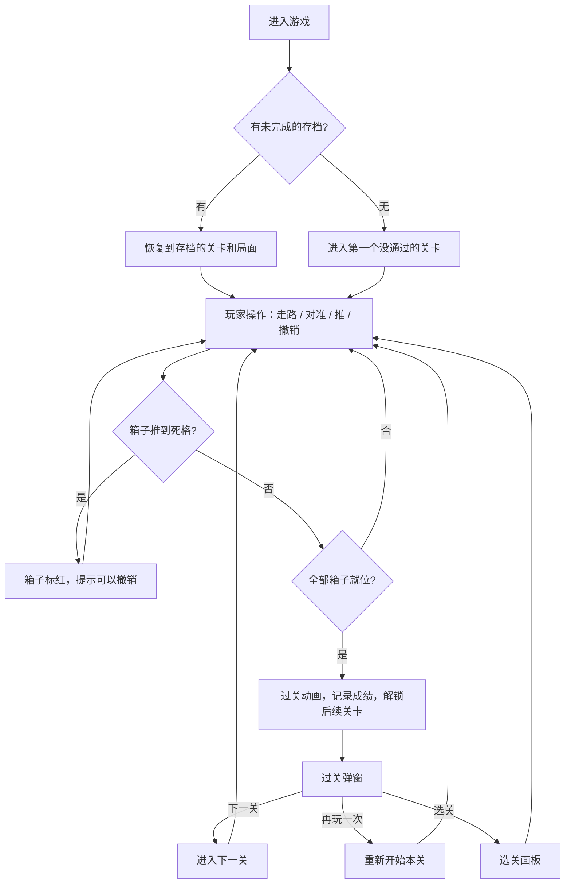

# 推箱子 · 产品设计文档

> 版本：v0.4　｜　所属项目：H5 游戏合集　｜　日期：2026-11-18

## 修订记录

| 版本 | 变更 |
| --- | --- |
| v0.1 | 初稿，配图：整体布局与圆形方向盘、推箱确认流程、地块与箱子状态 |
| v0.2 | 按本稿实现；实现时的调整：随机房间要多放墙（20%–32%）才能生成有深度的关卡，各章推动范围按实际生成结果更新（见 2.6）；生成时去掉死胡同、拒绝有 3×3 空地的房间；地图最大 11 列 × 10 行 |
| v0.3 | **推箱子改为“面朝箱子时再按同方向或按中心都会推”**，原来每次都要按中心，拇指来回挪太累；防误推改由“连续走不推、滑动不推、到达后 250ms 防连点”保证（见 4.2）。方向盘直径改为同时参考屏幕宽高，扇形切换加 10° 回差；撤销 60px 与方向盘垂直居中，重来 / 设置缩小到 44px 放到外侧；矮屏压缩顶栏与状态栏（见 3.2、3.3）。设置「方向键直接推」改为「推箱方式：先对准 / 直接推」 |
| v0.4 | 关卡从 50 关增加到 **100 关**：在末尾追加精通（4 箱）、大师（5 箱）、宗师（6 箱）三章，原有 50 关和玩家进度不变（见 2.6） |

## 1. 概述

**推箱子**（Sokoban）是经典的单人益智游戏。玩家扮演仓库管理员，在由墙围成的仓库里走动，把所有箱子推到目标点上即过关。箱子只能推、不能拉，一次只能推一个；推进墙角的箱子再也拿不出来，所以每一步都要想清楚推的顺序。

| 项 | 说明 |
| --- | --- |
| 平台 | 手机竖屏为主，兼容桌面浏览器（键盘操作）；纳入现有 PWA，离线可玩 |
| 单关时长 | 入门关 0.5–2 分钟，挑战关 3–10 分钟，宗师关 10–30 分钟 |
| 关卡 | 内置 **100 关**，分 7 章，难度递增（见 2.6） |
| 设计原则 | **右手单手操作**：屏幕右下角一个圆形方向盘，四个方向走路，**中间按钮确认推箱子**；撤销、重来就在方向盘左边，拇指不用离开右下角 |

和合集里其他游戏相比，推箱子的特点是**一步走错就可能无解**，所以本设计的重点是：

1. **防误推**：必须先面朝箱子（对准），再按同方向或中间按钮才推出去；连续走、滑动不会推，快速连点有防连点间隔（见 4.2）；
2. **撤销无限次**，并且撤销键放在拇指最顺手的位置；
3. **卡死提示**：箱子被推进死角时立即标红提醒，不用玩家自己发现后再回头。

## 2. 核心规则

### 2.1 地图元素

地图是一个矩形网格，每格是下面其中一种：

| 元素 | 关卡文本符号 | 说明 |
| --- | --- | --- |
| 墙 | `#` | 不能进入 |
| 地板 | 空格 | 可以走、可以放箱子 |
| 目标点 | `.` | 地板的一种，标有圆点 |
| 箱子 | `$` | 放在普通地板上 |
| 已就位的箱子 | `*` | 放在目标点上的箱子，显示为另一种颜色 |
| 玩家 | `@` | 站在普通地板上 |
| 玩家站在目标点上 | `+` | — |

关卡文本采用推箱子通行的 **XSB 格式**（即上表符号），每行一个字符串。墙外面的空格是“场外”，不绘制。



### 2.2 移动与推箱子

- 玩家每次向上 / 下 / 左 / 右移动一格。
- 前方是**墙**：不能走。
- 前方是**箱子**，且箱子再往前一格是地板或目标点（不是墙、不是另一个箱子）：可以把箱子推过去，玩家跟着进入箱子原来的格子。
- 前方是箱子，但箱子后面是墙或另一个箱子：推不动。
- **不能拉箱子**，也不能同时推两个箱子。

推箱子在手机上需要用中间按钮确认（见 4.2），这里只描述规则本身。

### 2.3 过关

所有箱子都在目标点上时立即过关，不需要玩家额外操作。每关的箱子数等于目标点数。

### 2.4 步数与推动数

| 计数 | 说明 |
| --- | --- |
| **步数** | 玩家每移动一格算 1 步（推箱子的那一步也算） |
| **推动** | 每推箱子一格算 1 次 |

- 原地转身（对准箱子、但没有推出去）**不算步数**。
- 撤销会把步数、推动数一起退回去。
- 每关记录**最少推动**（关卡数据里预先算好，见 2.6）。过关时推动数等于最少推动，评为「完美」。
- 不计时：推箱子是想清楚再动手的游戏，计时会催着玩家乱推。

### 2.5 卡死（死局）

有些位置一旦把箱子推进去，就再也推不到任何目标点，这关就无解了。最常见的是**不是目标点的墙角**。

本游戏做**简单卡死检测**：开局时算出所有“死格”——箱子在这一格上时，不管怎么推都到不了任何目标点。算法是从每个目标点出发，反向模拟“拉箱子”，能被拉到的格子都是活格，其余地板就是死格（见 5.4）。

- 箱子被推到死格上时，箱子**变红**，并提示一次「这个箱子推不出来了，撤销试试」。
- 只检测单个箱子的死格，不检测“两个箱子互相挡住”之类的组合卡死（太复杂，误报和漏报都会让人困惑）。组合卡死留作扩展。
- 卡死不会结束游戏，玩家撤销或重来即可。

### 2.6 关卡

内置 100 关，分 7 章：

| 章 | 关卡 | 箱子数 | 最少推动 | 说明 |
| --- | --- | --- | --- | --- |
| 教学 | 1–5 | 1–3 | 2–5 | 手工设计，分别教：推箱子、别推进墙角、推的顺序、绕到箱子另一边、多个箱子 |
| 入门 | 6–20 | 2 | 8–17 | 生成，房间内部 5–7 × 5–7 |
| 进阶 | 21–35 | 3 | 13–30 | 生成，房间内部 6–8 × 6–8 |
| 挑战 | 36–50 | 4 | 22–39 | 生成，房间内部 7–9 × 6–8 |
| 精通 | 51–70 | 4 | 30–56 | 生成，房间内部 8–9 × 7–9，墙更少、空间更大（v0.4） |
| 大师 | 71–85 | 5 | 31–67 | 生成，房间内部 7–9 × 7–8，墙 30%–42%，通道更窄；开局最多 1 个箱子已在目标点上（v0.4） |
| 宗师 | 86–100 | 6 | 34–55 | 生成，房间内部 8–9 × 8–9，墙 32%–44%；开局最多 2 个箱子已在目标点上（v0.4） |

**生成方式**（离线脚本 `scripts/gen-sokoban-levels.mjs`，和数独题库的做法一样，生成结果写进 `levels.js` 提交到仓库；随机种子固定，重新运行得到相同结果）：

1. 随机生成房间：四周是墙，里面每格按 20%–32% 的概率放墙，只保留最大的一片连通地板，再反复去掉三面是墙的死胡同。有 3×3 全是地板的房间太空旷、谜题太简单，直接丢弃。
2. 随机选 N 个目标点，把箱子都放在目标点上（也就是“已过关”的局面）。
3. 从这个局面出发，**反向做广度优先搜索**：玩家只能“拉”箱子。拉了 k 次能到达的局面，正向推回去最少也要推 k 次。
4. 取搜索中**最远**、并且所有箱子都**不在**目标点上的局面作为关卡开局；搜索深度就是这关的最少推动。
5. 只保留贴着地板的墙（含斜角），其余改成场外，并裁掉四周的空行空列，让地图紧凑。
6. 用正向求解器再算一遍最少推动（必须和反向搜索一致），并统计解法里换箱子的次数。按「最少推动 + 3 × 换箱次数」打分，去掉分数最低的 40%，从剩下的里面均匀挑 15 关，按分数从低到高排列。

这样生成的关卡**保证有解**，而且最少推动是精确值。测试里再用正向求解器逐关验证一遍（见 5.6）。

**v0.4 追加章节的做法**（5–6 个箱子时状态数会爆炸，要做三处调整）：

- **只能追加、各用各的种子**：前 4 章共用一条随机序列，改动任何参数都会让已发布的关卡全部变样，所以新章节放在末尾，每章用自己的随机种子。存档里的关卡序号和按地图哈希保存的成绩都不受影响，`LEVELS_VERSION` 不用改。
- **允许开局有箱子已在目标点上**：窄通道的房间里，5–6 个箱子常常无法同时离开目标点。经典关卡里开局就有箱子在目标点上也很常见（玩家常常要先把它挪开）。
- **反向搜索超出状态上限时保留已完成的层**：广度优先每一层的推动数都是精确的最少值，超限时取最后一个完整层里的局面作为开局，只是不一定是最远的。正向求解器在默认上限内解不出来的局面直接跳过，保证测试能逐关验证。

**关卡解锁**：第 1–3 关一开始就能玩；之后每关在“已通过的最远一关 + 3”以内都能玩。允许跳过最多 2 关卡住的关卡，又不会一下子跳到最难的关。

## 3. 界面布局

整个页面从上到下分为：**顶栏 → 状态栏 → 地图区 → 底部控制区**。



### 3.1 各区域说明

| 区域 | 内容 | 说明 |
| --- | --- | --- |
| 顶栏 | 返回、标题、选关、玩法说明 | 选关按钮打开选关面板（见 7 节）；音效开关放在设置面板里 |
| 状态栏 | 三格：关卡 / 步数 / 推动 | 关卡格显示「第 12 关」和章名；推动格下方小字显示「最少 18」 |
| 地图区 | 关卡地图，居中显示 | 占满剩余空间；点击地板可以自动走过去（见 4.4） |
| 底部控制区 | 左侧：撤销（大）、重来、设置；右侧：**圆形方向盘** | 固定在屏幕底部，避开底部安全区；高约 200px |

### 3.2 圆形方向盘

方向盘是一个圆，分成五个区域：

| 区域 | 形状 | 作用 |
| --- | --- | --- |
| 上 / 右 / 下 / 左 | 圆环按 45° 斜线切成四个扇形 | 走路、转身；面朝推得动的箱子时再按同方向 = 推 |
| 中心 | 小圆 | **推**：把正对着的箱子推一格 |

尺寸：

```
方向盘直径 D = clamp(140px, min(42vw, 23vh), 180px)
中心按钮直径 = 0.38 × D          （D = 153px 时约 58px）
右边距 = 16px + 右侧安全区，下边距 = 12px + 底部安全区
```

D 同时参考屏幕宽和高：宽屏手机不会大得占掉地图，矮屏手机（iPhone SE）会自动缩小。各尺寸下的可点区域：

| 屏幕 | D | 中心按钮 | 扇形环宽 | 说明 |
| --- | --- | --- | --- | --- |
| iPhone SE（375 × 667） | 153px | 58px | 47px | 都大于 44pt 的最小触控尺寸 |
| iPhone 13（390 × 844） | 164px | 62px | 51px | — |
| 大屏手机（430 × 932） | 180px | 68px | 56px | 封顶 |

- 判定按**触点相对圆心的位置**算，不按元素边界：离圆心小于中心半径算中心，其余按角度落在哪个扇形算哪个方向。方向盘外沿再往外 **16px** 以内也算对应方向，拇指按偏一点不会落空。
- **滑动回差**：手指按住滑动时，要越过分界线 **10°** 才切换到相邻方向，避免手指停在斜线附近时方向来回跳。按下的那一刻不加回差，按哪算哪。
- 四个扇形只画浅色分隔线和箭头，按下的扇形整体变深。
- 中心按钮平时是灰色，**正对着一个推得动的箱子时**变成橙色，并显示指向推的方向的箭头；箱子上同时出现同方向的箭头。橙色 = “现在按同方向或按中心都会推”（见 4.2）。
- 桌面不显示方向盘（只用键盘），触屏电脑可在设置里打开。

### 3.3 方向盘左侧的按钮

右手拇指以右下角附近的指根为轴转动，舒适区是一条围着右下角的弧带。方向盘占住弧带的中心，其余按钮按使用频率由近到远排开：

| 按钮 | 大小 | 位置 | 作用 |
| --- | --- | --- | --- |
| 撤销 | 60 × 60 | 方向盘左侧，间距 12px，和方向盘**垂直居中** | 退回一步；按住不放时连续撤销（见 4.3） |
| 重来 | 44 × 44 | 最外侧上方 | 回到本关开局（弹窗确认，见 7 节） |
| 设置 | 44 × 44 | 最外侧下方 | 打开设置面板 |

- 撤销是使用频率第二高的操作（仅次于方向盘），拇指从方向盘中心水平左移一个按钮宽度就能按到。
- 重来会丢掉进度，设置很少用，二者放在拇指最难够到的外侧，并和撤销隔开一列，降低误触；重来另有确认弹窗。
- 矮屏（高度 ≤ 700px）时顶栏高度从 56px 压到 48px，状态栏数字字号缩小，把空间留给地图。

### 3.4 格子尺寸

以格子边长 **S** 为基准：

```
S = floor(min(56px, 地图区可用宽度 / 关卡列数, 地图区可用高度 / 关卡行数))
```

S 取整数像素。关卡最大 11 列 × 10 行（含墙），iPhone SE 上最大的关卡 S = 31px；小关卡封顶 56px，避免格子大得夸张。

### 3.5 左手模式

设置里可以把方向盘换到**左下角**（左右整体镜像：方向盘在左，撤销等按钮在右），方便左手持机的玩家。默认右手。

## 4. 交互设计

### 4.1 走路

- 按下方向扇形（`pointerdown`）立即生效，不等抬起。
- 前方是地板：走一格，玩家朝向变成这个方向。
- 前方是墙：不动，玩家转向这个方向，轻微“撞一下”的动效。
- **按住不放**：等 **220ms** 后每 **110ms** 走一格，直到松开、撞墙或碰到箱子。连续走**永远不会推箱子**，走到箱子前自动停下并对准。
- **手指在扇形之间滑动**：从“上”滑到“右”就改成向右走，不用抬起手指（有 10° 回差，见 3.2）。滑动换方向只会走路或转身，**不会推**；滑进中心区域也不会推。

### 4.2 推箱子：先对准，再推



**对准**：玩家面朝一个推得动的箱子（紧挨着、箱子后面是空地）时就处于“对准”状态，箱子上显示箭头，中心按钮变橙色。进入对准有两种方式：

- 朝箱子走过去，走到跟前时自然面朝它；
- 站在箱子旁边但面朝别处时，朝箱子按方向键：**只转身、不推**，不算步数。

**推**：对准状态下，下面两种操作都会把箱子推一格，玩家跟进一格：

- **再按同一方向**（拇指不用挪，最顺手）；
- **按中心按钮**（明确的“推”键，适合习惯先确认的玩家，也用于点地图对准之后）。

推完后如果还能接着推，仍然是对准状态，继续按就继续推。**按住不放**（方向键或中心都可以）：等 300ms 后每 160ms 推一格，直到推不动或松开。

**为什么这样不会误推**——误推几乎都来自下面几种情况，每种都单独拦住了：

| 情况 | 处理 |
| --- | --- |
| 按住方向键往前走，走过头 | 连续走永远不推，到箱子前自动停下 |
| 快速连点方向键往前走，多点了一下 | **防连点**：走到箱子跟前后 **250ms** 内，同方向的按键被忽略。正常“看一眼再按”的间隔都在 300ms 以上，不受影响；快速连点的间隔通常在 150–200ms |
| 手指滑动时扫过某个方向 | 滑动只走路和转身，不推 |
| 按错方向，按向旁边的箱子 | 面朝别处时按向箱子只转身对准，要推必须再按一次 |

箱子推不动（后面是墙或箱子）时朝它按方向键：玩家转身对着它，箱子轻抖一下，播放 `error`，中心按钮保持灰色。中心按钮在没有对准时按下：无效，按钮轻抖。

**设置：推箱方式**——「先对准」（默认，即上面的规则）/「直接推」（经典玩法：朝推得动的箱子按方向键直接推，不需要先面朝它；连续走、滑动仍然不推）。

### 4.3 撤销与重来

- **撤销**：退回上一步（走路或推箱子都算一步），步数、推动数一起退回。次数不限，可以一直撤销到开局。
- **按住撤销**：等 400ms 后每 120ms 撤销一步，适合退回很远。
- **重来**：回到本关开局。本关还没走过就直接重来；走过就弹窗确认「重新开始本关吗？」。
- 撤销记录随存档保存，退出再进来也能继续撤销。

### 4.4 点击地图

- **点地板**：玩家沿最短路径自动走过去（不推任何箱子），每格 60ms 的动画；走不到的地方点了没反应。
- **点和玩家相邻的箱子**：转身对准它（不推）；推得动时中心按钮变橙，之后按同方向或中心推。
- 自动走路途中按任何键或再点地图，立即停在当前位置。
- 自动走过去的每一格都算步数，撤销时一格一格地退。

点击地图是辅助功能，主要操作仍然是方向盘。

### 4.5 桌面：键盘

| 按键 | 作用 |
| --- | --- |
| 方向键 / `W` `A` `S` `D` | 走路；**朝箱子按会直接推**（桌面键盘不容易误触，沿用经典习惯） |
| `Space` / `Enter` | 推（推正对着的箱子） |
| `Z` / `U` / `Backspace` | 撤销 |
| `R` | 重来（弹窗确认） |
| `N` / `P` | 下一关 / 上一关（只能去已解锁的关） |
| `L` | 打开选关面板 |

- 浏览器自带的按键重复不忽略（键盘按住移动是用户熟悉的手感），但按键重复**不会推箱子**，推箱子必须重新按下。
- 键盘的“直接推”不受设置影响，始终打开。

### 4.6 动画期间的输入

- 走一格、推一格的动画为 **90ms**（自动走路为 60ms），动画期间来的输入**立即生效**，动画直接改为过渡到新位置，不排队、不丢输入。
- 过关动画期间（约 900ms）忽略所有地图操作。

## 5. 判定逻辑

### 5.1 数据结构

```js
// 地图：宽 w、高 h，格子 index = y * w + x
// tiles: Uint8Array，0 = 场外，1 = 墙，2 = 地板
// target: Uint8Array，1 = 目标点
// box:    Uint8Array，1 = 有箱子
// player: 玩家所在 index；facing: 0 上 1 右 2 下 3 左
// history: 字符串，每步一个字符，LURD 记法：
//          l u r d = 走路，L U R D = 推箱子（推箱子的大写字母）
// moves / pushes：可由 history 算出，单独存一份方便显示
// dead: Uint8Array，1 = 死格（开局算好，见 5.4）
```

用 LURD 字符串记录历史是推箱子的通行做法：存档小、可以直接回放，撤销时取最后一个字符反向执行即可。

### 5.2 走一步

```js
function step(g, dir, allowPush) {
  const next = g.player + DELTA[dir];
  g.facing = dir;
  if (g.tiles[next] !== FLOOR) return { type: 'bump' };
  if (!g.box[next]) {
    g.player = next;
    g.history += 'urdl'[dir];
    return { type: 'move' };
  }
  const beyond = next + DELTA[dir];
  const pushable = g.tiles[beyond] === FLOOR && !g.box[beyond];
  if (!pushable) return { type: 'blocked' };          // 推不动
  if (!allowPush) return { type: 'aim' };             // 只转身对准，不推
  g.box[next] = 0;
  g.box[beyond] = 1;
  g.player = next;
  g.history += 'URDL'[dir];
  return { type: 'push', from: next, to: beyond };
}
```

中心按钮 = `step(g, g.facing, true)`，但只在玩家正对的格子是推得动的箱子时才调用。

### 5.3 撤销

取 `history` 最后一个字符：小写字母，玩家反向走一格；大写字母，玩家反向走一格，并把玩家前方（原推动方向）那格的箱子拉回玩家原来站的格子。撤销后玩家朝向保持为这一步的方向。

### 5.4 死格

```js
// 从每个目标点出发，反向“拉”箱子：箱子在 c，玩家站在 c - d，拉一步箱子到 c - d、玩家到 c - 2d。
// 只要 c - d 和 c - 2d 都是地板（忽略其他箱子和玩家能否走到），c - d 就是活格。
// 所有目标点能拉到的格子是活格，其余地板是死格。
```

死格只看墙，不看箱子，所以是“一定死”的保守判断，不会误报。

### 5.5 自动走路

点击地板时，以玩家为起点在“地板且没有箱子”的格子上做 BFS，得到最短路径（方向序列）；同样长度的路径优先少拐弯，看起来更自然。

### 5.6 求解器（只用于生成和测试）

```js
// 状态 = 箱子位置集合 + 玩家可达区域里 index 最小的格子（同一区域内的玩家位置等价）
// 从开局状态 BFS，每一层是推一次箱子；到达所有箱子都在目标点的状态时，层数 = 最少推动
```

- 生成脚本用**反向**搜索找关卡开局（见 2.6），测试用**正向**搜索验证每关有解、最少推动和关卡数据一致。
- 100 关正向求解共约 360 万个状态，Node 中全部验证一遍约 20 秒（大部分花在 5–6 箱的关卡上）。

### 5.7 测试要点

- 关卡数据：每关恰好 1 个玩家，箱子数 = 目标点数，地图被墙封闭（玩家走不出地图），开局没有箱子在死格上，开局没有全部就位，尺寸不超过 11 × 11，地图不重复。
- 正向求解每关有解，最少推动与 `levels.js` 中记录的一致。
- 走路：撞墙不动、不算步数；推得动 / 推不动 / 推两个箱子的判断；对准不算步数。
- 撤销：任意随机操作序列后连续撤销，能回到开局，步数、推动数归零；撤销推箱子时箱子正确拉回。
- 死格：墙角、靠墙且这一面墙上没有目标点的整排格子为死格；目标点本身永远是活格。
- 自动走路：路径不穿过墙和箱子；走不到时返回空。
- 存档：按 history 回放后局面一致；篡改的存档（非法字符、回放中撞墙、关卡号越界、未解锁）被丢弃。

## 6. 游戏流程



## 7. 弹窗与其他功能

- **过关弹窗**：

| 内容 | 说明 |
| --- | --- |
| 标题 | 「过关！」；推动数等于最少推动时为「完美过关！」 |
| 本次成绩 | 步数、推动、最少推动 |
| 历史最佳 | 本关的最少步数、最少推动（两项分别记录，可以来自不同的通关） |
| 新纪录 | 本次推动或步数少于历史最佳时显示「新纪录！」 |
| 按钮 | 「再玩一次」「选关」「下一关」（主按钮）；最后一关没有「下一关」，改为「全部通关！」的提示 |

- **选关面板**：按章分组，每章 5 列网格。每个格子显示关卡号，以及状态：未解锁（灰、锁图标）、未通过、已通过（✓）、完美（★）。顶部显示总进度「已通过 12 / 100 · 完美 5」。当前关卡描边。
- **重来确认**：本关走过之后点重来，弹窗「重新开始本关吗？」；当前关已过关、正在看过关后的局面时不确认。
- **切换关卡**：当前关走过但没过关时，切到别的关前**不确认**，当前关进度直接丢弃（推箱子随时可以重来，确认弹窗反而烦人）。
- **存档**：每一步之后把「当前关卡号 + history」写入 `localStorage`，恢复时按 history 回放。过关后存档清空。
- **成绩**（按关卡分别记录）：是否通过、最少步数、最少推动、是否完美、首次通过日期。
- **设置面板**：
  - 音效：开 / 关；
  - 推箱方式：先对准（默认）/ 直接推；
  - 方向盘位置：右手（默认）/ 左手；
  - 屏幕方向盘：显示 / 隐藏（默认按设备判断：触屏显示、非触屏隐藏；玩家明确选过才保存）；
  - 卡死提示：开（默认）/ 关。
- **玩法说明**：点顶栏「?」弹出，首次进入自动弹出一次。

## 8. 动效与音效

| 时机 | 动效 | 音效（`js/sfx.js`） |
| --- | --- | --- |
| 走一格 | 玩家平移 90ms，朝向变化 | 不播放（太频繁） |
| 撞墙 | 玩家向墙的方向挪 1/6 格再弹回（120ms） | 不播放 |
| 对准推得动的箱子 | 箱子上淡入箭头；中心按钮变橙并轻微放大回弹 | `tap`（音量减半） |
| 对准推不动的箱子 | 箱子左右轻抖 | `error` |
| 推一格 | 箱子和玩家同时平移 90ms | `move` |
| 箱子推上目标点 | 箱子变色，并有一圈光晕扩散（250ms） | `place` |
| 箱子推离目标点 | 箱子变回普通颜色 | 不播放 |
| 箱子推到死格 | 箱子变红并抖一下 | `error` |
| 撤销 | 和走路相同的平移动画（反向） | `tap`（按住连续撤销时只在第一下播放） |
| 中心按钮无效 | 按钮左右轻抖 | `error` |
| 过关 | 所有箱子依次轻跳（每个间隔 80ms），地图边框发光 | `win` |
| 完美 / 新纪录 | 弹窗中「完美」「新纪录！」放大回弹 | — |

振动（设备支持时，随音效开关一起关闭）：推一格 8ms，箱子就位 15ms，过关 `[30, 40, 60]`。

## 9. 视觉规范

地图在浅色、深色主题下使用固定配色，保证箱子和目标点的辨识度：

| 用途 | 色值 |
| --- | --- |
| 地图区背景 | 跟随主题（`--bg`） |
| 墙 | `#475569`，顶面高光 `#64748b`，底部阴影 `#334155` |
| 地板 | `#e7e1d4`，相邻格之间 1px `#ddd5c4` 分隔 |
| 目标点 | 地板中央直径 0.36S 的圆，`#f97316` 描边 + 浅橙填充 |
| 箱子 | 木箱：`#d97706` 底色，`#b45309` 边框和 X 形木条 |
| 已就位的箱子 | `#16a34a` 底色，`#15803d` 边框，带浅色高光 |
| 卡死的箱子 | `#dc2626` 底色，`#991b1b` 边框 |
| 玩家 | 圆形，`#4f46e5`（主题主色），白色眼睛朝向移动方向 |
| 准备推的箭头 | 白色箭头，半透明黑色描边 |

- 深色主题下地板改为 `#3b3a36`、分隔线 `#34332f`，其余不变。
- 墙、地板用一张 canvas 画好（关卡切换和尺寸变化时重画）；箱子和玩家用绝对定位的 DOM 元素，靠 CSS `transform` 过渡做移动动画。
- 目标点画在地板 canvas 上，箱子盖住时看不到，箱子颜色变化表示就位。

## 10. 边界情况

| 场景 | 处理 |
| --- | --- |
| 两根手指同时按方向盘 | 方向只认第一根手指；第二根手指按中心按钮时可以推 |
| 走到箱子跟前后马上（250ms 内）再按同方向 | 视为连点，忽略；稍等再按即可推（见 4.2） |
| 手指按着方向扇形滑出方向盘很远 | 超出外沿 16px 视为松开，停止连续走路 |
| 按住方向连续走，前面出现箱子 | 停在箱子前，**自动对准**它（推得动时中心按钮变橙），但不推 |
| 自动走路途中点了中心按钮 | 停止自动走路；如果停下时正好对着推得动的箱子，则推 |
| 撤销到开局再撤销 | 无效，撤销按钮置灰 |
| 推箱子过关的瞬间点撤销 | 过关动画期间忽略；过关弹窗关闭后可以撤销最后一步继续看（不影响已记录的成绩） |
| 切到后台 / 锁屏 | 每步已存档，不需要额外处理；没有计时，不需要暂停 |
| 旋转屏幕 / 改变窗口大小 | 重新计算 S 并重画地图，箱子和玩家位置无动画地跳到新坐标 |
| 横屏手机 | 地图在左侧，方向盘在右下角（左手模式在左下角），撤销等按钮竖排在方向盘上方 |
| 存档关卡号超出范围、history 回放失败 | 丢弃存档，进入第一个没通过的关卡 |
| 关卡数据更新导致关卡变了 | `levels.js` 带版本号，版本不同时丢弃当前局面存档；成绩按关卡的地图文本哈希保存，地图没变的关成绩保留 |

## 11. 决策记录

| 问题 | 结论 |
| --- | --- |
| 手机操作方式 | 右下角圆形方向盘 + 中心推按钮，主打右手单手（v0.1，见 3.2） |
| 方向键能否推 | 面朝箱子（对准）时再按同方向就推，中心按钮也推；面朝别处时按向箱子只转身。设置中可改为直接推；键盘始终直接推（v0.3，见 4.2、4.5）。v0.1 曾规定只有中心按钮能推，推一串箱子时拇指来回挪动太多，改掉 |
| 防连点间隔 | 250ms：介于快速连点（150–200ms）和有意识的再次按键（300ms 以上）之间（v0.3，见 4.2） |
| 方向盘大小 | D = clamp(140px, min(42vw, 23vh), 180px)，同时参考宽高，小屏自动缩小；可点区域始终大于 44pt（v0.3，见 3.2） |
| 连续走路是否推箱子 | 永远不推，碰到箱子自动对准停下（v0.1，见 4.1、10 节） |
| 关卡来源 | 5 关手工教学关 + 45 关脚本生成（反向拉箱子搜索，保证有解、最少推动精确），不使用有版权的经典关卡集（v0.1，见 2.6） |
| 是否计时 | 不计时，只记步数和推动（v0.1，见 2.4） |
| 卡死检测 | 只做单箱子死格，不做组合卡死（v0.1，见 2.5） |
| 撤销次数 | 不限，按住可连续撤销（v0.1，见 4.3） |
| 渲染方式 | 墙和地板用 canvas，箱子和玩家用 DOM + CSS transform（v0.1，见 9 节） |

### 待确认事项

1. **防连点间隔**：250ms 是按通常的点击节奏估的，真机试玩后可在 200–300ms 之间微调。
2. **自动走路是否保留**：点地板自动走在推箱子游戏里很常见，但会和“单手方向盘”的定位重叠。先保留，观察是否容易误触。

## 12. 接入合集

- 目录：`games/sokoban/`，文件：
  - `index.html`、`sokoban.css`；
  - `sokoban.js`：界面、方向盘输入、地图绘制、动画、存档、成绩、选关；
  - `engine.js`：纯逻辑（解析关卡、走路 / 对准 / 推、撤销、死格、自动寻路、存档校验），不依赖 DOM；
  - `levels.js`：关卡数据（脚本生成，带版本号和每关最少推动）；
  - `solver.js`：求解器（正向 BFS 求最少推动；生成脚本和测试使用，游戏运行时不加载）。
- `scripts/gen-sokoban-levels.mjs`：生成关卡并写入 `levels.js`。
- 在 `js/games.js` 的 `H5_GAMES` 中追加一项（`id: 'sokoban'`，名称「推箱子」，标签 `['益智', '单人']`），并在 `icons/` 下新增 `sokoban.svg`。
- 修改 `sw.js` 顶部的 `VERSION`。
- `tests/smoke.mjs` 增加测试，覆盖 5.7 节列出的要点。
- `README.md` 的游戏列表和项目结构里补上推箱子。

## 13. 后续可扩展

- **提示**：在 Web Worker 里跑求解器，给出下一步该推哪个箱子、往哪推（4 个箱子以内的关卡可以实时算）。
- **组合卡死检测**：2×2 方块卡死、两个箱子靠墙并排等常见情形。
- **重做**：撤销后可以再前进。
- **回放**：过关后按 history 回放自己的解法，或回放最少推动的解法。
- **导入关卡**：粘贴 XSB 文本即可玩，社区有大量免费关卡集（导入时需注意关卡作者的授权）。
- **更多关卡**：继续追加章节（同样各用各的种子）；更大的地图需要先解决手机上格子太小的问题。
