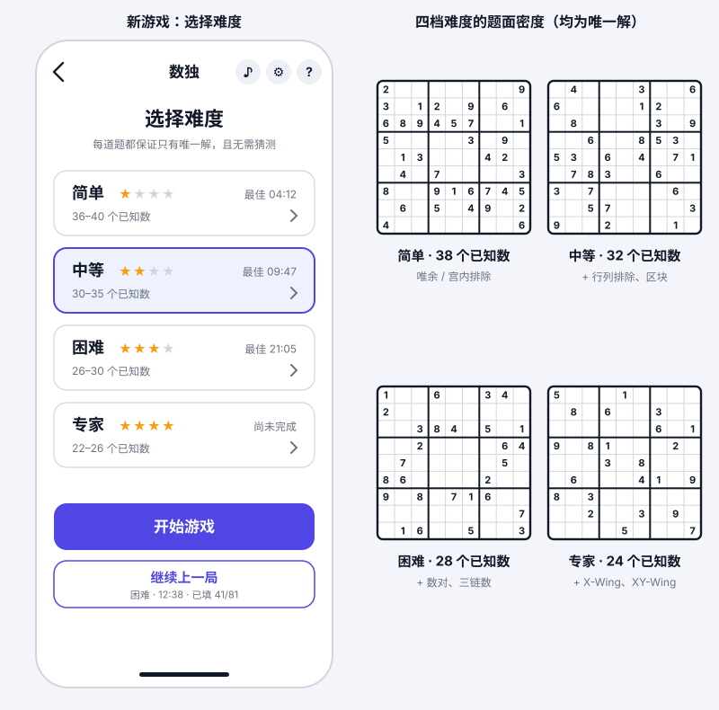
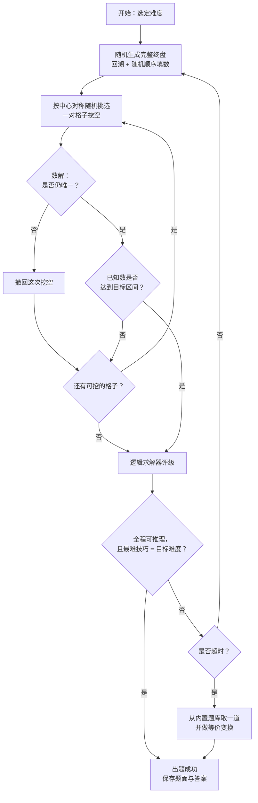
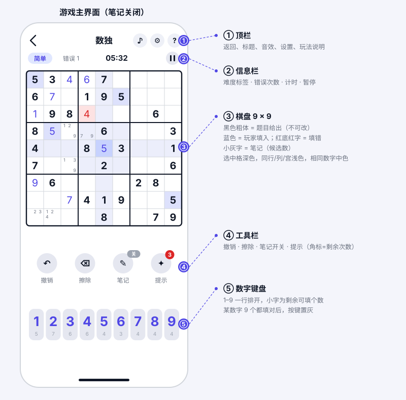
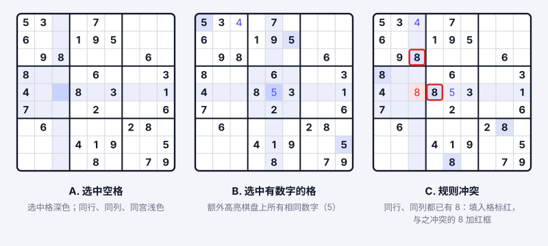
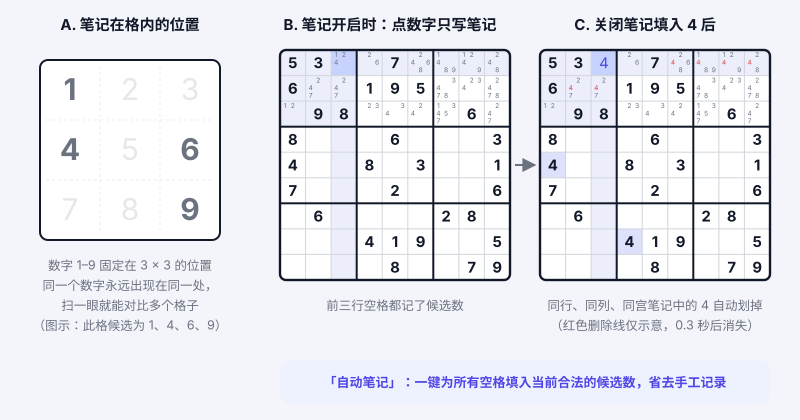
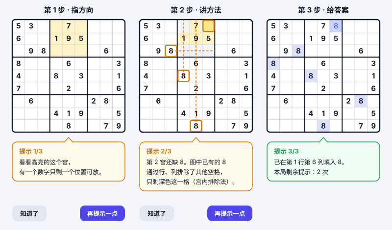
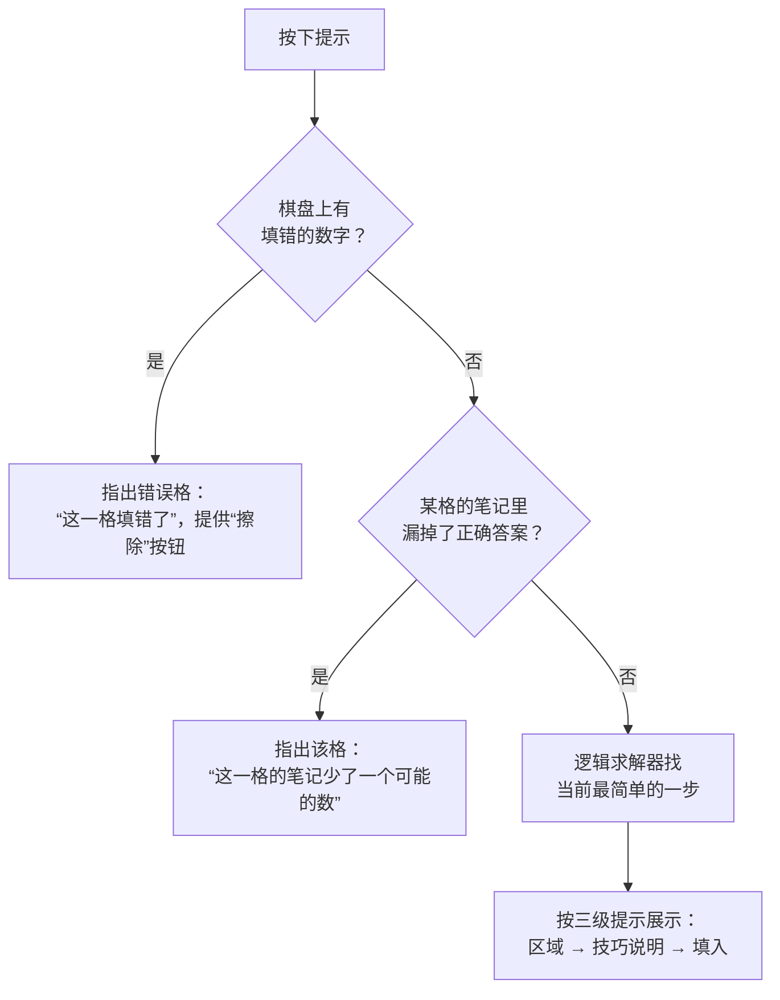
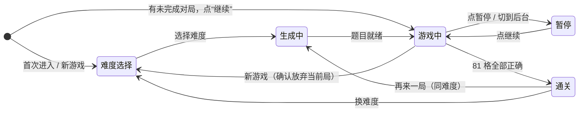
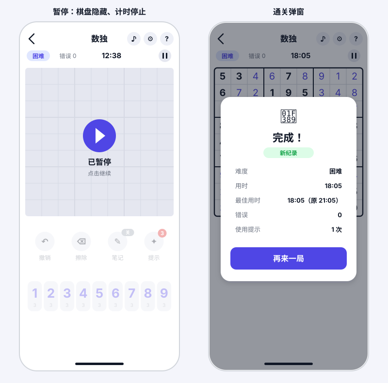

# 数独 · 产品设计文档

> 版本：v0.2（草案）　｜　所属项目：H5 游戏合集　｜　日期：2026-11-17

## 修订记录

| 版本 | 变更 |
| --- | --- |
| v0.1 | 初稿：规则、难度体系、出题与唯一解保证、界面、笔记、提示、存档与统计 |
| v0.2 | 随首版实现更新：排除类技巧的提示改为推进到下一个可确定的格子再给出（见 7.2）；待确认事项按默认方案实现 |

## 1. 概述

**数独**是经典的 9 × 9 数字逻辑游戏。玩家根据已给出的数字，在空格里填入 1–9，使每一行、每一列、每一个 3 × 3 宫都恰好包含 1–9 各一次。

| 项 | 说明 |
| --- | --- |
| 平台 | 手机竖屏为主，兼容桌面浏览器；纳入现有 PWA，离线可玩 |
| 单局时长 | 5 分钟（简单）到 40 分钟以上（专家） |
| 难度 | **简单 / 中等 / 困难 / 专家** 四档 |
| 核心承诺 | **每道题都有且只有一个解，并且只靠逻辑推理就能解出，不需要猜** |
| 辅助功能 | 笔记（候选数标记）、自动笔记、三级提示、撤销、擦除、错误检查、高亮 |
| 设计原则 | 单手可玩：棋盘在上，工具栏和数字键盘在拇指可达的下半屏 |

## 2. 核心规则

- **棋盘**：9 行 × 9 列，共 81 格；粗线把棋盘分成 9 个 3 × 3 的**宫**，按从左到右、从上到下编号为第 1–9 宫。
- **题面**：开局时一部分格子已给出数字（**已知数**），不可修改；其余为空格。
- **填数**：玩家在空格中填入 1–9。
- **约束**：每一行、每一列、每一宫中，1–9 各出现**恰好一次**。
- **胜利**：81 格全部填满，且与答案完全一致（因为答案唯一，等价于满足全部约束）。
- **没有失败**：默认不设错误上限，玩家总能把一局下完（见 11 节待确认事项）。

## 3. 难度体系

### 3.1 四档难度

难度**以解题所需的最难技巧为准**，已知数的个数只作为辅助约束。原因：已知数多不代表简单——同样 30 个已知数的题，可能只用最基础的排除就能解开，也可能需要 X-Wing。只按个数分档，会出现“简单题卡死新手”的情况。

| 难度 | 已知数 | 允许用到的最难技巧 | 目标时长 | 每局提示次数 |
| --- | --- | --- | --- | --- |
| ★ 简单 | 36–40 | 唯余法、宫内排除法 | 5–10 分钟 | 3 |
| ★★ 中等 | 30–35 | + 行/列排除法、区块排除 | 10–20 分钟 | 3 |
| ★★★ 困难 | 26–30 | + 显性/隐性数对、三链数 | 20–40 分钟 | 3 |
| ★★★★ 专家 | 22–26 | + X-Wing、Swordfish、XY-Wing | 40 分钟以上 | 3 |

一道题要被分到某一档，必须**同时**满足两个条件：

1. 已知数个数落在该档区间内；
2. 用逻辑求解器（见 4.3）解题时，**用到的最难技巧恰好属于该档**——不能更难（否则超纲），也不能全程只用低一档的技巧（否则名不副实）。



左图：新游戏时的难度选择页，每档显示星级、已知数范围和该档最佳用时；底部「继续上一局」显示未完成对局的进度。右图：四档难度的真实题面示例（均由生成器产出并校验为唯一解），可以直观看到已知数逐档减少。

### 3.2 技巧说明

| 技巧 | 所属难度 | 一句话解释 |
| --- | --- | --- |
| 唯余法（显性唯一） | 简单 | 某格排除同行、同列、同宫的数字后只剩一个候选 |
| 宫内排除法（隐性唯一） | 简单 | 某宫中，某个数字只剩一个格子能放 |
| 行/列排除法 | 中等 | 某行或某列中，某个数字只剩一个格子能放 |
| 区块排除 | 中等 | 宫内某数字只可能出现在同一行（列）上，则该行（列）的其他宫可排除此数；反之亦然 |
| 数对 / 三链数 | 困难 | 2 个格子只能放 2 个数（或 3 格 3 数），则同区域其他格排除这些数 |
| X-Wing / Swordfish | 专家 | 某数字在 2（3）行中只出现在相同的 2（3）列上，则这些列的其他格可排除此数 |
| XY-Wing | 专家 | 三个双候选格构成“枢轴 + 两翼”，两翼共同看到的格子可排除公共数 |

## 4. 出题方案：保证有解、唯一解、可推理

“必须有解”在本游戏里有三层含义，生成的每一道题都必须全部满足：

| 层次 | 含义 | 如何保证 |
| --- | --- | --- |
| ① 有解 | 至少存在一个合法填法 | 题目从一个**完整合法的终盘**挖空得来，终盘本身就是一个解 |
| ② 唯一解 | 只有一个合法填法 | 每挖一个（一对）格子，都用求解器数解，解数 ≠ 1 就撤回这次挖空 |
| ③ 可推理 | 不需要试错猜测 | 用逻辑求解器只靠第 3.2 节的技巧把题解完，解不完就丢弃这道题 |

### 4.1 生成流程



要点：

- **完整终盘**：对 81 格按顺序回溯填数，每格的候选数随机打乱，得到一个随机的合法终盘。
- **中心对称挖空**：每次挖掉格子 \((r, c)\) 和它的对称格 \((8-r, 8-c)\)，题面更美观，也是传统数独的惯例。
- **数解**：用“最少候选格优先”的回溯求解器，**找到第 2 个解就立即停止**，只需判断“是否唯一”，不必穷举，速度很快。
- **评级失败就重来**：生成的题可能偏易或偏难，直接重新生成，直到命中目标难度。

### 4.2 内置题库兜底

简单、中等两档实时生成几乎都能在 0.3 秒内完成；困难、专家两档命中率低，偶尔会耗时较长。为保证“点开始就能玩”：

- 实时生成设 **1.5 秒**超时；超时就从内置题库里取一道。
- 题库每档预置约 50 道已评级的题（离线脚本生成并校验，打包进 PWA 缓存）。
- 取出后做**等价变换**再给玩家，变换不改变唯一性和难度，但让同一道题“长得完全不同”：
  - 数字重新映射（例如把所有 1 换成 7、7 换成 3……），共 \(9! = 362880\) 种；
  - 同一横向三宫带内交换行、同一纵向三宫带内交换列；
  - 交换整条横向三宫带 / 纵向三宫带；
  - 转置（沿主对角线翻转）。
- 50 道题经过变换后可产生数以亿计的不同题面，玩家实际上不会遇到重复。

### 4.3 逻辑求解器

逻辑求解器只做两件事，并同时服务于“评级”和“提示”（见第 7 节）：

1. **找下一步**：在当前盘面上，按技巧从易到难依次尝试，返回**最简单的一步**（例如“第 2 宫的 8 只能放在第 1 行第 6 列，技巧：宫内排除法”）。
2. **评级**：反复执行“找下一步并应用”直到解完，记录过程中用到的最难技巧；如果中途找不到任何一步（需要猜），判定为“超纲”。

### 4.4 性能

- 生成在 **Web Worker** 中进行，不阻塞界面；生成期间棋盘显示加载动画。
- 玩家进入游戏页后，后台**预生成**下一局所选难度的题，「再来一局」可以瞬间开始。

## 5. 界面布局

整个页面从上到下分为：**顶栏 → 信息栏 → 棋盘 → 工具栏 → 数字键盘**。



图中状态：玩家选中了第 5 行第 5 列刚填入的 5，棋盘上所有 5 被高亮；第 3 行第 4 列填了 4，与答案不符，显示为红底红字；左侧几个空格里有灰色的笔记数字。

### 5.1 各区域说明

| 区域 | 内容 | 说明 |
| --- | --- | --- |
| 顶栏 | 返回、标题、音效开关、设置、玩法说明 | 沿用合集其他游戏的顶栏规范 |
| 信息栏 | 难度标签、错误次数、计时、暂停 | 计时格式 `mm:ss`，超过 1 小时显示 `h:mm:ss` |
| 棋盘 | 9 × 9 格 | 正方形，宽度撑满屏幕（左右留边距）；宫线粗、格线细 |
| 工具栏 | 撤销、擦除、笔记、提示 | 笔记按钮右上角显示「开 / 关」；提示按钮角标显示剩余次数 |
| 数字键盘 | 1–9 一行排开 | 每个键下方小字显示该数字还剩几个没填；全部填对后按键置灰 |

### 5.2 格子的视觉状态

| 状态 | 样式 |
| --- | --- |
| 已知数 | 黑色粗体，不可选中修改（可以选中用于高亮） |
| 玩家填入 | 主题蓝色，常规字重 |
| 填错（开启即时纠错时） | 红色数字 + 浅红底 |
| 规则冲突 | 冲突的填入格红字浅红底；与之冲突的格子加红框 |
| 笔记 | 灰色小字，按 3 × 3 固定位置排列（见 6.2） |
| 选中格 | 深一些的蓝紫色底 |
| 同行 / 同列 / 同宫 | 很浅的蓝紫色底 |
| 相同数字 | 中等深度的蓝紫色底 |

### 5.3 自适应

棋盘边长 \(B\) 取宽度约束和高度约束中的较小值，工具栏和数字键盘高度固定：

```
可用高度 = 屏幕高度 − 顶栏 − 信息栏 − 工具栏 − 数字键盘 − 底部安全区 − 边距
B = clamp(288px, min(屏幕宽度 − 24px, 可用高度), 540px)
格子边长 = B / 9
```

| 屏幕 | 棋盘边长 | 格子边长 |
| --- | --- | --- |
| iPhone SE（375 × 667） | 约 351px | 39px |
| 大屏手机（430 × 932） | 约 406px | 45px |
| 桌面浏览器 | 封顶 540px | 60px |

格子最小 32px，保证手指能准确点中。

## 6. 交互设计

### 6.1 选中与高亮

基本操作是**先选格，再按数字**：

1. 点击任意格子将其选中（已知数格也能选中，只是不能修改）；
2. 点击数字键，向选中格填入数字；
3. 再次按下与格内相同的数字，等同于擦除。



- **A. 选中空格**：同行、同列、同宫浅色高亮，帮助玩家看清“这一格受哪些格约束”。
- **B. 选中有数字的格**：额外把棋盘上所有相同数字高亮，便于做排除。
- **C. 规则冲突**：填入的数字与同行 / 列 / 宫已有数字重复时，填入格标红，与之冲突的格子加红框；冲突解除后自动恢复。

高亮可以在设置里分别关闭（见 9 节）。

### 6.2 笔记（候选数标记）

笔记用来记录“这一格可能是哪几个数”，是中高难度必备的辅助工具。



- **开关**：点击工具栏「笔记」切换。开启后按钮变为主题色，数字键盘的数字变成灰色、较细，提示当前处于笔记模式。
- **写笔记**：笔记模式下点数字，在选中格里**添加 / 去掉**这个候选数（再按一次就去掉）；已经填了数字的格子不能写笔记。
- **固定位置**：候选数 1–9 在格子里按 3 × 3 的固定位置显示（图 A）。同一个数字永远在同一处，扫一眼就能比较多个格子。
- **自动清除**：在某格填入数字后，同行、同列、同宫笔记里的这个数字**自动去掉**（图 C 中红色删除线的 4，动画 0.3 秒后消失）。
- **填数覆盖笔记**：在有笔记的格子里填入数字，笔记隐藏；擦掉数字后，**原来的笔记恢复显示**。
- **自动笔记**：工具栏长按「笔记」或在设置里点「自动笔记」，一键给所有空格填入当前合法的候选数。会覆盖玩家已有的笔记，执行前弹窗确认；可以撤销。
- **快捷操作**：非笔记模式下**长按**数字键，临时以笔记方式写入一次，不用来回切换开关。

### 6.3 擦除与撤销

| 操作 | 行为 |
| --- | --- |
| 擦除 | 清除选中格玩家填入的数字；如果格内只有笔记，就清空笔记；已知数格无效（按钮轻微抖动） |
| 撤销 | 撤回上一步操作，包括填数、擦除、写/删笔记、自动笔记、提示填入；不限步数 |
| 重做 | 不单独提供按钮；桌面端支持 `Ctrl/⌘ + Shift + Z` |

撤销会连带恢复被“自动清除”掉的笔记，确保一步撤销就能回到操作前的完整状态。

### 6.4 错误检查

提供两种检查强度，在设置里切换，默认为「即时纠错」：

| 模式 | 判定依据 | 表现 |
| --- | --- | --- |
| 即时纠错（默认） | 和**答案**比对 | 填错立即红色显示，错误次数 +1 |
| 只查冲突 | 只看是否违反行 / 列 / 宫规则 | 只有出现重复数字才标红；填了“不冲突但错误”的数字不会提示，也不计错误 |

“只查冲突”更接近纸笔数独的体验，适合进阶玩家。两种模式下都不设错误上限。

### 6.5 数字键盘

- 每个键下方的小字是**该数字还剩几个没填对**（9 减去棋盘上已正确出现的个数）。
- 数字的 9 个位置全部填对后，按键**置灰**并播放一次完成音效，表示“这个数字做完了”。
- 置灰的键仍可按（例如玩家想在笔记里写它），不做硬性禁用。

### 6.6 键盘操作（桌面浏览器）

| 按键 | 作用 |
| --- | --- |
| 方向键 / WASD | 移动选中格 |
| 1–9（含小键盘） | 填数；笔记模式下写笔记 |
| `Shift` + 1–9 | 临时写笔记 |
| 0、Backspace、Delete | 擦除 |
| N | 切换笔记模式 |
| H | 提示 |
| `Ctrl/⌘ + Z` | 撤销 |
| 空格 | 暂停 / 继续 |

## 7. 提示系统

提示的目标是**教玩家怎么想**，而不是直接给答案。每次提示分三级逐步揭示，玩家看懂了可以随时停在前一级。



以上图为例（第 2 宫缺 8）：

| 级别 | 内容 | 棋盘表现 |
| --- | --- | --- |
| 第 1 步 · 指方向 | “看看高亮的这个宫，有一个数字只剩一个位置可放。” | 黄色高亮目标区域（宫 / 行 / 列） |
| 第 2 步 · 讲方法 | “第 2 宫还缺 8。图中已有的 8 通过行、列排除了其他空格，只剩深色这一格（宫内排除法）。” | 给推理依据的格子加框，并画出排除线；目标格加深 |
| 第 3 步 · 给答案 | “已在第 1 行第 6 列填入 8。” | 自动填入，目标格闪烁绿色 |

### 7.1 提示的计次

- 每局 **3 次**提示，四档难度相同；剩余次数显示在提示按钮角标上。
- **按下提示按钮即消耗 1 次**；同一次提示里从第 1 步看到第 3 步，不额外消耗。
- 次数用完后，提示按钮置灰，按下弹出 toast：“本局提示已用完”。
- 通关弹窗会显示本局用了几次提示；**0 提示 0 错误**通关记为“完美通关”。

### 7.2 提示的内容选择

按下提示时，按以下顺序决定提示什么：



- 优先纠错：玩家在错误基础上继续推理只会越走越偏，所以有错先指错。
- 逻辑求解器基于**真实的候选数**计算，不依赖玩家的笔记是否完整。
- 如果最简单的一步属于排除类技巧（区块、数对、X-Wing 等），这一步本身不能填数。求解器会在内部继续推进，直到找到第一个能确定的格子；第 2 步在说明里补一句“这一步之前还需要先用「区块排除」等技巧排除一些候选数”。这样每次提示的第 3 步都能落到一个确定的数字上，不会出现“提示了但盘面没变化”的情况。
- 关闭“即时纠错”时，第一条检查仍然生效（提示本身就意味着玩家想要帮助）。

## 8. 游戏流程



- **计时**：从题目显示出来开始计时；暂停、切到后台、打开弹窗（设置、玩法说明）时停止。
- **暂停**：棋盘被遮住（防止暂停时偷偷思考），工具栏和键盘变淡不可用。
- **新游戏**：当前局有进度时，弹窗确认“放弃当前对局？”；没有进度直接开始。
- **重新开始本题**：设置里提供“重做本题”，清空所有填入和笔记，计时归零，提示次数恢复。



### 8.1 通关

- 最后一格填对的瞬间，计时停止，棋盘按宫依次闪一遍作为庆祝动画（约 1 秒），随后弹出通关弹窗。
- 弹窗内容：难度、用时、最佳用时（破纪录时显示“新纪录”标签和旧纪录）、错误次数、使用提示次数。
- 按钮：「再来一局」（同难度，用预生成好的题）；点弹窗外或关闭按钮可以留在棋盘上查看。

## 9. 设置

| 设置项 | 默认 | 说明 |
| --- | --- | --- |
| 错误检查 | 即时纠错 | 可切换为“只查冲突”（见 6.4） |
| 高亮同行 / 列 / 宫 | 开 | |
| 高亮相同数字 | 开 | |
| 填数后自动清除笔记 | 开 | |
| 显示计时 | 开 | 关闭后只隐藏，仍在后台计时用于统计 |
| 音效 | 开 | 共用合集的全局音效开关 |
| 自动笔记 | — | 动作按钮，一键填入全部候选数 |
| 重做本题 | — | 动作按钮，需确认 |

## 10. 存档与统计

### 10.1 自动存档

- 每次操作后立即写入 `localStorage`（复用 `js/pwa.js` 的存储工具），刷新、退出、断网都不丢进度。
- 存档内容：难度、题面、答案、玩家填入、笔记、撤销栈、已用时间、错误次数、剩余提示次数。
- 同时只保留**一局**未完成的对局；开始新游戏会覆盖它。

### 10.2 统计（按难度分别记录）

| 指标 | 说明 |
| --- | --- |
| 已完成局数 | |
| 最佳用时 | 只统计 0 提示的对局，避免用提示刷纪录 |
| 平均用时 | |
| 完美通关次数 | 0 提示且 0 错误 |
| 当前连胜 / 最长连胜 | 连续完成不放弃的局数 |

统计页从难度选择页进入。

## 11. 视觉规范

| 元素 | 浅色主题 | 深色主题 |
| --- | --- | --- |
| 页面背景 | `#f4f5fb` | 沿用 `common.css` 深色变量 |
| 棋盘底色 | `#ffffff` | `#1f2937` |
| 粗线（宫线、外框） | `#111827`，2px | `#e5e7eb`，2px |
| 细线（格线） | `#d1d5db`，1px | `#374151`，1px |
| 已知数 | `#111827` 粗体 | `#f9fafb` 粗体 |
| 玩家填入 | `#4f46e5` | `#a5b4fc` |
| 错误 | 字 `#dc2626`，底 `#fde2e2` | 字 `#f87171`，底 `#7f1d1d66` |
| 选中格 | `#c7d2fe` | `#4338ca` |
| 相同数字 | `#dde1fc` | `#3730a3aa` |
| 同行 / 列 / 宫 | `#eceefb` | `#ffffff0f` |
| 提示高亮 | `#fef3c7`，强调 `#d97706` | `#78350f80`，强调 `#fbbf24` |
| 数字字号 | 格子边长 × 0.58 | 同左 |
| 笔记字号 | 格子边长 × 0.26，最小 9px | 同左 |

## 12. 动效与音效

| 时机 | 动效 | 音效 |
| --- | --- | --- |
| 填入数字 | 数字轻微放大回弹（120ms） | 轻点声 |
| 填错 | 格子左右抖动（200ms） | 低沉提示音 |
| 某数字全部完成 | 该数字所有格依次闪一下 | 上扬音 |
| 某行 / 列 / 宫完成 | 该区域从一端扫过一道亮光 | 清脆音 |
| 提示填入 | 目标格绿色闪烁 2 次 | 提示音 |
| 通关 | 9 个宫依次闪烁 | 胜利音 |

音效使用 `js/sfx.js` 实时合成，遵循全局音效开关。系统开启“减少动态效果”时，动效简化为颜色渐变。

## 13. 边界情况

| 情况 | 处理 |
| --- | --- |
| 没选中格子就按数字 | 无反应，选中框所在位置轻微闪烁提示“先选格子” |
| 选中已知数格按数字 / 擦除 | 无效，格子轻微抖动 |
| 填满 81 格但有错误 | 不弹通关；toast 提示“还有 N 处错误”（只查冲突模式下提示“有冲突”或“有错误”） |
| 生成题目超时 | 自动改用题库题，玩家无感知 |
| Web Worker 不可用 | 退回主线程生成，只用题库题，避免卡顿 |
| 页面切到后台 | 自动暂停并存档 |
| 存档损坏 / 版本不兼容 | 丢弃存档，回到难度选择页，toast 提示 |
| 提示时没有任何逻辑步可走 | 理论上不会发生（题目保证可推理）；兜底为直接填入一个随机空格的答案 |

## 14. 技术方案

沿用合集的约定：纯 HTML / CSS / 原生 JS（ES modules），无构建步骤，逻辑与界面分离。

```
games/sudoku/
├── index.html
├── sudoku.css
├── sudoku.js        # 界面、交互、计时、存档
├── board.js         # 纯逻辑：盘面数据结构、候选数计算、冲突检测、撤销栈
├── solver.js        # 纯逻辑：回溯数解 + 逻辑求解器（找下一步、评级）
├── generator.js     # 纯逻辑：终盘生成、挖空、评级循环、等价变换
├── worker.js        # Web Worker 入口，调用 generator.js
└── puzzles.js       # 内置题库（每档约 50 道）
```

- 在 `js/games.js` 登记新游戏；`sw.js` 预缓存列表随之更新，保证离线可玩。
- `solver.js`、`generator.js` 不依赖 DOM，可在 Node 中直接测试。
- 测试（加入 `tests/`）：
  - 每档随机生成 N 道题，断言**解数恰好为 1**、逻辑求解器可解完、评级与目标难度一致、已知数在区间内；
  - 题库中每道题经随机等价变换后，仍满足以上条件；
  - 候选数自动清除、撤销恢复笔记等交互逻辑的单元测试。

## 15. 决策记录

| 决策 | 理由 |
| --- | --- |
| 难度按“最难技巧”分档，已知数只做辅助 | 已知数个数与真实难度相关性弱，按技巧分档体验更稳定 |
| 要求题目无需猜测 | 猜测不是推理乐趣；也让提示系统任何时候都能给出“讲得通”的一步 |
| 实时生成 + 题库兜底 | 兼顾题目多样性和“秒开”；题库经等价变换后实际不会重复 |
| 默认即时纠错、不设错误上限 | 面向休闲玩家，降低挫败感；进阶玩家可改为“只查冲突” |
| 提示三级递进、每局 3 次 | 优先“教方法”；限制次数保留挑战性 |
| 最佳用时只统计 0 提示对局 | 防止用提示刷纪录 |

### 待确认事项

1. **错误上限**：是否提供“3 次错误即失败”的挑战模式？当前设计不提供。
2. **提示次数**：是否按难度区分（如简单 5 次、专家 2 次），或允许观看/等待获得额外提示？
3. **自动笔记**是否计入“完美通关”判定？当前不计入。
4. 是否需要**每日挑战**（每天全球同一道题，基于日期做随机种子）？

## 16. 后续可扩展

- 每日挑战与日历打卡；
- 数字优先输入模式（先选数字，再连续点多个格子）；
- 格子颜色标记（除候选数外，再用几种底色标记推理链）；
- 变体数独：对角线数独、杀手数独、6 × 6 迷你数独；
- 解题回放：通关后按时间轴回放自己的填数过程。
