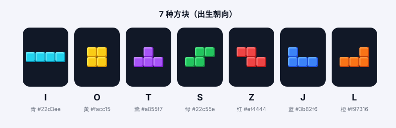
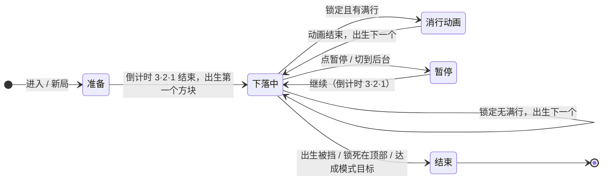
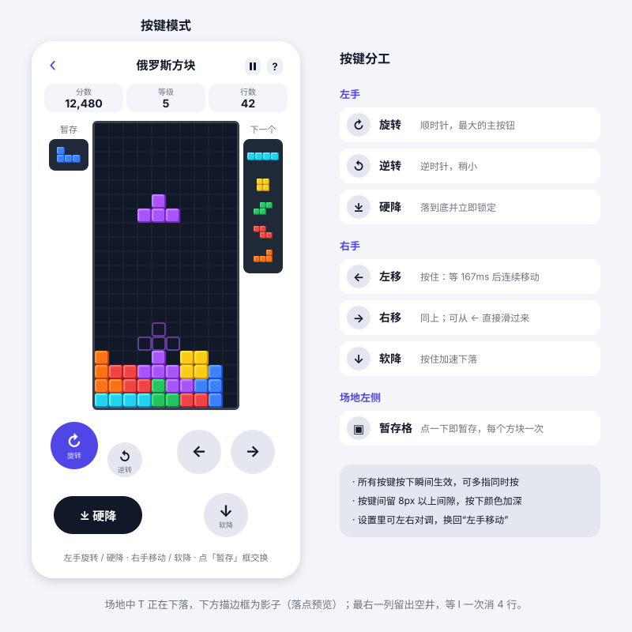
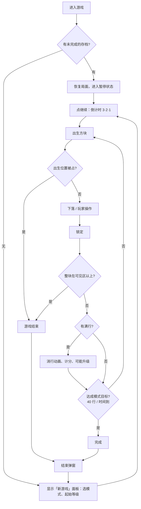

# 俄罗斯方块 · 产品设计文档

> 版本：v0.3　｜　所属项目：H5 游戏合集　｜　日期：2026-11-17

## 修订记录

| 版本 | 变更 |
| --- | --- |
| v0.1 | 初稿，配图：整体布局（按键 / 手势两种操作方式）、7 种方块 |
| v0.2 | 手机先只做**按键模式**，手势模式移到后续扩展（见 13 节）；屏幕按键左右对调：**左手旋转 / 逆转 / 硬降，右手左移 / 右移 / 软降**；布局配图改为按键模式 + 按键分工说明 |
| v0.3 | 按本稿实现；实现时的调整：升级音效改用 `chip`；窗口大小变化时只重新排版、不自动暂停；屏幕按键的显示默认按设备判断，玩家明确选过才保存 |

## 1. 概述

**俄罗斯方块**是经典的单人消除游戏。7 种由 4 个小方块组成的方块从场地顶部依次落下，玩家左右移动、旋转方块，让它们拼成完整的横行；填满的横行会被消除，上面的方块整体下落。方块堆到顶部、新方块放不下时游戏结束。

这是合集里**第一个实时动作类游戏**：其他游戏都是回合制，玩家想多久都行；这里方块会自己往下掉，所以对**操作延迟、帧率、触屏手感**要求明显更高，这些是本文档的重点。

| 项 | 说明 |
| --- | --- |
| 平台 | 手机竖屏为主，兼容桌面浏览器（键盘操作）；纳入现有 PWA，离线可玩 |
| 单局时长 | 马拉松 5–20 分钟；40 行竞速 1–3 分钟；限时 2 分钟 |
| 模式 | **马拉松 / 40 行竞速 / 限时 2 分钟** 三种（见 2.9） |
| 规则基准 | 沿用现代俄罗斯方块的通行规则：7 袋随机、SRS 旋转、暂存、影子、锁定延迟、T-Spin 计分 |
| 设计原则 | **手机上手感优先**：用屏幕按键操作（左手旋转 / 硬降，右手移动 / 软降）；所有按键在**按下瞬间**生效，不等抬起。手势操作留作扩展 |

## 2. 核心规则

### 2.1 场地

- 可见场地 **10 列 × 20 行**。
- 场地上方还有 **20 行隐藏区**，方块可以伸进去（旋转、出生时），但不显示。实际只用到最上面 2–3 行，留 20 行是为了实现简单、不会越界。
- 坐标约定：`x` 从左到右 0–9，`y` 从上到下，可见区为 `y = 0..19`，隐藏区为负数。

### 2.2 方块与出块顺序



7 种方块：I、O、T、S、Z、J、L，颜色固定（见 9 节）。

出块顺序用 **7 袋随机**（7-bag）：把 7 种方块各一个放进“袋子”洗乱，按顺序发完再装下一袋。

- 保证每 7 个方块里每种都有一个，不会连续很久等不到 I，也不会连来 4 个 S/Z。
- 同一种方块最多连续出现 2 次（上一袋最后一个 + 下一袋第一个），两次之间最多隔 12 个。
- 随机数用**可设种子**的伪随机（如 mulberry32），种子存进存档，方便测试和以后做回放、每日挑战。

### 2.3 基本操作

| 操作 | 作用 |
| --- | --- |
| **左移 / 右移** | 移动一格。按住不放时，先等 **DAS**（自动重复延迟）再按 **ARR**（重复间隔）连续移动，见 4.3 |
| **软降** | 按住时加速下落（重力的 20 倍）；松开恢复正常速度。不会直接锁定 |
| **硬降** | 方块立刻落到底并**立即锁定** |
| **顺时针旋转 / 逆时针旋转** | 按 SRS 规则旋转，转不过去时尝试“踢墙”（见 2.4） |
| **暂存**（Hold） | 把当前方块放进暂存格；如果暂存格里已有方块，就把它换出来，从顶部重新出生。**每落下一个方块只能暂存一次**，暂存格变灰表示本轮已用过 |

**影子**（Ghost）：当前方块正下方用描边显示它落到底的位置，默认开启，可在设置中关闭。

**预览**：右侧显示接下来的 **5 个**方块，第一个稍大。

### 2.4 旋转：SRS

旋转采用现代俄罗斯方块通用的 **SRS（Super Rotation System）**：

- 每种方块有 4 个朝向：`0`（出生）、`R`（顺时针 90°）、`2`（180°）、`L`（逆时针 90°）。
- 旋转后如果和墙或已有方块重叠，按顺序尝试 5 个偏移（踢墙），第一个不重叠的就用它；5 个都不行，旋转失败，方块不动。
- O 不旋转（转了也是原样）。I 和其余 5 种（J、L、S、T、Z）各用一张踢墙表。

**J、L、S、T、Z 的踢墙表**（`(dx, dy)`，**y 向上为正**，这是 SRS 资料的通行写法，代码里用 y 向下时要取反）：

| 旋转 | 测试 1 | 测试 2 | 测试 3 | 测试 4 | 测试 5 |
| --- | --- | --- | --- | --- | --- |
| 0 → R | (0, 0) | (−1, 0) | (−1, +1) | (0, −2) | (−1, −2) |
| R → 0 | (0, 0) | (+1, 0) | (+1, −1) | (0, +2) | (+1, +2) |
| R → 2 | (0, 0) | (+1, 0) | (+1, −1) | (0, +2) | (+1, +2) |
| 2 → R | (0, 0) | (−1, 0) | (−1, +1) | (0, −2) | (−1, −2) |
| 2 → L | (0, 0) | (+1, 0) | (+1, +1) | (0, −2) | (+1, −2) |
| L → 2 | (0, 0) | (−1, 0) | (−1, −1) | (0, +2) | (−1, +2) |
| L → 0 | (0, 0) | (−1, 0) | (−1, −1) | (0, +2) | (−1, +2) |
| 0 → L | (0, 0) | (+1, 0) | (+1, +1) | (0, −2) | (+1, −2) |

**I 的踢墙表**：

| 旋转 | 测试 1 | 测试 2 | 测试 3 | 测试 4 | 测试 5 |
| --- | --- | --- | --- | --- | --- |
| 0 → R | (0, 0) | (−2, 0) | (+1, 0) | (−2, −1) | (+1, +2) |
| R → 0 | (0, 0) | (+2, 0) | (−1, 0) | (+2, +1) | (−1, −2) |
| R → 2 | (0, 0) | (−1, 0) | (+2, 0) | (−1, +2) | (+2, −1) |
| 2 → R | (0, 0) | (+1, 0) | (−2, 0) | (+1, −2) | (−2, +1) |
| 2 → L | (0, 0) | (+2, 0) | (−1, 0) | (+2, +1) | (−1, −2) |
| L → 2 | (0, 0) | (−2, 0) | (+1, 0) | (−2, −1) | (+1, +2) |
| L → 0 | (0, 0) | (+1, 0) | (−2, 0) | (+1, −2) | (−2, +1) |
| 0 → L | (0, 0) | (−1, 0) | (+2, 0) | (−1, +2) | (+2, −1) |

v0.1 不做 180° 旋转（需要额外按键，手机上不划算），留作扩展。

### 2.5 出生、下落与锁定

- **出生位置**：方块以出生朝向出现在场地正中，I 和 O 居中，其余 3 格宽的方块偏左（占第 3–5 列，x = 3..5）。出生在可见区最上面两行（y = 0..1）上方的隐藏区，出生后如果下面是空的，立刻下落一格，让方块马上可见。
- **重力**：方块每隔一段时间下落一格，间隔由等级决定（见 2.7）。
- **锁定延迟**：方块落到支撑面上后不会立刻锁定，而是等 **500ms**；这期间成功的移动或旋转会重新开始计时，让玩家能在底部滑动、转进缝里。
  - 为防止无限拖延，每个方块最多重置 **15 次**；用完后一着地就立即锁定。
  - 方块如果因为移动又悬空、再落到比之前**更低**的一行，重置次数清零。
- **硬降**直接锁定，不等锁定延迟。

### 2.6 消行与计分

方块锁定后，检查它所在的行，所有填满的行同时消除，上面的方块整体下落（**朴素重力**：只下落消掉的行数，不会把悬空的方块掉下去）。

**基础得分**（乘以当前等级）：

| 动作 | 得分 | 是否“难消” |
| --- | --- | --- |
| 消 1 行（Single） | 100 | 否 |
| 消 2 行（Double） | 300 | 否 |
| 消 3 行（Triple） | 500 | 否 |
| 消 4 行（Tetris） | 800 | 是 |
| T-Spin Mini（不消行） | 100 | — |
| T-Spin Mini 消 1 行 | 200 | 是 |
| T-Spin（不消行） | 400 | — |
| T-Spin 消 1 行 | 800 | 是 |
| T-Spin 消 2 行 | 1200 | 是 |
| T-Spin 消 3 行 | 1600 | 是 |

**加成**：

- **背靠背**（Back-to-Back）：连续两次消行都是“难消”（中间可以有不消行的方块，但不能有普通的 1–3 行消除），后一次得分 **×1.5**。
- **连击**（Combo）：连续每个方块都消行，第 n 次连击额外得 **50 × n × 等级**；有一个方块没消行就中断。
- **软降**：每下落 1 格得 1 分；**硬降**：每格 2 分。软降、硬降得分不乘等级。

**T-Spin 判定**（三角规则）：

1. 锁定的是 T，并且**最后一次成功的操作是旋转**（旋转之后又移动或自然下落，就不算）；
2. T 中心格的 4 个斜角里至少 3 个被占（墙和地板也算被占）。

满足以上两条时：T 朝向那一侧（“正面”）的 2 个斜角**都被占**，判为 T-Spin；只有 1 个被占，判为 T-Spin Mini。例外：如果这次旋转用的是第 5 个踢墙偏移（偏移 1 列、2 行的那个），一律判为 T-Spin。

### 2.7 等级与速度

- 马拉松从选定的起始等级（1–10，默认 1）开始，每**累计消 10 行**升 1 级，最高 20 级。
- 每升一级，下落速度加快，每格的下落间隔为：

```
间隔（秒） = (0.8 − (等级 − 1) × 0.007) ^ (等级 − 1)
```

| 等级 | 每格间隔 | 体感 |
| --- | --- | --- |
| 1 | 1.00 秒 | 很慢，适合入门 |
| 5 | 0.36 秒 | 正常 |
| 10 | 0.064 秒 | 很快 |
| 13 | 0.017 秒 | 每帧约 1 格 |
| 15 | 0.007 秒 | 每帧 2 格以上 |
| 20 | 0.0005 秒 | 出生即到底（20G） |

高等级下一帧可能下落多格：每帧按累计时间计算应下落的格数，**逐格**检查碰撞，不能直接跳过去（否则会穿过窄缝）。

40 行竞速和限时模式**固定 1 级速度**，不升级。

### 2.8 游戏结束

满足任一条件即结束（Top Out）：

- **出生被挡**：新方块出生的位置已被占（Block Out）；
- **锁死在顶部**：方块锁定时整块都在可见区以上（Lock Out）。

方块只有部分伸进隐藏区时**不算**结束，玩家消掉下面的行后它会下来。



### 2.9 模式

| 模式 | 目标 | 结束条件 | 主要成绩 |
| --- | --- | --- | --- |
| **马拉松**（默认） | 尽量多得分，可选起始等级 1–10 | 方块堆到顶 | 最高分 |
| **40 行竞速** | 尽快消掉 40 行 | 消满 40 行（胜利），或堆到顶（失败） | 最短用时 |
| **限时 2 分钟** | 2 分钟内尽量多得分 | 时间到（正常结束），或堆到顶（也按当时得分记录） | 最高分 |

- 马拉松不设终点，20 级之后速度不再加快，一直玩到堆满为止。
- 40 行竞速时状态栏的“行数”显示为剩余行数（40 → 0），计时精确到 0.01 秒。
- 限时模式的计时为倒计时，最后 10 秒数字变红并每秒响一声。

## 3. 界面布局

整个页面从上到下分为：**顶栏 → 状态栏 → 游戏区（暂存 | 场地 | 预览） → 底部控制区**。



底部是两组屏幕按键：左手一组是旋转（最大的主按钮）、逆转和硬降，右手一组是左移、右移和软降；场地格子 18px。右侧为各按键的作用。

### 3.1 各区域说明

| 区域 | 内容 | 说明 |
| --- | --- | --- |
| 顶栏 | 返回、标题、暂停、玩法说明 | 比其他游戏多一个**暂停**按钮；音效开关和「重新开始」放进暂停菜单，避免对局中误触 |
| 状态栏 | 三格：分数 / 等级 / 行数 | 40 行竞速显示「用时 / 剩余行数 / 每秒方块数」；限时模式显示「剩余时间 / 分数 / 行数」 |
| 暂存格 | 场地左侧，显示暂存的方块 | 本轮已暂存过时变灰；**点暂存格**即暂存 |
| 场地 | 10 × 20，带浅网格线 | 用 canvas 绘制（见 9 节） |
| 预览 | 场地右侧，接下来 5 个方块 | 第一个用正常大小，后 4 个缩小 |
| 底部控制区 | 6 个屏幕按键，左右各 3 个 | 固定在屏幕底部，避开底部安全区；高约 170px |

模式选择、起始等级不放在主界面上，**在开局前的「新游戏」面板里选**（见 7 节），对局界面保持干净。

### 3.2 场地尺寸

以格子边长 **S** 为基准，场地 10S × 20S。左右两侧的暂存格、预览栏固定宽 **52px**，里面的方块用小格（暂存和第一个预览 10px，其余预览 8px）。

```
可用宽度 = 屏幕宽度 − 左右边距 − 暂存栏 − 预览栏 − 间距
可用高度 = 屏幕高度 − 顶栏 − 状态栏 − 底部控制区 − 安全区 − 边距
S = floor(min(36px, 可用宽度 / 10, 可用高度 / 20))
```

S 取整数像素，避免格子边缘模糊。实测估算：

| 屏幕 | S | 说明 |
| --- | --- | --- |
| iPhone SE（375 × 667） | 19px | 受高度限制 |
| 大屏手机（430 × 932） | 28px | 受宽度限制 |
| 桌面（1280 × 800） | 34px | 不显示屏幕按键 |

桌面端（检测到不是触屏设备）默认不显示屏幕按键，只用键盘；触屏笔记本可以在设置里打开。

## 4. 交互设计

### 4.1 手机：屏幕按键

| 按键 | 位置 | 作用 | 按住不放 |
| --- | --- | --- | --- |
| ↻ 旋转 | 左下，靠屏幕边缘，最大的主按钮 | 顺时针旋转 | 不重复 |
| ↺ 逆转 | 左下，旋转按钮右侧，稍小 | 逆时针旋转 | 不重复 |
| ⤓ 硬降 | 左下，旋转按钮下方，横向长按钮 | 硬降 | 不重复，必须松开再按 |
| ← / → | 右下，并排 | 左移 / 右移 | DAS 后连续移动 |
| ↓ 软降 | 右下，← → 下方居中 | 软降 | 持续软降 |
| 暂存格 | 场地左侧 | 暂存 | 不重复 |

按键的手感要求：

- **按下即生效**：监听 `pointerdown`，不用 `click`（`click` 要等手指抬起，还可能有延迟）。
- **支持多指同时按**：每个按键独立记录自己的 `pointerId`，可以按住 → 不放，同时点旋转。
- **手指滑到相邻按键**：从 ← 滑到 → 时，松开 ←、按下 →（用 `pointermove` + `elementFromPoint` 判断），右手不用抬起就能换方向。只在 ← → ↓ 三个移动键之间生效；旋转、硬降必须单独按下，避免滑过时误触。
- 按键直径不小于 **56px**（逆转 44px），按键之间留 8px 以上的间隙。
- 按下时按键颜色加深，轻振 8ms（设备支持时）。
- 控制区屏蔽长按菜单、文字选择、双击缩放（`touch-action: none`、`user-select: none`）。
- 默认布局是「左手旋转、右手移动」；设置里可以**左右对调**，换成「左手移动、右手旋转」。

### 4.2 桌面：键盘

| 按键 | 作用 |
| --- | --- |
| ← / → | 左移 / 右移 |
| ↓ | 软降 |
| `Space` | 硬降 |
| ↑ 或 `X` | 顺时针旋转 |
| `Z` 或 `Ctrl` | 逆时针旋转 |
| `C` 或 `Shift` | 暂存 |
| `Esc` 或 `P` | 暂停 / 继续 |
| `R` | 重新开始（弹窗确认） |

- 浏览器自带的按键重复（keydown repeat）**全部忽略**，自动重复由游戏自己的 DAS / ARR 控制，保证不同系统手感一致。
- 同时按住 ← 和 →：以**后按下的**为准；松开它后，如果另一个还按着，立即转向另一个方向，并重新计算 DAS。
- 暂停或窗口失去焦点时清空所有按键状态，避免回来后方块自己一直往一边跑。

### 4.3 自动重复：DAS / ARR

按住左右移动时：

1. 按下立即移动 1 格；
2. 继续按住，等 **DAS**（默认 167ms）；
3. 之后每隔 **ARR**（默认 33ms）移动 1 格，直到撞墙或松开。

设置中提供三档，不暴露具体数值，免得普通玩家看不懂：

| 档位 | DAS | ARR |
| --- | --- | --- |
| 慢 | 220ms | 50ms |
| 中（默认） | 167ms | 33ms |
| 快 | 117ms | 0ms（瞬间移到墙边） |

在消行动画期间按住方向键，DAS 照常累计，下一个方块出生后如果已超过 DAS，直接进入连续移动（避免“动画结束后要重新等一次”）。

### 4.4 暂停与后台

- 点顶栏暂停按钮，或页面切到后台（`visibilitychange` 隐藏）、窗口失去焦点（`blur`）时**自动暂停**。
- 暂停时**遮住场地**（显示暂停菜单）。这和扫雷、数独不同：方块游戏暂停时能看场地，就可以“暂停→想好→继续”，影响竞速成绩。
- 暂停菜单：继续、重新开始、音效开关、设置、退出。
- 继续时先显示 **3·2·1** 倒计时（每个数字 0.4 秒），再恢复下落，不会一继续方块就掉下来。

## 5. 判定逻辑

### 5.1 数据结构

```js
// 场地：Uint8Array(10 * 40)，index = (y + 20) * 10 + x；0 = 空，1–7 = 方块种类（决定颜色）
// 当前方块：{ type, rot, x, y }，rot 为 0–3
// 方块形状：每种 4 个朝向，各存 4 个格子的相对坐标（SRS 标准形状，预先算好）
// 其他状态：hold、holdUsed、queue（预览 + 袋子）、rng 种子、
//          lockTimer、lockResets、lowestY、lastWasRotation、lastKick、
//          score、lines、level、combo、b2b、elapsedMs
```

### 5.2 主循环

```js
// 逻辑以固定步长 1/60 秒推进，渲染跟随 requestAnimationFrame。
// 120Hz 屏幕每帧推进 0 或 1 步；掉帧时一帧最多补 5 步，避免卡顿后“瞬间掉一大截”。
function frame(now) {
  acc += Math.min(now - last, 100);
  last = now;
  while (acc >= STEP) {
    game.update(STEP, input.snapshot());
    acc -= STEP;
  }
  render(game);
  requestAnimationFrame(frame);
}
```

`engine.js` 只有纯逻辑：输入是“这一步按下 / 松开了哪些键”，输出是新的局面和事件（锁定、消行、T-Spin、升级、结束），**不依赖 DOM 和真实时间**，方便写测试。界面层根据事件播放动画和音效。

### 5.3 旋转

```js
function rotate(dir) {               // dir = +1 顺时针，-1 逆时针
  const from = piece.rot, to = (from + dir + 4) % 4;
  const kicks = kickTable(piece.type, from, to);
  for (let i = 0; i < kicks.length; i++) {
    const [dx, dy] = kicks[i];
    if (fits(piece.type, to, piece.x + dx, piece.y - dy)) {   // 表里 y 向上为正，场地 y 向下
      Object.assign(piece, { rot: to, x: piece.x + dx, y: piece.y - dy });
      lastWasRotation = true;
      lastKick = i;
      onMovedOrRotated();            // 处理锁定延迟重置
      return true;
    }
  }
  return false;
}
```

### 5.4 锁定延迟

```js
function onMovedOrRotated() {
  if (piece.y > lowestY) { lowestY = piece.y; lockResets = 0; }
  if (isGrounded() && lockResets < 15) { lockTimer = 0; lockResets++; }
}
// 每步：着地时 lockTimer += dt，达到 500ms 锁定；
// 着地且 lockResets 已满 15 时，不再重置，到时即锁
```

### 5.5 测试要点

- 7 袋随机：任意连续 7 个（按袋对齐）恰好包含 7 种；同一种子生成同一序列。
- SRS：每种方块每个方向的踢墙结果和标准表一致；经典 T-Spin Triple、I 在墙边旋转等局面能正确转进去。
- 锁定延迟：15 次重置后立即锁定；下降到新低点后重置次数清零。
- 消行：同时消除不相邻的行（如第 17、19 行）后，上方方块下落的行数正确。
- 计分：各消除类型、背靠背、连击、软降 / 硬降得分；T-Spin / Mini 的判定，包括“第 5 个踢墙偏移一律算 T-Spin”的例外。
- 游戏结束：出生被挡、锁死在顶部；部分伸进隐藏区时不结束。

## 6. 游戏流程



## 7. 结束弹窗与其他功能

- **新游戏面板**：首次进入、每局结束后「再来一局」时显示。三个模式卡片，马拉松下方有起始等级选择（1–10）。默认选中上次玩的模式和等级。
- **结束弹窗**：

| 模式 | 标题 | 内容 |
| --- | --- | --- |
| 马拉松 | 游戏结束 | 分数、等级、消行数、用时、Tetris 次数、T-Spin 次数；打破纪录时显示「新纪录！」 |
| 40 行竞速 · 完成 | 完成！ | 用时（0.01 秒）、方块数、每秒方块数（PPS）、和最佳成绩的差距 |
| 40 行竞速 · 失败 | 堆满了 | 已消行数 / 40；不计入最佳用时 |
| 限时 2 分钟 | 时间到 | 分数、消行数、Tetris 次数 |

  弹窗按钮：「再来一局」（同模式、同等级直接开始）、「换模式」（回到新游戏面板）、「查看场地」（关闭弹窗回看结束时的场地，只读）。

- **重新开始**：在暂停菜单里，对局中点击需确认「放弃本局吗？」。马拉松放弃时按当前分数正常记录；40 行竞速放弃不记录。
- **存档**：暂停、切到后台、每次锁定方块时，把模式、场地、当前方块、暂存、袋子和随机种子、分数、行数、等级、连击 / 背靠背状态、已用时间写入 `localStorage`。恢复时进入暂停状态。已结束的对局不保存。
- **统计**（按模式分别记录）：
  - 马拉松：最高分前 5 名（含日期、等级、行数）、累计局数、累计消行数；
  - 40 行竞速：最短用时前 5 名、完成次数；
  - 限时 2 分钟：最高分前 5 名；
  - 全模式：Tetris 总次数、T-Spin 总次数、最长连击。
- **设置**（暂停菜单里进入）：
  - 按键布局：左手旋转、右手移动（默认）/ 左手移动、右手旋转；
  - 移动速度（DAS / ARR）：慢 / 中（默认）/ 快；
  - 影子：开（默认）/ 关。
- **玩法说明**：点顶栏「?」弹出，内容为第 2.3、4.1、4.2 节的精简版，配一张按键分工示意图（按当前按键布局绘制）。首次进入游戏自动弹出一次。

## 8. 动效与音效

| 时机 | 动效 | 音效（`js/sfx.js`） |
| --- | --- | --- |
| 移动 | 无（要即时） | 不播放（太频繁） |
| 旋转成功 | 无 | `select`（音量减半） |
| 旋转失败 | 方块左右轻抖 | 不播放 |
| 硬降 | 方块落下的路径留一道淡色拖影（100ms），场地轻微下沉 2px 再弹回 | `place` |
| 自然锁定 | 方块闪亮一下（80ms） | `place`（音量减半） |
| 暂存 | 暂存格里的方块淡入 | `tap` |
| 消 1–3 行 | 满行闪白后向中间收缩消失（200ms），上方方块下落 | 新增 `clear`，消的行越多音调越高 |
| 消 4 行（Tetris） | 同上，时长 300ms，场地边框闪青色，屏幕中央浮出「TETRIS」 | 新增 `tetris` |
| T-Spin | 场地中央浮出「T-SPIN DOUBLE」等文字 | `clear` + `select` |
| 背靠背 / 连击 | 文字下方追加「B2B」「3 连击」 | — |
| 升级 | 等级数字放大回弹，场地边框闪一下 | `chip` |
| 堆得很高（最高处进入顶部 4 行） | 场地边框变红并缓慢呼吸 | — |
| 游戏结束 | 场地从下到上逐行变灰（600ms） | `lose` |
| 40 行完成 / 新纪录 | 弹窗中「新纪录！」放大回弹 | `win` |

- 需要在 `js/sfx.js` 里**新增 `clear` 和 `tetris` 两个音效**（Web Audio 合成，和现有音效风格一致），其他游戏以后也能用。
- **消行动画期间不出新方块**（即消行延迟），1–3 行 200ms、Tetris 300ms；没有消行时下一个方块立即出生（不设出块延迟）。
- 振动（设备支持时）：硬降 10ms，消 4 行 `[20, 30, 40]`，游戏结束 `[60, 40, 120]`，随音效开关一起关闭。

## 9. 视觉规范

场地沿用扫雷的**深色底**风格，在浅色、深色主题下都使用固定的场地配色，方块颜色才鲜艳。

| 用途 | 色值 |
| --- | --- |
| 场地底色 | `#111827` |
| 网格线 | `#1f2937`，1px |
| 场地边框 | `#374151`，3px；危险时 `#ef4444` |
| 暂存格、预览栏底色 | `#1f2937` |
| 暂存格已用（变灰） | 方块整体 40% 不透明度 |
| 影子 | 当前方块颜色描边，70% 不透明度，1.5px |

方块颜色沿用通行配色（见 2.2 的配图）：

| 方块 | 主色 | 高光 | 阴影 |
| --- | --- | --- | --- |
| I | `#22d3ee`（青） | `#67e8f9` | `#0891b2` |
| O | `#facc15`（黄） | `#fde047` | `#ca8a04` |
| T | `#a855f7`（紫） | `#c084fc` | `#7e22ce` |
| S | `#22c55e`（绿） | `#4ade80` | `#15803d` |
| Z | `#ef4444`（红） | `#f87171` | `#b91c1c` |
| J | `#3b82f6`（蓝） | `#60a5fa` | `#1d4ed8` |
| L | `#f97316`（橙） | `#fb923c` | `#c2410c` |

每个格子画成“主色方块 + 左上高光 + 右下阴影”，有轻微立体感。

**渲染方式**：场地、暂存、预览都用 **canvas**（和扫雷用 DOM 不同：这里每帧都要重画，DOM 太慢）。

- canvas 按 `devicePixelRatio` 放大，保证高分屏清晰。
- 已锁定的方块画在一张**离屏 canvas** 上，只在锁定 / 消行时重画；每帧只把它贴上去，再画当前方块和影子。
- 文字（分数、等级）用 DOM，只在数值变化时更新。

## 10. 边界情况

| 场景 | 处理 |
| --- | --- |
| 硬降按住不放 | 只硬降一次，下一个方块出生后必须松开再按 |
| 手指按着 ← 时又按硬降、旋转 | 各按键独立生效：左移继续，同时硬降 / 旋转 |
| 手指从 ← 滑到硬降按钮上 | 不触发硬降（跨组滑动不生效，见 4.1），← 视为松开 |
| 暂存后换出来的方块出生位置被占 | 按出生被挡处理，游戏结束 |
| 本轮已暂存过，再按暂存 | 无效，暂存格轻抖，播放 `error` |
| 旋转时贴着隐藏区顶部 | 隐藏区共 20 行，踢墙最多向上 2 格，不会越界 |
| 高等级一帧下落多格 | 逐格检查碰撞，不能跳过窄缝 |
| 消行动画期间操作 | 方向键累计 DAS；旋转、硬降、暂存忽略 |
| 对局中旋转屏幕 / 改变窗口大小 | 重新计算 S 和布局，不暂停（iOS Safari 地址栏伸缩也会改变窗口大小，暂停会频繁打断） |
| 横屏手机 | 场地居中，两组按键分到场地左右两侧（左右分工不变） |
| 切到后台 / 锁屏 / 来电 | 自动暂停并存档；回来时停在暂停菜单 |
| 掉帧、卡顿 | 一帧最多补 5 个逻辑步（约 83ms），超出的部分丢弃，相当于游戏短暂变慢，不会“卡完方块直接锁死” |
| 40 行竞速消行时超过 40（如第 38 行时消 4 行） | 按 40 行完成，计时停在这次锁定的时刻 |
| 限时模式时间到时正在消行动画 | 等动画结束、计分完成后再结束 |
| 存档损坏或版本不兼容 | 丢弃存档，显示新游戏面板 |
| 弹窗打开时 | 遮罩拦截所有操作，游戏处于暂停状态 |

## 11. 决策记录

| 问题 | 结论 |
| --- | --- |
| 规则基准 | 用现代通行规则（7 袋、SRS、暂存、影子、锁定延迟），不做 NES 经典版的纯随机、无暂存（v0.1） |
| 手机操作方式 | 先只做屏幕按键，手势模式留作扩展（v0.2，见 4.1、13 节） |
| 按键左右分工 | 左手旋转 / 逆转 / 硬降，右手左移 / 右移 / 软降；设置中可对调（v0.2，见 4.1） |
| 按键生效时机 | `pointerdown` 按下即生效，支持多指（v0.1） |
| 模式 | 马拉松（无终点）、40 行竞速、限时 2 分钟（v0.1，见 2.9） |
| 180° 旋转 | 不做，留作扩展（v0.1） |
| 预览数量 | 5 个（v0.1） |
| 暂停时是否遮住场地 | 遮住，并在继续时倒计时 3·2·1（v0.1，见 4.4） |
| 渲染方式 | canvas + 离屏缓存已锁定方块（v0.1，见 9 节） |
| 逻辑步长 | 固定 60Hz，和屏幕刷新率无关（v0.1，见 5.2） |

### 待确认事项

1. **小屏场地偏小**：按键区占掉约 170px 高，iPhone SE 上格子只有 19px。真机试玩后看是否需要把按键区压缩到 150px 左右。
2. **硬降的位置**：硬降在左手旋转键正下方，拇指从旋转往下一挪就能按到，但也可能误触。需要试玩确认，必要时加大两者间距。
3. **默认 DAS / ARR**：167ms / 33ms 是偏休闲的值，老玩家会嫌慢。可以考虑默认值不变，在玩法说明里提示“设置里可以调快”。
4. **马拉松是否设终点**：本稿为无终点；如果想给普通玩家一个“通关”的目标，可以改为 150 行（15 级）通关，通关后可选继续。
5. **名称**：英文 “Tetris” 是注册商标，合集里只用中文通用名「俄罗斯方块」，图标、界面不使用官方标志和 “TETRIS” 字样；第 8 节消 4 行浮出的文字改为「消四行！」或「满贯！」。如果合集不对外发布，可以保留 “TETRIS”。

## 12. 接入合集

- 目录：`games/tetris/`，文件：
  - `index.html`、`tetris.css`；
  - `tetris.js`：界面、主循环、canvas 绘制、动画、存档；
  - `input.js`：屏幕按键、键盘两种输入统一成“按下 / 松开某个动作”，以后加手势也只改这里；
  - `engine.js`：纯逻辑（场地、方块、7 袋、SRS、锁定延迟、消行、计分、模式规则），不依赖 DOM。
- 在 `js/games.js` 的 `H5_GAMES` 中追加一项（`id: 'tetris'`，名称「俄罗斯方块」，标签 `['休闲', '动作']`），并在 `icons/` 下新增 `tetris.svg`。
- `js/sfx.js` 新增 `clear`、`tetris` 两个音效，并更新文件头部的音效清单注释。
- 修改 `sw.js` 顶部的 `VERSION`。
- `tests/smoke.mjs` 增加 `engine.js` 的测试，覆盖 5.5 节列出的要点。

## 13. 后续可扩展

### 13.1 手势模式

不显示屏幕按键，在场地和底部区域用手势操作，小屏手机上场地能更大（iPhone SE 上格子约 22px）。设置中增加「操作方式：按键 / 手势」。

| 手势 | 作用 | 判定 |
| --- | --- | --- |
| **左右拖动** | 移动 | 手指每横向移动 **1 个格宽**，方块跟着移动 1 格（灵敏度可调：0.6 / 0.8 / 1.0 格宽） |
| **轻点** | 顺时针旋转 | 按下到抬起不超过 250ms，移动不超过 10px |
| **双指轻点** | 逆时针旋转 | 两指同时轻点 |
| **慢慢下拉** | 软降 | 手指每下移 1 个格宽，方块下落 1 格 |
| **快速下滑** | 硬降 | 抬起时向下速度超过 1.2px/ms，且总下移超过 2 格宽 |
| **上滑** | 暂存 | 抬起时向上速度超过 0.8px/ms |

- **方向锁定**：手指移动超过 12px 后，按主方向锁定为“横向”或“纵向”，本次拖动不再切换。
- 横向拖动后，抬手瞬间如果向下速度足够快，仍然算硬降（“拖到位置、顺势一甩”）。
- 上一个方块硬降的那次下滑还没结束、新方块已出生时，这次手势作废，不会把新方块也甩下去。
- 底部显示手势提示，可在设置中隐藏。

### 13.2 其他

- **180° 旋转**：键盘加一个键（如 `A`），屏幕按键加一个按钮。
- **完美消除**（Perfect Clear）：消行后场地全空，额外加分并显示特效。
- **每日挑战**：用日期作为随机种子，同一天所有人的出块顺序相同，比 40 行用时。
- **回放**：引擎是确定性的，记录种子 + 每一步的输入就能完整回放，体积很小。
- **预输入**（IRS / IHS）：消行动画期间按住旋转或暂存，新方块出生时直接生效，进阶玩家需要。
- **更多模式**：禅模式（不会结束，适合放松）、垃圾行挑战（底部定时冒出带缺口的行）。
- **人机对战**：和 AI 互相发送垃圾行，复用五子棋的 Web Worker 结构跑 AI。
